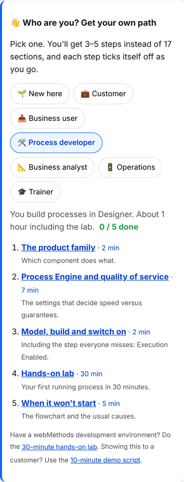
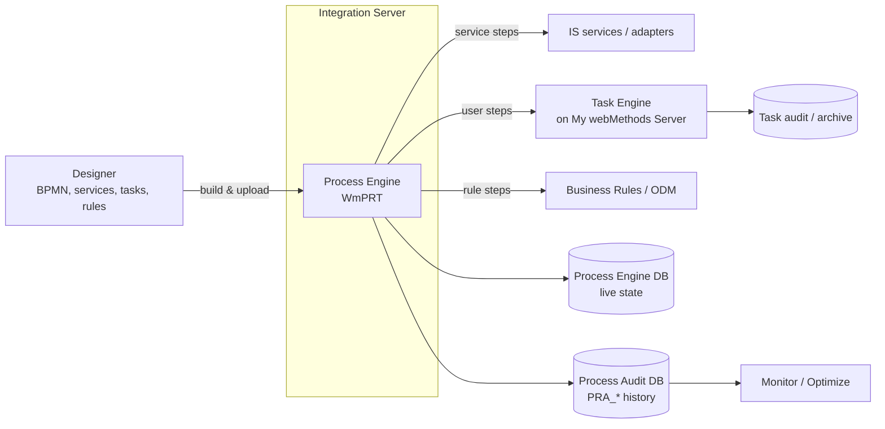

# IBM webMethods BPMS Academy

**English** | [中文](README.zh-CN.md)

<p>
  <a href="https://github.com/Xudaniel"></a>
  <a href="https://github.com/Xudaniel/webmethods-bpms-academy/releases/tag/v1.3.0"></a>
  <a href="https://xudaniel.github.io/webmethods-bpms-academy/"></a>
  
</p>

> ### ✍️ Created by **Daniel Yuanpeng Xu**
> Daniel conceived, designed, directed, reviewed and published this academy: the curriculum, the knowledge base, the role guides, the hands-on lab, the diagrams, the PRD and every *Author's view*. He maintains every release. He is a product manager in business process and decision automation, based in Toronto.
>
> **[GitHub @Xudaniel](https://github.com/Xudaniel)** · **[LinkedIn](https://www.linkedin.com/in/danielxuvision/)** · [About the author](#about-the-author) · [How to cite](#how-to-cite)

**Learn IBM webMethods BPMS the way you will actually use it.** This is a free, phone-first course. Pick your role and get a 3–5 step path. See the whole product in one picture, then learn by doing: a simulator, a 30-minute hands-on lab, and step-by-step guides for every role. Every fact is cited from public documentation.

**[▶ Open the course](https://xudaniel.github.io/webmethods-bpms-academy/)** · [Reading version](https://xudaniel.github.io/webmethods-bpms-academy/read.html) · Current release **[v1.3.0](https://github.com/Xudaniel/webmethods-bpms-academy/releases/tag/v1.3.0)** · [What's new](CHANGELOG.md) · [Product requirements (PRD)](docs/PRD.md)

<p>
  
  
  
</p>

> **Independent learning resource.** Sections marked *Author's view* are the personal opinions of the author, Daniel Yuanpeng Xu, drawn from experience as a product manager on process and decision-automation products; they are not the position of any employer or vendor and contain no employer-internal data.
>
> **Also:** This is not an official IBM site and is not affiliated with or endorsed by IBM or Software AG. Product names are trademarks of their respective owners. All content comes from public product documentation and public reports, cited below. No customer, employer-internal or confidential data is used; the Agent Scan Lab ships with synthetic data only.

---

## Contents

1. [What you can do in five minutes](#what-you-can-do-in-five-minutes)
2. [Who this is for](#who-this-is-for)
3. [What's inside](#whats-inside)
4. [Curriculum, in site order](#curriculum-in-site-order)
5. [Reading version](#reading-version)
6. [📱 Using it on your phone](#-using-it-on-your-phone)
7. [What you will learn](#what-you-will-learn)
8. [Core concepts at a glance](#core-concepts-at-a-glance)
9. [Interactive tools](#interactive-tools)
10. [Start here: the public explainer](#start-here-the-public-explainer)
11. [Agent-era patterns](#agent-era-patterns)
12. [Market context](#market-context)
13. [Getting started](#getting-started)
14. [Project structure](#project-structure)
15. [Editing content](#editing-content)
16. [Testing](#testing)
17. [Design principles](#design-principles)
18. [Roadmap](#roadmap)
19. [Contributing](#contributing)
20. [About the author](#about-the-author)
21. [How to cite](#how-to-cite)
22. [Sources](#sources)

---

## What you can do in five minutes

| | You can… | Where |
| --- | --- | --- |
| 👋 | **Pick your role** (New here, Customer, Business user, Process developer, Business analyst, Operations, Trainer) and get a 3–5 step path that ticks itself off | [Start here](https://xudaniel.github.io/webmethods-bpms-academy/#start) |
| 📦 | **Follow one story**: Mia's $1,200 laptop request travels through the whole course with Sam (manager), Priya (analyst), Leo (developer) and Omar (operations); each section shows the next moment and where her request is now | [Start here](https://xudaniel.github.io/webmethods-bpms-academy/#start) |
| 🧱 | **Learn the fundamentals first**: seven 2-minute lessons (process vs instance, who does each step, five BPMN shapes, rules vs process, tasks, the engine and audit trail, drawing to running), each with a picture and one question | [Basics 101](https://xudaniel.github.io/webmethods-bpms-academy/#basics) |
| 🌱 | **Understand every word**: tap any underlined term (BPMN, IS, MWS, Hot Deploy…) for a one-line plain-English explanation, and switch on **Beginner mode** to see only the 10 sections you need first | Everywhere |
| 🗺️ | **See the whole product in one picture**, from model to audit trail, and tap any box to jump to its guide | [Start here](https://xudaniel.github.io/webmethods-bpms-academy/#start) |
| 🎛️ | **Play with the settings**: toggle quality of service and watch the trade-offs, or move an AI agent's approval limit and watch the decision log | [Knowledge base](https://xudaniel.github.io/webmethods-bpms-academy/#knowledge) · [Start here](https://xudaniel.github.io/webmethods-bpms-academy/#start) |
| 🧪 | **Learn by doing**: run a loan process in the simulator, then build your first real process in a 30-minute lab | [Simulator](https://xudaniel.github.io/webmethods-bpms-academy/#simulator) · [Lab](https://xudaniel.github.io/webmethods-bpms-academy/#lab) |
| 🛠️ | **Fix a problem**: search 16 symptoms ("the process never starts", "Hot Deploy is greyed out") for the cause and the fix | [Troubleshooting](https://xudaniel.github.io/webmethods-bpms-academy/#trouble) |
| 📱 | **Take it with you**: install it on your phone, read it offline, print it as a PDF | [On your phone](#-using-it-on-your-phone) |
| 🎓 | **Teach or present it**: a 10-minute customer demo script and a 3-hour workshop plan | [Teach a class](https://xudaniel.github.io/webmethods-bpms-academy/#teach) |

## Who this is for

| Audience | Start with | What they get |
| --- | --- | --- |
| **Beginners** | Role *New here* | A 15-minute path, plain-language explanations, a glossary and a quiz |
| **Customers and prospects** | Role *Customer*, or the demo script | The business value and the depth of the product in about 20 minutes |
| **Business users** | Role *Business user* | How to accept, complete and delegate tasks, a cheat sheet and a self-check |
| **Process developers** | Role *Process developer* | Model, build, **enable** and test, then the hands-on lab |
| **Business analysts** | Role *Business analyst* | Change a decision table safely and hot deploy it without a rebuild |
| **Operations** | Role *Operations* | Instance states, suspend, resume and resubmit, and the permissions needed |
| **Trainers, pre-sales, consultants** | Role *Trainer* | The workshop plan, the demo script, worked cases and the Agent Scan Lab |
| **Product managers and architects** | Architecture, Knowledge base | How the engines, rules and audit history fit together, and where agents belong |

No prior webMethods experience is needed.

## What's inside

### Start: your path and the big picture
- **Mia's request**, a fictional story told across the whole course. Mia needs a $1,200 laptop. A *Meet the cast* card introduces her, her manager Sam, analyst Priya, developer Leo and Omar from operations. A short story card opens 17 sections with the next moment of her request, a five-stage tracker (Submitted → Rules check → Manager approves → Order created → On record) and a *Next in Mia's story* link that walks a 12-part route. The reading version has the same boxes.
- **Basics 101** for complete beginners: seven short lessons on the ideas behind every process platform, each with a plain story, three key points, a picture, one check question and links to go deeper. The last lesson maps every idea to its IBM webMethods name. Progress is saved in your browser.
- **Who are you?** Seven roles, each with a 3–5 step path. Each step shows its purpose and reading time, deep-links to the right guide, knowledge topic or troubleshooting area, and ticks itself off. A **Your path: Next →** link closes every section on the path.
- **IBM webMethods BPMS in one picture:** a numbered, clickable map: *Model → Build and upload → **Enable*** (the step beginners miss) *→ Process Engine → people work tasks / rules decide → Monitor and fix → audit history*, and where AI agents fit.
- **Six hands-on steps** for a general audience: before and after a BPMS, who owns which job, and an AI agent governed by a rulebook (see [Start here: the public explainer](#start-here-the-public-explainer)).

### Learn: a cited knowledge base and diagrams
**9 topics and 55 facts**, each linked to public IBM or Software AG documentation, plus a practitioner note per topic:

| Topic | What you learn |
| --- | --- |
| Releases and lifecycle | 10.15 (GA Oct 2022; end of maintenance Oct 2027, end of support Oct 2028; last release on AIX and z/Linux), 11.1 (Sep 2024), 12.1 (Java 21, Jakarta EE 10, FIPS 140-3, containers) |
| Process Engine runtime and quality of service | Transition documents; the speed-versus-guarantee trade-off; **Optimize Locally** (on by default), **Volatile Transition Documents** (on), **Volatile Tracking** (off); Universal Messaging as JMS provider; Broker deprecated |
| Execution history and audit | Process Engine DB versus Process Audit DB (`PRA_*` tables), logging levels, where task history lives in 10.15 |
| Task Engine and human work | Inboxes on My webMethods Server, `getTaskAudit`, task archiving |
| webMethods Business Rules | Rule projects, rule sets, decision tables, decision trees, event rules; Data/Service/Process actions; deploying to Integration Server and My webMethods Server |
| Rule Engine configuration and Rule Tasks | Where the Rules Engine runs (WmBusinessRules) and how to point it at a remote Integration Server (`businessrulesruntime` alias), configuring a Rule Task, Process Aware tables, rule actions and logging level, event rules and JMS triggers, Hot Deploy and its server connections |
| Monitor, resubmit and Optimize | Where Monitor lives, resubmitting failed and completed instances (Resubmit Closest / Earliest, editing the pipeline), the privileges you need, Optimize KPIs and Process Analytics |
| Upgrading from 10.15 | Side-by-side upgrade: Database Component Configurator, migration utilities or Command Central, keeping in-flight instances, re-versioning models, post-upgrade checks |
| Practitioner design checklist | Ten checks for design reviews and upgrades |

**Diagrams** (original SVG, no IBM artwork; 26, in both the course and the reading version), including: where each part runs (architecture); the lifecycle loop; BPMN gateways and lanes; agent proposes, rules decide, process executes; one flow per worked case; the simulator's loan process; a decision table's anatomy; how the Agent Scan Lab sorts steps; four Basics 101 pictures (model vs instances, who does each step, five BPMN shapes, engine and audit trail); an **interactive quality-of-service** diagram; process vs rules; the Hot Deploy path; task lifecycle; build pipeline; instance states; the lab process with an **animated token**; a "process won't start" flowchart; and the workshop timeline. There are also architecture, BPMN, patterns, worked cases, market, a 33-term glossary and a 22-question quiz.

### Do: step-by-step guides, a lab and troubleshooting
**Decision lab:** move a decision table's limits and test an application (approve, refer or decline), compare changing a rule with changing the process, and review common rules-configuration pitfalls.

**How to use**, by role. Each step gives the menu path and an official source, and ends with *how you'll know it worked*. Every role also has a printable **cheat sheet** and a 3-question **self-check**:

| Role | Guide | Key steps |
| --- | --- | --- |
| Business user | Work your tasks in My webMethods | My Inbox → find the task → Accept → Submit / Complete → Delegate if needed |
| Process developer | Model, build and switch on a process | Process Developer mode → draw the BPMN and implement steps (service, user task, rule task) → logging and QoS → Build and upload → **Enable for execution** → test in Monitor |
| Business analyst | Change a business rule safely | Rule project in the My webMethods Server repository → open and lock → edit the decision table → verify → **Hot Deploy** (no process rebuild) |
| Operations | Watch, fix and resubmit | Process Instances → Stop / Suspend / Resume → **Resubmit** (optionally after editing pipeline data) → Task List Management → permissions |

**Hands-on lab: your first process in 30 minutes.** Build a purchase-approval process with a progress tracker, a pitfalls table, a practice path for learners without an environment, and a printable sheet:

| Stage | Minutes | You'll know it worked when |
| --- | --- | --- |
| 1. Create the project and the process | 3 | The process opens on an empty canvas |
| 2. Start the process with a document | 4 | The start event shows the receive document |
| 3. Add the approval task | 6 | The step shows a user-task icon |
| 4. Route on the decision | 4 | Every path reaches an end event |
| 5. Build, upload and enable | 5 | No build errors; Execution Enabled |
| 6. Start an instance | 3 | The task appears in the approver's inbox |
| 7. Work the task as the approver | 3 | The task shows Completed |
| 8. Follow the instance in Monitor | 2 | The instance is Completed via Approved |

**Troubleshooting:** 16 searchable problems in four areas (start and deploy, tasks, rules, monitor and operations), each with what to check first, the fix, where to apply it and a source.

### Teach and present
- **Customer demo script** (10 minutes, *Author's view*): six beats, each with what to click, what to say, and the customer question it answers.
- **Teach a class** (*Author's view*): a 3-hour workshop agenda linked to the site, a print list and facilitator tips.

### Plain words for beginners
- **Tap any underlined term** in the course or the reading version for a one-line plain-English explanation, the technical definition and a link to the glossary. On a phone it opens as a sheet at the bottom of the screen. Quizzes are never underlined, so they still test you.
- **🌱 Beginner mode** (switch in the header, remembered on your device): the tab bar and ☰ menu show the 12 beginner sections, each section opens with an *In plain words* box, advanced sections say they can wait, and Previous / Next skip them.

### Stay motivated
- **⏱ Reading time** on every section, in the Sections menu and for each chapter of the reading version. The whole course is about 40 minutes of reading.
- **Progress and badges:** sections explored out of 19, and nine badges with a small celebration (Explorer, Basics done, Agent tamer, Simulator, Scanner, Fixer, Role ready, Lab finisher, Quiz ace). There's also a **Did you know?** fact. Everything stays in your browser.

## Curriculum, in site order

| # | Section | Format | What it's for |
| --- | --- | --- | --- |
| 1 | **Start here** | Role picker, map, six hands-on steps | Find your path; see the big picture; why process platforms matter for AI agents |
| 2 | **Basics 101** | 7 lessons, each with a picture and a check | The ideas behind every process platform, for complete beginners, then the IBM webMethods names |
| 3 | **Overview** | Reading + family table | The core idea, and IBM webMethods at a glance (9 components) |
| 4 | **Knowledge base** | Cited reference + interactive diagram | 9 topics, 55 facts on how the product behaves |
| 5 | **How to use** | Role guides, cheat sheets, self-checks, demo script | Day-to-day use for four roles, plus presenting to customers |
| 6 | **Hands-on lab** | 30-minute exercise with a tracker | Build, enable, run and monitor your first process |
| 7 | **Decision lab** | Interactive decision table + comparison | Change a rule's limits, test an application, see why rules change faster than processes |
| 8 | **Troubleshooting** | Search + flowchart | Symptom → check first → fix → where |
| 9 | **Teach a class** | Workshop plan + timeline | A 3-hour class for users or customers |
| 10 | **Lifecycle** | Clickable stages + release table | Model → implement → build and upload → execute → monitor → optimize → govern; release dates |
| 11 | **Architecture** | Clickable component map | Engines, databases and `PRA_*` audit tables |
| 12 | **BPMN** | Reference tables | Activities, gateways, events, pools and lanes |
| 13 | **Patterns** | Filterable cards | Four classic and three agent-era patterns |
| 14 | **Cases** | Flow diagrams | Purchase approval, loan decisioning, logistics exception |
| 15 | **Simulator** | Interactive | A loan instance through a rule task and an underwriter task, with an audit log |
| 16 | **Agent Scan Lab** | Interactive | Find rule and agent candidates in process history (synthetic data or your CSV) |
| 17 | **Market** | Reading + sources | Sizing, analyst views, competitor signals, regulatory dates |
| 18 | **Glossary** | Searchable | 33 terms; underlined terms anywhere open a plain-English explanation |
| 19 | **Quiz** | 24 questions | Instant feedback and a score |

Every section has its own link (for example [`#lab`](https://xudaniel.github.io/webmethods-bpms-academy/#lab)), plus Previous / Next at the bottom.

## Reading version

[`read.html`](https://xudaniel.github.io/webmethods-bpms-academy/read.html) is for readers who want to go straight through, on a phone, offline or on paper. It has **22 chapters** with a table of contents, a reading time per chapter, a "Which chapters should I read?" table by role, **26 diagrams**, every guide, cheat sheet and troubleshooting entry, a printable lab sheet with tick boxes, and the quiz with an answer key. It prints cleanly. The text comes from the same files as the interactive version, so the two never drift apart.

## 📱 Using it on your phone

The site is built for phones first. To get the most out of it, save it as an app:


**iPhone (Safari)**
1. Open <https://xudaniel.github.io/webmethods-bpms-academy/> in Safari. On a laptop, scan the QR code with your phone camera.
2. Tap **Share**, or tap **⋯** next to the address bar and then Share.
3. Scroll down and tap **Add to Home Screen**. If it isn't there, tap **Edit Actions** at the bottom of the list and add it.
4. Keep **Open as Web App** on, then tap **Add**.

**Android (Chrome)**
1. Open the site in Chrome.
2. Tap **⋮** at the top right → **Add to home screen**.
3. Choose **Install** (or **Install app**) and confirm.

**Finding your way on a phone**
- **☰ Sections** (top left) opens every section, grouped as Start, Do, Learn and Teach. You can also swipe the tab bar sideways.
- Every section ends with **Previous / Next**. The round **↑** button returns to the top. In the reading version, **Contents** jumps back to the table of contents.
- **Offline:** after your first visit, the saved app opens without a connection. Lab progress is stored on your phone only.
- **Text size:** use your browser's text-size setting or pinch to zoom. The layout reflows, with no sideways scrolling at 360 px.
- **Read or save a PDF:** open the **Reading version**, then use your browser's Share or Print option.

## What you will learn

After working through the site you should be able to:

1. Name the main IBM webMethods components in a BPMS solution and explain what each one does.
2. Distinguish the **Process Engine database** (live state) from the **Process Audit database** (history), and know where human-task history lives.
3. Read and design a BPMN model using tasks, gateways, events and lanes.
4. Choose Process Engine quality-of-service settings (Optimize Locally, Volatile Transition Documents, Volatile Tracking) and explain what each trades away.
5. Model decisions in webMethods Business Rules: rule projects, rule sets, decision tables, decision trees and event rules.
6. Decide when logic belongs in the process, in a rule task or decision service, or with a person.
7. Apply three agent-era patterns: *agent proposes, rules decide, process executes*; the *human-approval inbox*; and the *decision log*.
8. Score execution history to find ODM rule candidates and agent candidates, and explain the limits of that analysis.
9. Explain why upgrade deadlines and regulation (EU AI Act) shape buying decisions in this market.

## Core concepts at a glance



**Where execution history lives**

| Store | Purpose | Typical use |
| --- | --- | --- |
| Process Engine database | Private, real-time instance state | Used by the engine only; not for reporting |
| Process Audit database | Public history: process and step status, transitions, logged fields, errors | Monitor, reporting, process analysis |
| Task Engine audit / archive | Per-task operations, assignments, outcomes | Human-task analysis |

Key Process Audit tables (9.6 and later use the `PRA_` prefix):

| Table | Holds |
| --- | --- |
| `PRA_PROCESS` | A row per process status (if process status logging is on) |
| `PRA_PROCESS_STEP` | A row per step status (if step logging is on) |
| `PRA_PROCESS_STEP_LOOP` | Step status with process, step and loop iteration |
| `PRA_STEP_TRANSITION` | Begin and end step of each transition (if transition logging is on) |
| `PRA_STEP_LOGGED_FIELD(S)` | Run-time values of fields marked for logging |
| `PRA_ERROR` | A row for each failed step |

> In 10.15, writing task status into the Process Audit tables is **disabled by default**. Human-task detail usually has to come from the Task Engine audit (`getTaskAudit`) or the task archive.

## Interactive tools

### Loan process simulator

A five-step loan process: *Application received → Fetch credit data → Rule: eligibility → Underwriter review → Send decision*.

| Rule (illustrative) | Outcome |
| --- | --- |
| Credit score < 580 | Decline |
| Score ≥ 720 and loan/income ≤ 35% | Approve |
| Anything else | Refer to underwriter (user task) |

The log panel prints rows shaped like `PRA_PROCESS`, `PRA_PROCESS_STEP` and `PRA_STEP_LOGGED_FIELD` entries, so learners can connect a running instance to the history it leaves behind.

### Agent Scan Lab

Long-running BPMS estates hold years of evidence about where people approve almost everything, wait for days, or make the same decision for the same inputs. The lab turns that history into a ranked list of opportunities. Everything runs in the browser; files are never uploaded.

**Metrics per step**

| Metric | Meaning |
| --- | --- |
| Volume per month | Completed instances of the step |
| Work minutes / wait hours | Human effort and queue time |
| Top-outcome share | Share of the most common outcome (e.g. "approve") |
| Determinism | Share of instances whose input group produces one outcome ≥ 95% of the time |
| Rework, error rate | Loops and failures |

**Classification rules**

| Class | Rule | Interpretation |
| --- | --- | --- |
| Rule candidate (ODM) | user task, determinism ≥ 80% | A decision already made by rule — just not written down |
| Agent candidate (rubber-stamp) | ≥ 90% one outcome and ≤ 15 min work | Agent prepares, rule or person confirms |
| Agent candidate (triage + human approve) | wait ≥ 24 h and ≥ 70% one outcome | Agent triages documents; person approves |
| Integration fix | service step, error rate ≥ 5% | Fix the integration before adding AI |
| Keep human | everything else | High variance or high stakes |

Estimated hours saved = human hours per month × an assumed automatable share (rules 80%, rubber-stamp 60%, triage 40%). **These thresholds and shares are placeholders** to be calibrated on real data.

**CSV input** — one row per completed step instance:

| Column | Type | Example | Typical source |
| --- | --- | --- | --- |
| `process` | text | `Customs hold` | `PRA_PROCESS` / model metadata |
| `step` | text | `Release approval` | `PRA_PROCESS_STEP` |
| `step_type` | `user_task` \| `service` \| `gateway` | `user_task` | model metadata |
| `instance_id` | text | `42` | `PRA_PROCESS_STEP` |
| `start_ts`, `end_ts` | ISO timestamp | `2026-05-01T09:00:00` | `PRA_PROCESS_STEP` |
| `wait_min`, `work_min` | number | `30`, `6` | Task Engine audit |
| `outcome` | text | `approve` | logged field or task data |
| `input_key` | text (hash) | `k17` | hash of decision-driving fields |
| `loop_count` | integer | `0` | `PRA_PROCESS_STEP_LOOP` |
| `error` | 0/1 | `0` | `PRA_ERROR` |

Use anonymised exports only. Do not include personal data or raw business payloads.

**Limits.** Results depend on what was logged and retained: purged or archived history, low logging levels, or missing outcome fields reduce what the scan can see. The synthetic sample was generated to contain these patterns, so it demonstrates the method, not real-world results.

A Python version with the same logic is in [`tools/`](tools/):

```bash
cd tools
python3 make_synthetic.py            # writes synthetic_audit.csv
python3 agent_scan.py synthetic_audit.csv
```

## Start here: the public explainer

Below the role picker and the map, six interactive steps explain the "why" for readers with no BPMS background:

| Step | Interaction | Point it makes |
| --- | --- | --- |
| 1. One request, two worlds | Toggle without / with a BPMS | Routing, rules, timers and audit replace "someone remembering" |
| 2. Who should own each job? | Sorting game, 8 jobs | Process orchestrates, rules judge, people handle exceptions, agents propose |
| 3. Agents need a rulebook | Sliders for auto-approve limit and minimum delay; key-account toggle | An agent proposes credits; rules return allow / refer / deny; each decision is logged with a rule version |
| 4. The clock that drives this market | Clickable timeline, 2022–2028 | Upgrade deadlines and regulation decide when platforms are re-evaluated |
| 5. Where the market really is | Tap-to-reveal layers | Analyst category vs where a mature on-premises BPMS actually competes |
| 6. Five ideas for the agent era | Expandable cards | Mine process history, human-approval inbox, decision flight recorder, build where the base is, maintenance-to-AI credits |

Steps 3, 5 and 6 are labelled *Author's view*.

## Agent-era patterns

| Pattern | Problem | Solution |
| --- | --- | --- |
| **Agent proposes, rules decide, process executes** | Agents read documents well, but regulated decisions must be explainable and repeatable | Agent extracts facts and proposes; a decision service returns allow / deny / refer; the process executes or escalates to a person; every step is logged |
| **Human-approval inbox for agents** | Agents on several platforms need a person to approve some actions, with SLAs and audit | Route "needs a human" steps into BPMS user tasks to reuse assignment, delegation, escalation and audit |
| **Decision log (flight recorder)** | After an incident you must show the rule version, inputs and approver behind an outcome | Log inputs, rule version, outcome and approver for every agent-relevant decision alongside the process audit trail |

## Market context

Summarised from public sources (2026). See the Market page for details.

- **Sizing is inconsistent.** 2025 estimates for the "BPM market" range from about **$16.7B to $26.5B** depending on the firm and scope. Useful for direction, not for sizing a product line.
- **The category is shifting to orchestration.** Gartner's 2026 Magic Quadrant for *Business Orchestration and Automation Technologies* (BOAT) evaluated 20 vendors and requires native AI-agent orchestration and governance. Gartner expects 70% of enterprises to move to a consolidated orchestration platform by 2030, up from 10%.
- **Growth is in regulated, human-supervised work.** Camunda reported ARR nearing $200M in August 2026, led by insurance, public sector and banking; Appian reports about 80% of ARR from financial services, life sciences and public sector.
- **Deadlines drive decisions.**

| Date | Event |
| --- | --- |
| 18 Oct 2022 | webMethods 10.15 general availability |
| Oct 2027 | webMethods 10.15 end of maintenance (last release supporting AIX and z/Linux) |
| 2 Dec 2027 | EU AI Act obligations for Annex III high-risk systems (e.g. credit scoring) |
| Oct 2028 | webMethods 10.15 end of support |

## Getting started

**View locally**

```bash
git clone https://github.com/Xudaniel/webmethods-bpms-academy.git
cd webmethods-bpms-academy
python3 -m http.server 8000
# open http://localhost:8000
```

Opening `index.html` directly also works in most browsers; a local server avoids file-URL restrictions when loading CSVs.

**Publish with GitHub Pages**

1. Repository **Settings → Pages**.
2. **Source:** Deploy from a branch → `main` / `(root)`.
3. The site appears at `https://xudaniel.github.io/webmethods-bpms-academy/`.

**Browser support:** current Chrome, Edge, Firefox and Safari, desktop and mobile. No external libraries or fonts are loaded.

## Project structure

```
webmethods-bpms-academy/
├── index.html          # interactive version
├── read.html           # reading version: one page, diagrams, quiz with answer key
├── README.md           # English README
├── README.zh-CN.md     # Chinese README (中文说明)
├── CHANGELOG.md        # release history
├── manifest.webmanifest # install as an app (name, icons, theme colour)
├── sw.js               # offline support (network first, cache fallback)
├── assets/             # app icons, QR code, diagrams (SVG), README screenshots
├── docs/
│   └── PRD.md          # product requirements document
├── css/
│   ├── styles.css      # layout, components, mobile breakpoints
│   └── read.css        # reading version: diagrams and print styles
├── js/
│   ├── content.js      # course content and sources
│   ├── knowledge.js    # IBM webMethods knowledge base: family, cited topics, extra glossary and quiz
│   ├── howto.js        # How to use: role guides, beginner path, customer demo script
│   ├── lab.js          # Hands-on lab: first process in 30 minutes
│   ├── support.js      # Troubleshooting, role cheat sheets and self-checks, teach a class
│   ├── diagrams.js     # Original SVG diagrams (interactive QoS, role diagrams, lab BPMN, flowchart, timeline)
│   ├── path.js         # Role picker with personal paths, clickable one-picture map
│   ├── words.js        # Tap-to-explain terms in plain English, Beginner mode
│   ├── basics.js       # Basics 101: seven fundamental lessons with checks
│   ├── decision-lab.js # Decision lab: decision table, agility comparison, rules pitfalls
│   ├── fun.js          # Reading times, explorer progress, badges, did-you-know
│   ├── mobile.js       # Phone guide, sections menu, previous/next, back to top, offline registration
│   ├── explainer.js    # "Start here" content (author's view items labelled)
│   ├── explainer-app.js# "Start here" interactions: toggle, sorting game, decision guard, timeline
│   └── read.js         # renders the reading version from the same content files
│   └── app.js          # navigation, simulator, scan lab, glossary search, quiz
├── tools/
│   ├── build_diagrams.js # writes assets/diagrams/*.svg from js/diagrams.js
│   ├── agent_scan.py   # Python version of the scan
│   └── make_synthetic.py
└── tests/
    └── smoke_test.py   # headless browser check of every section
```

## Editing content

All text lives in `js/content.js` in one `window.ACADEMY` object, so content changes rarely touch layout or logic.

| Key | Shape | Rendered in |
| --- | --- | --- |
| `architecture` | `{ id, name, role, text, tip }[]` | Architecture tiles |
| `auditTables` | `[table, description][]` | Architecture → Process Audit tables |
| `lifecycle` | `[stage, description][]` | Lifecycle tiles |
| `lifecycleDates` | `[event, date][]` | Lifecycle → release table |
| `bpmn` | `{ group, items: [name, description][] }[]` | BPMN |
| `patterns` | `{ name, tag: "classic" \| "agent era", problem, solution, when }[]` | Patterns |
| `cases` | `{ name, flow: string[], lesson }[]` | Cases |
| `glossary` | `[term, definition][]` | Glossary |
| `market` | `{ sizing, signals, takeaways }` | Market |
| `quiz` | `{ q, a: string[], c: correctIndex, e: explanation }[]` | Quiz |
| `sources` | `[title, url][]` | Market → Sources |

The knowledge base lives in `js/knowledge.js` as `window.KNOWLEDGE`: `family` (`[component, role][]`), `topics` (`{ id, title, summary, facts[], practice, sources: number[] }[]`), `glossary`, `quiz` and numbered `sources`. Its glossary terms, quiz questions and sources are merged into the main course automatically.

Rules for content: cite a public source for every factual claim, keep dates absolute (e.g. "Oct 2027", not "next year"), and never add customer names, revenue figures or non-public material.

## Testing

```bash
pip install playwright
playwright install chromium
python3 tests/smoke_test.py
```

GitHub Actions runs the same test (`.github/workflows/smoke-test.yml`) on every pull request, and `main` only accepts changes that pass it. The test serves the site locally, opens every section at phone width (390 × 844), checks the IBM webMethods title, knowledge counter, family table and cited knowledge topics, the beginner path, every how-to guide, the demo script and the hands-on lab with its progress tracker, troubleshooting search and filters, a role self-check and the class agenda, exercises the Start-here interactions, runs the simulator to completion and the Agent Scan Lab on the synthetic sample, checks that `read.html` has five diagrams, a complete quiz and answer key and all sections filled, checks the phone guide, the sections menu, Previous/Next on every section, back to top, no horizontal overflow at 360 px in any section, and that the manifest icons and service worker exist, and fails on any JavaScript error.

## Design principles

- **Beginner first.** Pick a role, see one picture, do one thing; details come later.
- **Mobile first.** Single column, a ☰ Sections menu, Previous / Next, no sideways scrolling at 360 px, and installable as an app.
- **No dependencies.** Plain HTML, CSS and JavaScript; nothing to install, nothing that breaks on a library update.
- **Privacy by design.** No analytics, accounts or cookies. Progress, badges and uploaded CSVs stay in your browser. The service worker only caches this site's own files for offline use.
- **Every fact cited.** Public sources and absolute dates. Opinions are labelled *Author's view*.
- **Honest numbers.** Placeholders and synthetic data are labelled wherever they appear.

## Roadmap

**Next**
- [ ] **Practice sandbox:** simplified, clearly labelled practice screens to accept a task, tick Execution Enabled and hot deploy a rule, with no environment needed
- [ ] **Knowledge base:** what changes from 10.15 to 12.1, release by release
- [ ] **Simulator:** timer escalation and parallel-gateway scenarios

**Later**
- [ ] Chinese user interface
- [ ] Module on moving webMethods Business Rules to IBM ODM decision services
- [ ] Agent Scan Lab: adjustable thresholds and CSV export

**Done since v1.3.0:** Mia's request, a story through the whole course. automatic smoke test on every pull request, `main` accepts changes only through pull requests, 11 more diagrams, cited rules pitfalls, and knowledge topics on Monitor/Optimize and upgrading from 10.15.

**Done in v1.3.0:** Basics 101 and the Decision lab.

**Done in v1.2.0:** tap-to-explain terms and Beginner mode.

**Done in v1.1.0:** role paths, the one-picture map, the hands-on lab, troubleshooting, cheat sheets and self-checks, the class plan, the phone app with offline mode, reading times, 14 diagrams, badges, and author credit. See the [changelog](CHANGELOG.md).

## Contributing

Issues and pull requests are welcome. Please keep changes small, cite public sources for any new facts, run `tests/smoke_test.py` before opening a PR, and do not include confidential or customer data.

## About the author

**Daniel Yuanpeng Xu** created the IBM webMethods BPMS Academy and is its product owner. He is a product manager in business process and decision automation, based in Toronto.

He set the product direction, defined the audiences and scope, chose and checked the public sources, wrote the *Author's view* frameworks, and directed and reviewed every change and release. The academy is his independent work. It is not affiliated with or endorsed by IBM.

- GitHub: [@Xudaniel](https://github.com/Xudaniel)
- LinkedIn: [Daniel Xu](https://www.linkedin.com/in/danielxuvision/)
- Product requirements: [docs/PRD.md](docs/PRD.md)

## How to cite

> Xu, Daniel Yuanpeng (2026). *IBM webMethods BPMS Academy* (Version 1.3.0) [Interactive course]. https://github.com/xudaniel/webmethods-bpms-academy

GitHub's **Cite this repository** button (from [`CITATION.cff`](CITATION.cff)) gives the same citation in APA and BibTeX. If you reuse or adapt any material, please credit **Daniel Yuanpeng Xu** and link to this repository.

## Sources

**Product documentation**
- [Process Audit Log database component tables — Designer 10.15](https://documentation.softwareag.com/webmethods/designer/sdf10-15/webhelp/sdf-webhelp/sdf-webhelp/proc.process.audit.log.database.component.tables.html)
- [Process Engine vs Process Audit databases — IBM community](https://community.ibm.com/community/user/discussion/differences-between-process-engine-db-and-process-audit-log-db)
- [Task Engine `getTaskAudit`](https://documentation.softwareag.com/webmethods/task_engine/wtn10-7/10-7_Task_Engine_webhelp/task-engine-webhelp/te_web_taskaudit.html)
- [Task audit logging into Process Audit disabled by default — IBM 10.15 docs](https://www.ibm.com/docs/en/SSHZPA_10.15.0/te_users_guide/co-disable_enable_task_logging_in_processes.html)
- [Task archiving](https://documentation.softwareag.com/webmethods/compendiums/v10-7/C_Digital_Event_Comm/intsagdes-compendium/co-about-task-archiving.html)

**How to use (day-to-day operation)**
Every step in the site links to its source; the main ones:
- [About My Inbox (Task Engine)](https://documentation.softwareag.com/webmethods/compendiums/v10-5/C_Run_BPs_and_CAs/runbpca-compendium/co-about_my_inbox.html)
- [Accepting a task](https://documentation.softwareag.com/webmethods/compendiums/v10-3/C_Run_BPs_and_CAs/runbpca-compendium/co-accepting_a_task.html)
- [Enabling and disabling process model versions (Monitor)](https://documentation.softwareag.com/webmethods/monitor/wmn10-3/10-3_Monitor_webhelp/monitor-webhelp/to-process_models_24.html)
- [Build and upload preferences (Designer 10.5)](https://documentation.softwareag.com/webmethods/designer/sdf10-5/10-5_sdf-webhelp/sdf-webhelp/proc.configuring.build.and.upload.preferences.html)
- [Hot deploying a rule project](https://documentation.softwareag.com/webmethods/compendiums/v10-4/C_Digital_Event_Comm/intsagdes-compendium/ta-hot_deploy_decent.html)
- [About resubmitting process instances and steps (Monitor 10.7)](https://documentation.softwareag.com/webmethods/monitor/wmn10-7/10-7_Monitor_webhelp/wmn-webhelp/to-processes_25.html)
- [Stopping, suspending or resuming a process instance (Monitor 10.7)](https://documentation.softwareag.com/webmethods/monitor/wmn10-7/10-7_Monitor_webhelp/wmn-webhelp/to-processes_23.html)

**Process Engine, Business Rules and releases**
- [Tuning Process Engine performance and quality of service](https://documentation.softwareag.com/webmethods/compendiums/v10-3/C_Run_BPs_and_CAs/runbpca-compendium/to-concepts_2.html)
- [Quality of service settings](https://documentation.softwareag.com/webmethods/wmsuites/wmsuite10-1/C_Run_BPs_and_CAs/runbpca-compendium/to-tuning_3.html)
- [Configuring Process Engine settings — IBM 11.1 docs](https://www.ibm.com/docs/en/SSLMF12_11.1/ta-configuring_monitoring_configuring_settings.html)
- [About webMethods Business Rules — Designer 10.15](https://documentation.softwareag.com/webmethods/designer/sdf10-15/webhelp/sdf-webhelp/sdf-webhelp/proc.about.webmethods.business.rules.html)
- [Rules Development terminology — Designer 10.7](https://documentation.softwareag.com/webmethods/designer/sdf10-7/10-7_sdf-webhelp/sdf-webhelp/co-rules_terminology.html)
- [Rules Development overview — Designer 10.7](https://documentation.softwareag.com/webmethods/designer/sdf10-7/10-7_sdf-webhelp/sdf-webhelp/co-intro_business_rules.html)
- [IBM webMethods Integration 12.1 lifecycle — IBM](https://www.ibm.com/support/pages/ibm-webmethods-integration121)
- [From legacy integration to AI-ready architecture with IBM webMethods 12.1 — IBM community](https://community.ibm.com/community/user/blogs/noboru-tanaka/2026/07/23/ibm-webmethods12-ai-led-integration-arc)
- [IBM webMethods 11.1 release notes (copy)](https://www.scribd.com/document/818628366/webmethods-release-notes)
- [Introducing IBM webMethods Hybrid Integration — IBM](https://www.ibm.com/new/announcements/introducing-webmethods-hybrid-integration)

**Lifecycle and regulation**
- [webMethods support lifecycle — IBM](https://www.ibm.com/support/pages/node/7180543)
- [Longer support for webMethods 10.15 — Software AG forum](https://tech.forums.softwareag.com/t/longer-support-for-webmethods-10-15/276574)
- [EU AI Act Digital Omnibus — Orrick](https://www.orrick.com/fr-FR/Insights/2026/07/EU-AI-Act-Update-Digital-Omnibus-Finalizes-8-Compliance-Changes)

**Market**
- [Gartner BOAT Magic Quadrant 2026 — abstract](https://www.gartner.com/en/documents/8381781) · [Appian on BOAT 2026](https://itwire.com/guest-articles/company-news/2026-gartner-critical-capabilities-for-business-orchestration-and-automation-technologies-report-ranks-appian-1-for-the-deterministic-workflow-automation-use-case-and-platform-cons)
- [Camunda ARR nearing $200M — Business Wire](https://www.businesswire.com/news/home/20260804044254/en/) · [Camunda regulated-industry growth](https://techintelpro.com/news/ai/agentic-ai/camunda-accelerates-agentic-orchestration-adoption)
- [Appian Q3 2026 results — SEC 8-K](https://www.sec.gov/Archives/edgar/data/0001441683/000144168326000056/appnex991earningsrelease-9.htm) · [Appian industry mix](https://www.webull.com/news/15872292364510209)
- BPM market sizing: [Mordor](https://www.scotts-international.com/business-process-management-market-share-analysis-industry-trends-statistics-growth-forecasts-2026-2031,t2166895/58022) · [IMARC](https://www.imarcgroup.com/global-business-process-management-market) · [Fortune Business Insights](https://www.fortunebusinessinsights.com/business-process-management-bpm-market-102639) · [360iResearch](https://cn.gii.tw/report/ires2011888-business-process-management-market-by-organization.html)

---

**Created and maintained by [Daniel Yuanpeng Xu](https://github.com/Xudaniel)** · [LinkedIn](https://www.linkedin.com/in/danielxuvision/)

© 2026 Daniel Yuanpeng Xu. All rights reserved. No open-source license has been chosen yet, so default copyright applies. To reuse the material, open an issue, and always credit Daniel Yuanpeng Xu.
