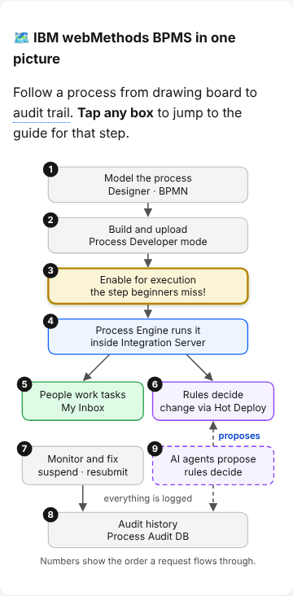
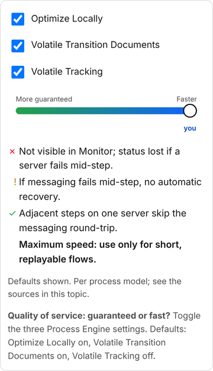
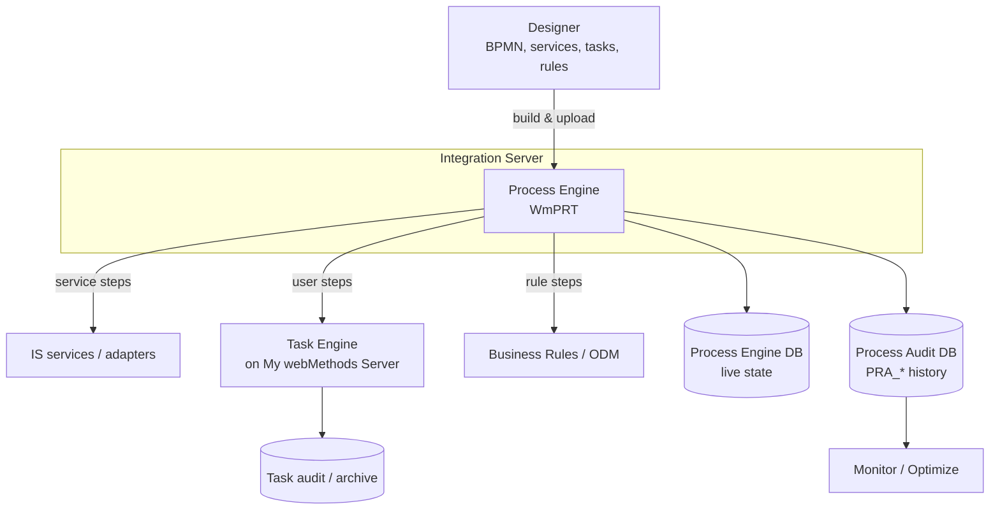

# IBM webMethods BPMS Academy

**English** | [中文](README.zh-CN.md)

<p>
  <a href="https://xudaniel.github.io/webmethods-bpms-academy/"></a>
  <a href="https://github.com/Xudaniel/webmethods-bpms-academy/releases/tag/v2.6.0"></a>
  
  <a href="https://github.com/Xudaniel"></a>
</p>

**Learn IBM webMethods BPMS the way you will actually use it.** A free, phone-first course: pick your role, get a 3–5 step path, see the whole product in one picture, then learn by doing. Every fact is cited from public documentation.

### [▶ Open the course](https://xudaniel.github.io/webmethods-bpms-academy/)

[Reading version](https://xudaniel.github.io/webmethods-bpms-academy/read.html) · [中文版](https://xudaniel.github.io/webmethods-bpms-academy/?lang=zh) · [What's new in v2.6.0](CHANGELOG.md) · [PRD](docs/PRD.md)

<p>
  
  
  
</p>

> **Independent learning resource by Daniel Yuanpeng Xu.** Not an official IBM site and not endorsed by IBM or Software AG. Only public sources are used (cited below); *Author's view* sections are personal opinions, and the Agent Scan Lab uses synthetic data only.

**Jump to:** [Start](#start-in-five-minutes) · [Who it's for](#who-its-for) · [Phone](#-on-your-phone) · [Course details](#the-course-in-detail) · [Contributors](#for-contributors) · [Author](#about-the-author) · [Sources](#sources)

## Start in five minutes

- 👋 **Pick your role** and get a 3–5 step path → [Start here](https://xudaniel.github.io/webmethods-bpms-academy/#start)
- ⚡ **Know nothing yet?** Take the 10-minute course → [10-minute course](https://xudaniel.github.io/webmethods-bpms-academy/#crash)
- 🧱 **Learn the basics**: seven 2-minute lessons → [Basics 101](https://xudaniel.github.io/webmethods-bpms-academy/#basics)
- 🧪 **Learn by doing**: a loan simulator and a 30-minute lab → [Lab](https://xudaniel.github.io/webmethods-bpms-academy/#lab)
- 🛠️ **Fix a problem**: 16 searchable symptoms → [Troubleshooting](https://xudaniel.github.io/webmethods-bpms-academy/#trouble)
- 🎲 **Teach without laptops**: print a board and cards and play the engine around a table → [Classroom kit](https://xudaniel.github.io/webmethods-bpms-academy/kit.html)
- 🌐 **Read it in Chinese** → [中文版](https://xudaniel.github.io/webmethods-bpms-academy/?lang=zh)

<details>
<summary><b>Everything you can do (20 features)</b></summary>

- 👋 **Pick your role** (New here, Customer, Business user, Process developer, Business analyst, Operations, Trainer) and get a 3–5 step path that ticks itself off → [Start here](https://xudaniel.github.io/webmethods-bpms-academy/#start)
- 📦 **Follow one story**: Mia's $1,200 laptop request travels through the whole course with Sam (manager), Priya (analyst), Leo (developer) and Omar (operations); each section shows the next moment and where her request is now → [Start here](https://xudaniel.github.io/webmethods-bpms-academy/#start)
- ⚡ **Know nothing? Take the 10-minute course**: five 2-minute steps (what a BPMS is, who does each step, the IBM webMethods parts, drawing to running, why it matters for AI agents), one picture each, then three quick checks → [10-minute course](https://xudaniel.github.io/webmethods-bpms-academy/#crash)
- 🧱 **Learn the fundamentals first**: seven 2-minute lessons (process vs instance, who does each step, five BPMN shapes, rules vs process, tasks, the engine and audit trail, drawing to running), each with a picture and one question → [Basics 101](https://xudaniel.github.io/webmethods-bpms-academy/#basics)
- 🌐 **Read it in Chinese**: tap **中文** in the header (or open `?lang=zh`). A browser set to Chinese opens in Chinese, and the switch is remembered. The whole site is translated: every course section, diagrams, games and quizzes, the reading version and both executive briefs → [中文版](https://xudaniel.github.io/webmethods-bpms-academy/?lang=zh)
- 🌱 **Understand every word**: tap any underlined term (BPMN, IS, MWS, Hot Deploy…) for a one-line plain-English explanation, and switch on **Beginner mode** to see only the 17 sections you need first → Everywhere
- 🗺️ **See the whole product in one picture**, from model to audit trail, and tap any box to jump to its guide → [Start here](https://xudaniel.github.io/webmethods-bpms-academy/#start)
- 🎛️ **Play with the settings**: toggle quality of service and watch the trade-offs, or move an AI agent's approval limit and watch the decision log → [Knowledge base](https://xudaniel.github.io/webmethods-bpms-academy/#knowledge) · [Start here](https://xudaniel.github.io/webmethods-bpms-academy/#start)
- 🧪 **Learn by doing**: run a loan process in the simulator, then build your first real process in a 30-minute lab → [Simulator](https://xudaniel.github.io/webmethods-bpms-academy/#simulator) · [Lab](https://xudaniel.github.io/webmethods-bpms-academy/#lab)
- 🔍 **Find anything**: tap 🔍 next to ☰ (or press `/`) and search knowledge facts, troubleshooting, the glossary, how-to steps and cheat sheets, the lab, Basics 101, controls, patterns, cases and BPMN, in English or Chinese. Tap a result to land on the exact place → Everywhere
- 📒 **Remember what you got wrong**: every wrong answer anywhere on the site (quiz, Basics 101, the 10-minute course, role self-checks, Swipe sort, on-call drills) goes into a review book and comes back after 1 day and 3 days; two right answers and it leaves. Start here shows how many are due today → [Review book](https://xudaniel.github.io/webmethods-bpms-academy/#review)
- 🚨 **Practise being on call**: three short incidents (the process never starts, a manual decision is ignored, Monitor shows nothing) with a clock that keeps running. Good checks move you on, wrong ones cost minutes; each ends with a cited debrief → [On-call drills](https://xudaniel.github.io/webmethods-bpms-academy/#drills)
- 👗 **Put it all together**: follow one markdown request at a fictional clothing store through all three layers. The agent proposes a discount, the rules check the margin floor and the age cap and decide who approves, the manager approves or the timer escalates after 24 hours, and the process changes the price. Change the rules table, pick a style, and watch the audit trail grow; made-up numbers, all hand-checked → [Capstone](https://xudaniel.github.io/webmethods-bpms-academy/#capstone)
- 👆 **Swipe sort: rule, agent or human?** 20 synthetic steps in 60 seconds; swipe (or tap, or use the arrow keys) and every answer is explained with the same thresholds the Agent Scan Lab uses. Streaks, a best score and a share line → [Swipe sort](https://xudaniel.github.io/webmethods-bpms-academy/#swipe)
- 🧩 **Repair broken processes**: five tap-to-place puzzles (a missing end event, the wrong gateway, a limit welded into a gateway, a task with no timer, a manager who checks everything); press ▶ Run and watch a token get through, or get stuck and tell you why → [Fix the diagram](https://xudaniel.github.io/webmethods-bpms-academy/#puzzles)
- 💼 **Present it to a client**: switch on Professional mode (or share a `?mode=pro` link) to hide badges and the story, and print a one-page executive brief for banking or insurance → [Briefs](https://xudaniel.github.io/webmethods-bpms-academy/brief.html)
- 🏦 **Show the controls to a bank or insurer**: seven common controls (four-eyes approval, segregation of duties, decision traceability, human oversight, change control, retention, resilience) mapped to the frameworks that ask for them and to the evidence IBM webMethods BPMS produces; every regulation cited to the regulator's own page → [Controls](https://xudaniel.github.io/webmethods-bpms-academy/#controls)
- 🛠️ **Fix a problem**: search 16 symptoms ("the process never starts", "Hot Deploy is greyed out") for the cause and the fix → [Troubleshooting](https://xudaniel.github.io/webmethods-bpms-academy/#trouble)
- 📱 **Take it with you**: install it on your phone, read it offline, print it as a PDF → [On your phone](#-on-your-phone)
- 🎲 **Teach without laptops**: print a board, coins and cards and let teams play the Process Engine, the rules and Sam's inbox around a table; change a rule mid-game with Hot Deploy, handle incident cards, then compare the paper audit log with Monitor → [Classroom kit](https://xudaniel.github.io/webmethods-bpms-academy/kit.html)
- 🎓 **Teach or present it**: a 10-minute customer demo script and a 3-hour workshop plan → [Teach a class](https://xudaniel.github.io/webmethods-bpms-academy/#teach)

</details>

## Who it's for

No prior webMethods experience is needed.

- **Beginners**: start with the *New here* role. A 15-minute path, plain-language explanations, a glossary and a quiz.
- **Customers and prospects**: start with the *Customer* role, or the demo script. The business value and the depth of the product in about 20 minutes.
- **Business users**: start with the *Business user* role. How to accept, complete and delegate tasks, a cheat sheet and a self-check.
- **Process developers**: start with the *Process developer* role. Model, build, **enable** and test, then the hands-on lab.
- **Business analysts**: start with the *Business analyst* role. Change a decision table safely and hot deploy it without a rebuild.
- **Operations**: start with the *Operations* role. Instance states, suspend, resume and resubmit, and the permissions needed.
- **Trainers, pre-sales, consultants**: start with the *Trainer* role. The workshop plan, the demo script, worked cases and the Agent Scan Lab.
- **Product managers and architects**: start with Architecture and the Knowledge base. How the engines, rules and audit history fit together, and where agents belong.

## 📱 On your phone

The site is built for phones first. To get the most out of it, save it as an app:


**iPhone (Safari)**
1. Open <https://xudaniel.github.io/webmethods-bpms-academy/> in Safari. On a laptop, scan the QR code with your phone camera.
2. Tap **Share**, or tap **⋯** next to the address bar and then Share.
3. Scroll down and tap **Add to Home Screen**. If it isn't there, tap **Edit Actions** at the bottom of the list and add it.
4. Keep **Open as Web App** on, then tap **Add**.

**Android (Chrome)**
1. Open the site in Chrome.
2. Tap **⋮** at the top right → **Add to home screen**.
3. Choose **Install** (or **Install app**) and confirm.

**Finding your way on a phone**
- **☰ Sections** (top left) opens every section, grouped as Start, Do, Learn and Teach. You can also swipe the tab bar sideways.
- **🔍 Search** (next to ☰, or press `/`) searches every section on your device; ↑ ↓ and Enter work too.
- Every section ends with **Previous / Next**. The round **↑** button returns to the top. In the reading version, **Contents** jumps back to the table of contents.
- **Offline:** after your first visit, the saved app opens without a connection. Lab progress is stored on your phone only.
- **Text size:** use your browser's text-size setting or pinch to zoom. The layout reflows, with no sideways scrolling at 360 px.
- **Read or save a PDF:** open the **Reading version**, then use your browser's Share or Print option.

## The course in detail

<details>
<summary><b>What's inside</b></summary>

### Start: your path and the big picture
- **Mia's request**, a fictional story told across the whole course. Mia needs a $1,200 laptop. A *Meet the cast* card introduces her, her manager Sam, analyst Priya, developer Leo and Omar from operations. A short story card opens 17 sections with the next moment of her request, a five-stage tracker (Submitted → Rules check → Manager approves → Order created → On record) and a *Next in Mia's story* link that walks a 12-part route. The reading version has the same boxes.
- **10-minute course** for people who know nothing yet: five 2-minute steps, one at a time with Back / Next and a progress bar, each with a picture and a *Remember* line, then three check questions and a finish card that points to Basics 101, Fix the diagram or the lab. The *New here* path starts with it.
- **Basics 101** for complete beginners: seven short lessons on the ideas behind every process platform, each with a plain story, three key points, a picture, one check question and links to go deeper. The last lesson maps every idea to its IBM webMethods name. Progress is saved in your browser.
- **Who are you?** Seven roles, each with a 3–5 step path. Each step shows its purpose and reading time, deep-links to the right guide, knowledge topic or troubleshooting area, and ticks itself off. A **Your path: Next →** link closes every section on the path.
- **IBM webMethods BPMS in one picture:** a numbered, clickable map: *Model → Build and upload → **Enable*** (the step beginners miss) *→ Process Engine → people work tasks / rules decide → Monitor and fix → audit history*, and where AI agents fit.
- **Six hands-on steps** for a general audience: before and after a BPMS, who owns which job, and an AI agent governed by a rulebook (see *Start here: the public explainer* below).

### Learn: a cited knowledge base and diagrams
**21 topics and 165 facts**, each linked to public IBM or Software AG documentation, plus a practitioner note per topic:

- **Releases and lifecycle**: 10.15 (GA Oct 2022; end of support 31 Oct 2027, paid extended support to Oct 2028 and Oct 2030; last release on AIX and z/Linux), 11.1 (Sep 2024), 12.1 (Java 21, Jakarta EE 10, FIPS 140-3, containers)
- **Process Engine runtime and quality of service**: Transition documents; the speed-versus-guarantee trade-off; **Optimize Locally** (on by default), **Volatile Transition Documents** (on), **Volatile Tracking** (off); Universal Messaging as JMS provider; Broker deprecated
- **Running the Process Engine on several servers**: One shared Process Engine database; Integration Server cluster, external cluster (the External Cluster setting) and distributed mode; where Task Engine on My webMethods Server and on Integration Server fit in a cluster; what the 10.4 and 10.5 guides leave to be confirmed for Universal Messaging and 12.1
- **Correlation: how a message finds its running process**: Correlation field versus correlation service, which steps use it, where correlation IDs are kept (`WMPRTXREF` or memory), what happens on a match and on no match, and why a subscription filter cannot change between versions
- **Execution history and audit**: Process Engine DB versus Process Audit DB (`PRA_*` tables), logging levels, where task history lives in 10.15
- **Archiving and deleting audit data**: Archive database versus partitions, what disappears from My webMethods, the four archive stored procedures and their retention, status and batch parameters, and the advice to run small, regular batches
- **Task Engine and human work**: Inboxes on My webMethods Server, `getTaskAudit`, task archiving; task statuses and the seven-day Delete Task rule, priority and expiry, votable tasks (51%, rounded up) and assignment from a decision table
- **Task rules, events and timers**: Assignments, events, filters, change rules and schedules in a task type; date/time events and why an administrator must recalculate their stored trigger times
- **Process design building blocks**: OR, AND and COMPLEX joins and why a dead path blocks an AND join, process and join timeouts, Step Iterations Exceeded and Unsatisfied Join transitions, interrupting boundary events, callable processes and BPMN subprocesses
- **webMethods Business Rules**: Rule projects, rule sets, decision tables, decision trees, event rules; Data/Service/Process actions; deploying to Integration Server and My webMethods Server
- **Rule Engine configuration and Rule Tasks**: Where the Rules Engine runs (WmBusinessRules) and how to point it at a remote Integration Server (`businessrulesruntime` alias), configuring a Rule Task, Process Aware tables, rule actions and logging level, event rules and JMS triggers, Hot Deploy and its server connections
- **Moving webMethods Business Rules to IBM ODM**: How rule projects, decision tables and processing modes map to ODM's BOM, rulesets, rule tasks and exit criteria; getting tables out as JSON and into ODM through Excel; calling ODM from a process through OpenAPI; and testing both side by side before switching
- **Business Rules in practice**: Data models and Sync Data Model, event rules inside rule sets, local testing with Run As, data provider and verification services, CSV import, the Integration Server REST invoke service (and its different default for missing inputs), and auditing to the database
- **Deploying decision services on IBM Cloud**: Code Engine's limits for functions (120 seconds), applications (600 seconds) and jobs (24 hours) and job retries, revisions and endpoint visibility, where ODM containers are supported (certified Kubernetes, fully on OpenShift), Decision Optimization deployments in watsonx.ai (S to XL), and the CPLEX Community Edition limit of 1,000 variables and 1,000 constraints.
- **Monitor, resubmit and Optimize**: Where Monitor lives, resubmitting failed and completed instances (Resubmit Closest / Earliest, editing the pipeline), the privileges you need, Optimize KPIs and Process Analytics
- **Building, versioning and deploying process models**: Versions and the metadata tables an upload fills, the generation receipt, repository-based deployment with the Asset Build Environment and Deployer, composites, and the limits to plan for
- **Upgrading from 10.15**: Side-by-side upgrade: Database Component Configurator, migration utilities or Command Central, keeping in-flight instances, re-versioning models, post-upgrade checks; what the 12.1 Pre-Upgrade Analyzer does and does not cover; license keys and metering after the upgrade
- **What changes for BPM from 10.15 to 12.1**: The Java path (11, 17, 21), Jakarta EE 10, My webMethods Server and Task Engine changes in 11.1, Business Rules removals and date patterns, deprecated Broker and webMethods subprocesses, a security fix to apply, and what the public 12.1 material does not yet say
- **IBM Integration (formerly webMethods Hybrid Integration, IWHI)**: What it is (announced May 2025, renamed IBM Integration in 2026), which runtimes its hybrid control plane manages, how it is sold, its six capability areas (BPM is not one), REST APIs as MCP tools, and why BPMS keeps running in the webMethods estate rather than moving
- **Agents and human tasks across IBM's process products**: Human tasks in watsonx Orchestrate flows, MCP access to workflows, cases and tasks in Business Automation Workflow 26.0, MCP servers in Cloud Pak for Business Automation, MCP tools in webMethods Integration, and what the BPM 12.1 Task Engine API offers today
- **Practitioner design checklist**: Ten checks for design reviews and upgrades

**Controls for regulated industries:** seven controls, each with what is expected, how BPMS and rules provide it (cited product docs) and the evidence an auditor sees. The framework panel covers SR 11-7, OSFI E-23 (effective 1 May 2027), EU AI Act Annex III and Articles 12 and 14, GDPR Article 22, the NAIC AI Model Bulletin and DORA (applies from 17 January 2025), each cited to the regulator. Educational mapping, not legal or compliance advice.

**Professional mode and executive briefs:** a 💼 header switch, or a `?mode=pro` link, gives a calmer presentation for client meetings. It hides badges, progress, confetti, *Did you know?* and Mia's story, and keeps diagrams, sources and facts. [`brief.html`](https://xudaniel.github.io/webmethods-bpms-academy/brief.html) prints one A4 page each for banking and insurance: the problem, where process plus rules help, the controls that matter, the dates on the horizon and numbered sources. Every knowledge topic shows when it was last reviewed against its sources.

**Diagrams** (original SVG, no IBM artwork; 26, in both the course and the reading version), including: where each part runs (architecture); the lifecycle loop; BPMN gateways and lanes; agent proposes, rules decide, process executes; one flow per worked case; the simulator's loan process; a decision table's anatomy; how the Agent Scan Lab sorts steps; four Basics 101 pictures (model vs instances, who does each step, five BPMN shapes, engine and audit trail); an **interactive quality-of-service** diagram; process vs rules; the Hot Deploy path; task lifecycle; build pipeline; instance states; the lab process with an **animated token**; a "process won't start" flowchart; and the workshop timeline. There are also architecture, BPMN, patterns, worked cases, market, a 46-term glossary and a 36-question quiz.

### Do: step-by-step guides, a lab and troubleshooting
**Fix the diagram:** five puzzle levels, each with one broken piece. Tap a piece into the dashed slot, press ▶ Run, and a token animates through the process. A wrong piece explains why it fails and links the lesson that covers it. Progress is saved in your browser, and fixing all five earns the 🧩 *Process fixer* badge.

**Swipe sort:** a phone-first card game. Each card is a synthetic step with four facts (how often one outcome wins, how often the same inputs give the same outcome, work minutes, waiting hours). Swipe left for a rule, right for an agent, up to keep a person. Answers come from the Agent Scan Lab's own classifier, so the game and the lab always agree.

**On-call drills:** three branching incidents told through Mia's story. Each decision offers two or three checks; the right one moves you on, a wrong one costs simulated minutes and explains why, and the clock also ticks while you think. The debrief compares your time with the ideal path and cites the documentation behind each step. Solving all three on the ideal path earns the 🚨 *On-call hero* badge.

**Decision lab:** move a decision table's limits and test an application (approve, refer or decline), compare changing a rule with changing the process, and review common rules-configuration pitfalls.

**Capstone:** one markdown request at a fictional clothing store, end to end. Three rules (a margin floor of 1.3 × cost, a discount cap that grows with weeks on the shelf, and a 30% auto-approval line) decide whether the agent's proposal goes through, goes to the regional manager or comes back with the most it may ask for. The manager can approve or reject, or let the 24-hour timer escalate to the buying director. Every step lands in an audit trail. Also: who does what, six design decisions, common mistakes, four metrics, an IBM product mapping (the author's sketch), a 30-second pitch and six self-check questions.

**How to use**, by role. Each step gives the menu path and an official source, and ends with *how you'll know it worked*. Every role also has a printable **cheat sheet** and a 3-question **self-check**:

- **Business user**\
  Guide: Work your tasks in My webMethods\
  Key steps: My Inbox → find the task → Accept → Submit / Complete → Delegate if needed
- **Process developer**\
  Guide: Model, build and switch on a process\
  Key steps: Process Developer mode → draw the BPMN and implement steps (service, user task, rule task) → logging and QoS → Build and upload → **Enable for execution** → test in Monitor
- **Business analyst**\
  Guide: Change a business rule safely\
  Key steps: Rule project in the My webMethods Server repository → open and lock → edit the decision table → verify → **Hot Deploy** (no process rebuild)
- **Operations**\
  Guide: Watch, fix and resubmit\
  Key steps: Process Instances → Stop / Suspend / Resume → **Resubmit** (optionally after editing pipeline data) → Task List Management → permissions

**Hands-on lab: your first process in 30 minutes.** Build a purchase-approval process with a progress tracker, a pitfalls table, a practice path for learners without an environment, and a printable sheet:

- **1. Create the project and the process** (3 min): The process opens on an empty canvas
- **2. Start the process with a document** (4 min): The start event shows the receive document
- **3. Add the approval task** (6 min): The step shows a user-task icon
- **4. Route on the decision** (4 min): Every path reaches an end event
- **5. Build, upload and enable** (5 min): No build errors; Execution Enabled
- **6. Start an instance** (3 min): The task appears in the approver's inbox
- **7. Work the task as the approver** (3 min): The task shows Completed
- **8. Follow the instance in Monitor** (2 min): The instance is Completed via Approved

**Troubleshooting:** 16 searchable problems in four areas (start and deploy, tasks, rules, monitor and operations), each with what to check first, the fix, where to apply it and a source.

### Teach and present
- **Customer demo script** (10 minutes, *Author's view*): six beats, each with what to click, what to say, and the customer question it answers.
- **Teach a class** (*Author's view*): a 3-hour workshop agenda linked to the site, a print list and facilitator tips.
- **Unplugged classroom kit** ([`kit.html`](https://xudaniel.github.io/webmethods-bpms-academy/kit.html)): a 40-minute table game for 4 to 6 people per team, with no laptops. An A3 board of Mia's purchase process with lanes, 12 request cards, rule cards (version 1, and version 2 for a mid-game Hot Deploy), a four-eyes control card, 8 event cards (timer, holiday, ordering system down, version not enabled, server restart, Hot Deploy, delegation, Sam's own request), an audit log sheet, facilitator notes for three 10-minute rounds, a debrief against Monitor and an answer key. Every product claim on a card links to the section that cites it. Prints in black and white on A3 and A4 / Letter, in English and 中文.

### Plain words for beginners
- **Tap any underlined term** in the course or the reading version for a one-line plain-English explanation, the technical definition and a link to the glossary. On a phone it opens as a sheet at the bottom of the screen. Quizzes are never underlined, so they still test you.
- **🌐 中文 / English** (switch in the header, remembered on your device, or `?lang=zh` / `?lang=en`): a Simplified Chinese version, as detailed as the English one. Product and screen names stay in English so you can match the real product and IBM documentation. Translated in batches ([#68](https://github.com/Xudaniel/webmethods-bpms-academy/issues/68)): every section of the interactive course is done, including the glossary (46 terms), the quiz (36 questions), the controls for regulated industries, the decision lab, Fix the diagram and every diagram, plus the reading version (all 23 chapters) and both executive briefs. A browser whose first language is Chinese opens in Chinese until you pick a language.
- **🌱 Beginner mode** (switch in the header, remembered on your device): the tab bar and ☰ menu show the 17 beginner sections, each section opens with an *In plain words* box, advanced sections say they can wait, and Previous / Next skip them.

### Stay motivated
- **⏱ Reading time** on every section, in the Sections menu and for each chapter of the reading version. The whole course is about 40 minutes of reading.
- **Progress and badges:** sections explored out of 26, and eleven badges with a small celebration (Explorer, Basics done, Process fixer, Agent tamer, Simulator, Scanner, Fixer, Role ready, Lab finisher, Quiz ace, On-call hero). There's also a **Did you know?** fact. Everything stays in your browser.

</details>

<details>
<summary><b>Curriculum: 26 sections, in site order</b></summary>

- **1. Start here** · Role picker, map, six hands-on steps\
  Find your path; see the big picture; why process platforms matter for AI agents
- **2. 10-minute course** · 5 steps, 5 pictures, 3 checks\
  Know nothing? IBM webMethods BPMS from zero in ten minutes
- **3. Basics 101** · 7 lessons, each with a picture and a check\
  The ideas behind every process platform, for complete beginners, then the IBM webMethods names
- **4. Overview** · Reading + family table\
  The core idea, and IBM webMethods at a glance (9 components)
- **5. Knowledge base** · Cited reference + interactive diagram\
  21 topics, 165 facts on how the product behaves
- **6. Controls** · Control map + framework panel\
  For banks and insurers: seven controls, the frameworks that ask for them (SR 11-7, OSFI E-23, EU AI Act, GDPR Art. 22, NAIC, DORA) and the BPMS evidence
- **7. How to use** · Role guides, cheat sheets, self-checks, demo script\
  Day-to-day use for four roles, plus presenting to customers
- **8. Hands-on lab** · 30-minute exercise with a tracker\
  Build, enable, run and monitor your first process
- **9. Decision lab** · Interactive decision table + comparison\
  Change a rule's limits, test an application, see why rules change faster than processes
- **10. Capstone** · One request end to end, with an audit trail\
  A clothing-store markdown: the agent proposes, the rules decide, a manager approves, the process changes the price
- **11. Fix the diagram** · 5 puzzle levels with a running token\
  Repair broken processes: end event, gateway choice, rule task, timer, exception path
- **12. Swipe sort** · 20 cards, 60 seconds\
  Rule, agent or keep human? The agent-era split, judged card by card
- **13. Troubleshooting** · Search + flowchart\
  Symptom → check first → fix → where
- **14. On-call drills** · 3 branching incidents with a clock\
  Practise the first checks under a little pressure, then read a cited debrief
- **15. Teach a class** · Workshop plan + timeline\
  A 3-hour class for users or customers
- **16. Lifecycle** · Clickable stages + release table\
  Model → implement → build and upload → execute → monitor → optimize → govern; release dates
- **17. Architecture** · Clickable component map\
  Engines, databases and `PRA_*` audit tables
- **18. BPMN** · Reference tables\
  Activities, gateways, events, pools and lanes
- **19. Patterns** · Filterable cards\
  Four classic and three agent-era patterns
- **20. Cases** · Flow diagrams\
  Purchase approval, loan decisioning, logistics exception
- **21. Simulator** · Interactive\
  A loan instance through a rule task and an underwriter task, with an audit log
- **22. Agent Scan Lab** · Interactive\
  Find rule and agent candidates in process history (synthetic data or your CSV)
- **23. Market** · Reading + sources\
  Sizing, analyst views, competitor signals, regulatory dates
- **24. Glossary** · Searchable\
  50 terms; underlined terms anywhere open a plain-English explanation
- **25. Quiz** · 41 questions\
  Instant feedback and a score
- **26. Review book** · Spaced review\
  Every question you got wrong comes back after 1 and 3 days (and 7 if you miss it again) until it sticks

Every section has its own link (for example [`#lab`](https://xudaniel.github.io/webmethods-bpms-academy/#lab)), plus Previous / Next at the bottom.

</details>

<details>
<summary><b>Reading version</b></summary>

[`read.html`](https://xudaniel.github.io/webmethods-bpms-academy/read.html) is for readers who want to go straight through, on a phone, offline or on paper. It has **23 chapters** with a table of contents, a reading time per chapter, a "Which chapters should I read?" table by role, **26 diagrams**, every guide, cheat sheet and troubleshooting entry, a printable lab sheet with tick boxes, and the quiz with an answer key. It prints cleanly. The text comes from the same files as the interactive version, so the two never drift apart.

</details>

<details>
<summary><b>What you will learn</b></summary>

After working through the site you should be able to:

1. Name the main IBM webMethods components in a BPMS solution and explain what each one does.
2. Distinguish the **Process Engine database** (live state) from the **Process Audit database** (history), and know where human-task history lives.
3. Read and design a BPMN model using tasks, gateways, events and lanes.
4. Choose Process Engine quality-of-service settings (Optimize Locally, Volatile Transition Documents, Volatile Tracking) and explain what each trades away.
5. Model decisions in webMethods Business Rules: rule projects, rule sets, decision tables, decision trees and event rules.
6. Decide when logic belongs in the process, in a rule task or decision service, or with a person.
7. Apply three agent-era patterns: *agent proposes, rules decide, process executes*; the *human-approval inbox*; and the *decision log*.
8. Score execution history to find ODM rule candidates and agent candidates, and explain the limits of that analysis.
9. Explain why upgrade deadlines and regulation (EU AI Act) shape buying decisions in this market.

</details>

<details>
<summary><b>Core concepts at a glance</b></summary>



**Where execution history lives**

- **Process Engine database**\
  Purpose: Private, real-time instance state\
  Typical use: Used by the engine only; not for reporting
- **Process Audit database**\
  Purpose: Public history: process and step status, transitions, logged fields, errors\
  Typical use: Monitor, reporting, process analysis
- **Task Engine audit / archive**\
  Purpose: Per-task operations, assignments, outcomes\
  Typical use: Human-task analysis

Key Process Audit tables (9.6 and later use the `PRA_` prefix):

- `PRA_PROCESS`: A row per process status (if process status logging is on)
- `PRA_PROCESS_STEP`: A row per step status (if step logging is on)
- `PRA_PROCESS_STEP_LOOP`: Step status with process, step and loop iteration
- `PRA_STEP_TRANSITION`: Begin and end step of each transition (if transition logging is on)
- `PRA_STEP_LOGGED_FIELD(S)`: Run-time values of fields marked for logging
- `PRA_ERROR`: A row for each failed step

> In 10.15, writing task status into the Process Audit tables is **disabled by default**. Human-task detail usually has to come from the Task Engine audit (`getTaskAudit`) or the task archive.

</details>

<details>
<summary><b>Interactive tools: simulator and Agent Scan Lab</b></summary>

### Loan process simulator

A five-step loan process: *Application received → Fetch credit data → Rule: eligibility → Underwriter review → Send decision*.

- **Credit score < 580**: Decline
- **Score ≥ 720 and loan/income ≤ 35%**: Approve
- **Anything else**: Refer to underwriter (user task)

The log panel prints rows shaped like `PRA_PROCESS`, `PRA_PROCESS_STEP` and `PRA_STEP_LOGGED_FIELD` entries, so learners can connect a running instance to the history it leaves behind.

**⏪ Instance time machine:** when the instance completes, a player appears under the log. Drag the slider (or use ⏮ ◀ ▶ ▶▶ and the arrow keys): the token moves on the loan diagram and the matching audit row lights up. Tick *What if Volatile Tracking were on?* to see that none of these rows would exist, with a link to the cited quality-of-service topic.

### Agent Scan Lab

Long-running BPMS estates hold years of evidence about where people approve almost everything, wait for days, or make the same decision for the same inputs. The lab turns that history into a ranked list of opportunities. Everything runs in the browser; files are never uploaded.

**Metrics per step**

- **Volume per month**: Completed instances of the step
- **Work minutes / wait hours**: Human effort and queue time
- **Top-outcome share**: Share of the most common outcome (e.g. "approve")
- **Determinism**: Share of instances whose input group produces one outcome ≥ 95% of the time
- **Rework, error rate**: Loops and failures

**Classification rules**

- **Rule candidate (ODM)**\
  Rule: user task, determinism ≥ 80%\
  Interpretation: A decision already made by rule — just not written down
- **Agent candidate (rubber-stamp)**\
  Rule: ≥ 90% one outcome and ≤ 15 min work\
  Interpretation: Agent prepares, rule or person confirms
- **Agent candidate (triage + human approve)**\
  Rule: wait ≥ 24 h and ≥ 70% one outcome\
  Interpretation: Agent triages documents; person approves
- **Integration fix**\
  Rule: service step, error rate ≥ 5%\
  Interpretation: Fix the integration before adding AI
- **Keep human**\
  Rule: everything else\
  Interpretation: High variance or high stakes

Estimated hours saved = human hours per month × an assumed automatable share (rules 80%, rubber-stamp 60%, triage 40%). **These thresholds and shares are placeholders** to be calibrated on real data.

**CSV input** — one row per completed step instance:

- `process`\
  Type: text\
  Example: `Customs hold`\
  Typical source: `PRA_PROCESS` / model metadata
- `step`\
  Type: text\
  Example: `Release approval`\
  Typical source: `PRA_PROCESS_STEP`
- `step_type`\
  Type: `user_task` \| `service` \| `gateway`\
  Example: `user_task`\
  Typical source: model metadata
- `instance_id`\
  Type: text\
  Example: `42`\
  Typical source: `PRA_PROCESS_STEP`
- `start_ts`, `end_ts`\
  Type: ISO timestamp\
  Example: `2026-05-01T09:00:00`\
  Typical source: `PRA_PROCESS_STEP`
- `wait_min`, `work_min`\
  Type: number\
  Example: `30`, `6`\
  Typical source: Task Engine audit
- `outcome`\
  Type: text\
  Example: `approve`\
  Typical source: logged field or task data
- `input_key`\
  Type: text (hash)\
  Example: `k17`\
  Typical source: hash of decision-driving fields
- `loop_count`\
  Type: integer\
  Example: `0`\
  Typical source: `PRA_PROCESS_STEP_LOOP`
- `error`\
  Type: 0/1\
  Example: `0`\
  Typical source: `PRA_ERROR`

Use anonymised exports only. Do not include personal data or raw business payloads.

**Limits.** Results depend on what was logged and retained: purged or archived history, low logging levels, or missing outcome fields reduce what the scan can see. The synthetic sample was generated to contain these patterns, so it demonstrates the method, not real-world results.

A Python version with the same logic is in [`tools/`](tools/):

```bash
cd tools
# writes synthetic_audit.csv
python3 make_synthetic.py
python3 agent_scan.py synthetic_audit.csv
```

</details>

<details>
<summary><b>Start here: the public explainer</b></summary>

Below the role picker and the map, six interactive steps explain the "why" for readers with no BPMS background:

- **1. One request, two worlds**\
  Interaction: Toggle without / with a BPMS\
  Point it makes: Routing, rules, timers and audit replace "someone remembering"
- **2. Who should own each job?**\
  Interaction: Sorting game, 8 jobs\
  Point it makes: Process orchestrates, rules judge, people handle exceptions, agents propose
- **3. Agents need a rulebook**\
  Interaction: Sliders for auto-approve limit and minimum delay; key-account toggle\
  Point it makes: An agent proposes credits; rules return allow / refer / deny; each decision is logged with a rule version
- **4. The clock that drives this market**\
  Interaction: Clickable timeline, 2022–2028\
  Point it makes: Upgrade deadlines and regulation decide when platforms are re-evaluated
- **5. Where the market really is**\
  Interaction: Tap-to-reveal layers\
  Point it makes: Analyst category vs where a mature on-premises BPMS actually competes
- **6. Five ideas for the agent era**\
  Interaction: Expandable cards\
  Point it makes: Mine process history, human-approval inbox, decision flight recorder, build where the base is, maintenance-to-AI credits

Steps 3, 5 and 6 are labelled *Author's view*.

</details>

<details>
<summary><b>Agent-era patterns</b></summary>

- **Agent proposes, rules decide, process executes**\
  Problem: Agents read documents well, but regulated decisions must be explainable and repeatable\
  Solution: Agent extracts facts and proposes; a decision service returns allow / deny / refer; the process executes or escalates to a person; every step is logged
- **Human-approval inbox for agents**\
  Problem: Agents on several platforms need a person to approve some actions, with SLAs and audit\
  Solution: Route "needs a human" steps into BPMS user tasks to reuse assignment, delegation, escalation and audit
- **Decision log (flight recorder)**\
  Problem: After an incident you must show the rule version, inputs and approver behind an outcome\
  Solution: Log inputs, rule version, outcome and approver for every agent-relevant decision alongside the process audit trail

</details>

<details>
<summary><b>Market context</b></summary>

Summarised from public sources (2026). See the Market page for details.

- **Sizing is inconsistent.** 2025 estimates for the "BPM market" range from about **$16.7B to $26.5B** depending on the firm and scope. Useful for direction, not for sizing a product line.
- **The category is shifting to orchestration.** Gartner's 2026 Magic Quadrant for *Business Orchestration and Automation Technologies* (BOAT) evaluated 20 vendors and requires native AI-agent orchestration and governance. Gartner expects 70% of enterprises to move to a consolidated orchestration platform by 2030, up from 10%.
- **Growth is in regulated, human-supervised work.** Camunda reported ARR nearing $200M in August 2026, led by insurance, public sector and banking; Appian reports about 80% of ARR from financial services, life sciences and public sector.
- **Deadlines drive decisions.**

- **18 Oct 2022**: webMethods 10.15 general availability
- **31 Oct 2027**: webMethods 10.15 end of support (last release supporting AIX and z/Linux)
- **2 Dec 2027**: EU AI Act obligations for Annex III high-risk systems (e.g. credit scoring)
- **31 Oct 2028**: webMethods 10.15 initial extended support ends (ongoing extended support, usage and known defects only, to 31 Oct 2030)

</details>

## For contributors

<details>
<summary><b>Getting started</b></summary>

**View locally**

```bash
git clone https://github.com/Xudaniel/webmethods-bpms-academy.git
cd webmethods-bpms-academy
python3 -m http.server 8000
# open http://localhost:8000
```

Opening `index.html` directly also works in most browsers; a local server avoids file-URL restrictions when loading CSVs.

**Publish with GitHub Pages**

1. Repository **Settings → Pages**.
2. **Source:** Deploy from a branch → `main` / `(root)`.
3. The site appears at <https://xudaniel.github.io/webmethods-bpms-academy/>.

**Browser support:** current Chrome, Edge, Firefox and Safari, desktop and mobile. No external libraries or fonts are loaded.

</details>

<details>
<summary><b>Project structure</b></summary>

Root folder: `webmethods-bpms-academy/`

- `index.html` — interactive version
- `read.html` — reading version: one page, diagrams, quiz with answer key
- `optimization.html` — optimization primer page with two demos (EN + 中文)
- `brief.html` — one-page executive briefs for banking and insurance (print to PDF)
- `kit.html` — unplugged classroom kit: board, cards, audit log sheet and facilitator notes (print)
- `README.md` — English README
- `README.zh-CN.md` — Chinese README (中文说明)
- `CHANGELOG.md` — release history
- `manifest.webmanifest` — install as an app (name, icons, theme colour)
- `sw.js` — offline support (network first, cache fallback)
- `examples/optimization/` — optimization primer: MIP and CP algorithms, runnable C and Python
- `assets/` — app icons, QR code, diagrams (SVG), README screenshots
- `docs/`
  - `PRD.md`, `PRD.zh-CN.md` — product requirements document (English, Chinese)
  - `USER-TESTING.md` — 15-minute user test kit
- `css/`
  - `styles.css` — layout, components, mobile breakpoints
  - `read.css` — reading version: diagrams and print styles
- `js/`
  - `content.js` — course content and sources
  - `knowledge.js` — IBM webMethods knowledge base: family, cited topics, extra glossary and quiz
  - `howto.js` — How to use: role guides, beginner path, customer demo script
  - `lab.js` — Hands-on lab: first process in 30 minutes
  - `support.js` — Troubleshooting, role cheat sheets and self-checks, teach a class
  - `diagrams.js` — Original SVG diagrams (interactive QoS, role diagrams, lab BPMN, flowchart, timeline)
  - `path.js` — Role picker with personal paths, clickable one-picture map
  - `i18n.js` — 中文 / English switch (?lang=zh), loaded first
  - `zh/` — Chinese text, one file per area: core.js, beginner.js, guides.js, explore.js, labs.js, read.js, kit.js
  - `swipe.js` — Swipe sort: rule, agent or human? (#53)
  - `timemachine.js` — Instance time machine under the simulator (#51)
  - `drills.js` — On-call drills with a clock and a cited debrief (#50)
  - `review.js` — Review book: spaced review of wrong answers (#76)
  - `search.js` — Site search in the browser, English and Chinese (#77)
  - `words.js` — Tap-to-explain terms in plain English, Beginner mode
  - `basics.js` — Basics 101: seven fundamental lessons with checks
  - `crash.js` — 10-minute course: five steps and three checks
  - `decision-lab.js` — Decision lab: decision table, agility comparison, rules pitfalls
  - `capstone.js` — Capstone: clothing-store markdown approval (agent, rules, manager, process)
  - `controls.js` — Controls for regulated industries: controls, frameworks, evidence
  - `pro.js` — Professional mode (header switch or ?mode=pro)
  - `brief.js` — Builds the executive briefs from the control map
  - `kit.js` — Builds the classroom kit: the board, the cards, the log sheet and the answer key
  - `fun.js` — Reading times, explorer progress, badges, did-you-know
  - `mobile.js` — Phone guide, sections menu, previous/next, back to top, offline registration
  - `explainer.js` — "Start here" content (author's view items labelled)
  - `explainer-app.js` — "Start here" interactions: toggle, sorting game, decision guard, timeline
  - `read.js` — renders the reading version from the same content files
  - `app.js` — navigation, simulator, scan lab, glossary search, quiz
- `tools/`
  - `build_diagrams.js` — writes assets/diagrams/*.svg from js/diagrams.js
  - `agent_scan.py` — Python version of the scan
  - `make_synthetic.py`
- `tests/`
  - `smoke_test.py` — headless browser check of every section

</details>

<details>
<summary><b>Editing content</b></summary>

All text lives in `js/content.js` in one `window.ACADEMY` object, so content changes rarely touch layout or logic.

- `architecture`\
  Shape: `{ id, name, role, text, tip }[]`\
  Rendered in: Architecture tiles
- `auditTables`\
  Shape: `[table, description][]`\
  Rendered in: Architecture → Process Audit tables
- `lifecycle`\
  Shape: `[stage, description][]`\
  Rendered in: Lifecycle tiles
- `lifecycleDates`\
  Shape: `[event, date][]`\
  Rendered in: Lifecycle → release table
- `bpmn`\
  Shape: `{ group, items: [name, description][] }[]`\
  Rendered in: BPMN
- `patterns`\
  Shape: `{ name, tag: "classic" \| "agent era", problem, solution, when }[]`\
  Rendered in: Patterns
- `cases`\
  Shape: `{ name, flow: string[], lesson }[]`\
  Rendered in: Cases
- `glossary`\
  Shape: `[term, definition][]`\
  Rendered in: Glossary
- `market`\
  Shape: `{ sizing, signals, takeaways }`\
  Rendered in: Market
- `quiz`\
  Shape: `{ q, a: string[], c: correctIndex, e: explanation }[]`\
  Rendered in: Quiz
- `sources`\
  Shape: `[title, url][]`\
  Rendered in: Market → Sources

The knowledge base lives in `js/knowledge.js` as `window.KNOWLEDGE`: `family` (`[component, role][]`), `topics` (`{ id, title, summary, facts[], practice, sources: number[] }[]`), `glossary`, `quiz` and numbered `sources`. Its glossary terms, quiz questions and sources are merged into the main course automatically.

Rules for content: cite a public source for every factual claim, keep dates absolute (e.g. "Oct 2027", not "next year"), and never add customer names, revenue figures or non-public material.

</details>

<details>
<summary><b>Testing</b></summary>

```bash
pip install playwright
playwright install chromium
python3 tests/smoke_test.py
```

GitHub Actions runs the same test (`.github/workflows/smoke-test.yml`) on every pull request and every push to `main`. Turn on branch protection for `main` (require the `smoke` check) so that a failing change cannot be merged. 

**What the test checks.** It serves the site locally, opens every section at phone width (390 × 844), and checks the IBM webMethods title, knowledge counter, family table and cited knowledge topics, the beginner path, every how-to guide, the demo script and the hands-on lab with its progress tracker, troubleshooting search and filters, a role self-check and the class agenda, exercises the Start-here interactions, runs the simulator to completion and the Agent Scan Lab on the synthetic sample, checks that `read.html` has five diagrams, a complete quiz and answer key and all sections filled, checks the phone guide, the sections menu, Previous/Next on every section, back to top, no horizontal overflow at 360 px in any section, and that the manifest icons and service worker exist, and fails on any JavaScript error.

</details>

<details>
<summary><b>Design principles</b></summary>

- **Beginner first.** Pick a role, see one picture, do one thing; details come later.
- **Mobile first.** Single column, a ☰ Sections menu, Previous / Next, no sideways scrolling at 360 px, and installable as an app.
- **No dependencies.** Plain HTML, CSS and JavaScript; nothing to install, nothing that breaks on a library update.
- **Privacy by design.** No analytics, accounts or cookies. Progress, badges and uploaded CSVs stay in your browser. The service worker only caches this site's own files for offline use.
- **Every fact cited.** Public sources and absolute dates. Opinions are labelled *Author's view*.
- **Honest numbers.** Placeholders and synthetic data are labelled wherever they appear.

</details>

<details>
<summary><b>Roadmap</b></summary>

**Next**
- [ ] **Practice sandbox:** simplified, clearly labelled practice screens to accept a task, tick Execution Enabled and hot deploy a rule, with no environment needed
- [x] **Knowledge base:** what changes from 10.15 to 12.1, release by release
- [ ] **Simulator:** timer escalation and parallel-gateway scenarios

**Later**
- [x] Chinese user interface (#68)
- [x] Module on moving webMethods Business Rules to IBM ODM decision services (knowledge topic)
- [ ] Agent Scan Lab: adjustable thresholds and CSV export

**Done in v2.6.0:** a capstone exercise, *clothing-store markdown approval* (agent proposes, three rules decide, a manager approves or a timer escalates, every step audited; 26 sections), and three new or fuller cited knowledge topics: *Deploying decision services on IBM Cloud*, *Process design building blocks* and a fuller *Task Engine and human work* (21 topics, 165 facts, 50 terms, 41 questions).

**Done in v2.5.0:** a new cited knowledge topic, *Business Rules in practice* (19 topics, 142 facts): data models and Sync Data Model, event rules inside rule sets, local testing with Run As, data provider and verification services, CSV import, the Integration Server REST invoke service and its default for missing inputs, and auditing to the database; glossary 46 terms, quiz 36 questions (#104).

**Done in v2.4.0:** an unplugged classroom kit (#54); knowledge base grown to 18 cited topics and 133 facts, including moving Business Rules to IBM ODM and what changes from 10.15 to 12.1; phone-friendly READMEs; a 15-minute user test kit; the PRD rewritten and published in Chinese.

**Done in v2.3.0:** the whole site in Chinese (#68); site search; a review book with spaced review; on-call drills, instance time machine and swipe sort; knowledge base grown to 11 cited topics and 72 facts; an optimization primer page with three demos.

**Done in v2.2.0:** a 10-minute course for people who know nothing yet: five steps, five pictures, three checks; the first step of the *New here* path.

**Done in v2.1.0:** Controls for regulated industries; Professional mode; executive briefs for banking and insurance; last-reviewed dates.

**Done in v2.0.0:** Fix the diagram (five puzzle levels); Mia's request, a story through the whole course; 11 more diagrams; knowledge topics on Monitor/Optimize and upgrading from 10.15; cited rules pitfalls; an automatic smoke test on every pull request.

**Done in v1.3.0:** Basics 101 and the Decision lab.

**Done in v1.2.0:** tap-to-explain terms and Beginner mode.

**Done in v1.1.0:** role paths, the one-picture map, the hands-on lab, troubleshooting, cheat sheets and self-checks, the class plan, the phone app with offline mode, reading times, 14 diagrams, badges, and author credit. See the [changelog](CHANGELOG.md).

</details>

<details>
<summary><b>Contributing</b></summary>

Issues and pull requests are welcome. Please keep changes small, cite public sources for any new facts, run `tests/smoke_test.py` before opening a PR, and do not include confidential or customer data.

**Try it with a real user:** run the [15-minute user test](docs/USER-TESTING.md) and file the results with the [feedback form](https://github.com/Xudaniel/webmethods-bpms-academy/issues/new?template=feedback.yml).

</details>

## About the author

**Daniel Yuanpeng Xu** created the IBM webMethods BPMS Academy and is its product owner. He is a product manager in business process and decision automation, based in Toronto.

He set the product direction, defined the audiences and scope, chose and checked the public sources, wrote the *Author's view* frameworks, and directed and reviewed every change and release. The academy is his independent work. It is not affiliated with or endorsed by IBM.

- GitHub: [@Xudaniel](https://github.com/Xudaniel)
- LinkedIn: [Daniel Xu](https://www.linkedin.com/in/danielxuvision/)
- Product requirements: [English](docs/PRD.md) · [中文](docs/PRD.zh-CN.md)

### How to cite

> Xu, Daniel Yuanpeng (2026). *IBM webMethods BPMS Academy* (Version 2.6.0) [Interactive course]. https://github.com/xudaniel/webmethods-bpms-academy

GitHub's **Cite this repository** button (from [`CITATION.cff`](CITATION.cff)) gives the same citation in APA and BibTeX. If you reuse or adapt any material, please credit **Daniel Yuanpeng Xu** and link to this repository.

## Sources

<details>
<summary><b>All sources (product docs, lifecycle, regulation, market)</b></summary>

**Product documentation**
- [Process Audit Log database component tables — Designer 10.15](https://documentation.softwareag.com/webmethods/designer/sdf10-15/webhelp/sdf-webhelp/sdf-webhelp/proc.process.audit.log.database.component.tables.html)
- [Process Engine vs Process Audit databases — IBM community](https://community.ibm.com/community/user/discussion/differences-between-process-engine-db-and-process-audit-log-db)
- [Task Engine `getTaskAudit`](https://documentation.softwareag.com/webmethods/task_engine/wtn10-7/10-7_Task_Engine_webhelp/task-engine-webhelp/te_web_taskaudit.html)
- [Task audit logging into Process Audit disabled by default — IBM 10.15 docs](https://www.ibm.com/docs/en/SSHZPA_10.15.0/te_users_guide/co-disable_enable_task_logging_in_processes.html)
- [Task archiving](https://documentation.softwareag.com/webmethods/compendiums/v10-7/C_Digital_Event_Comm/intsagdes-compendium/co-about-task-archiving.html)

**How to use (day-to-day operation)**
Every step in the site links to its source; the main ones:
- [About My Inbox (Task Engine)](https://documentation.softwareag.com/webmethods/compendiums/v10-5/C_Run_BPs_and_CAs/runbpca-compendium/co-about_my_inbox.html)
- [Accepting a task](https://documentation.softwareag.com/webmethods/compendiums/v10-3/C_Run_BPs_and_CAs/runbpca-compendium/co-accepting_a_task.html)
- [Enabling and disabling process model versions (Monitor)](https://documentation.softwareag.com/webmethods/monitor/wmn10-3/10-3_Monitor_webhelp/monitor-webhelp/to-process_models_24.html)
- [Build and upload preferences (Designer 10.5)](https://documentation.softwareag.com/webmethods/designer/sdf10-5/10-5_sdf-webhelp/sdf-webhelp/proc.configuring.build.and.upload.preferences.html)
- [Hot deploying a rule project](https://documentation.softwareag.com/webmethods/compendiums/v10-4/C_Digital_Event_Comm/intsagdes-compendium/ta-hot_deploy_decent.html)
- [About resubmitting process instances and steps (Monitor 10.7)](https://documentation.softwareag.com/webmethods/monitor/wmn10-7/10-7_Monitor_webhelp/wmn-webhelp/to-processes_25.html)
- [Stopping, suspending or resuming a process instance (Monitor 10.7)](https://documentation.softwareag.com/webmethods/monitor/wmn10-7/10-7_Monitor_webhelp/wmn-webhelp/to-processes_23.html)

**Process Engine, Business Rules and releases**
- [Tuning Process Engine performance and quality of service](https://documentation.softwareag.com/webmethods/compendiums/v10-3/C_Run_BPs_and_CAs/runbpca-compendium/to-concepts_2.html)
- [Quality of service settings](https://documentation.softwareag.com/webmethods/wmsuites/wmsuite10-1/C_Run_BPs_and_CAs/runbpca-compendium/to-tuning_3.html)
- [Configuring Process Engine settings — IBM 11.1 docs](https://www.ibm.com/docs/en/SSLMF12_11.1/ta-configuring_monitoring_configuring_settings.html)
- [About webMethods Business Rules — Designer 10.15](https://documentation.softwareag.com/webmethods/designer/sdf10-15/webhelp/sdf-webhelp/sdf-webhelp/proc.about.webmethods.business.rules.html)
- [Rules Development terminology — Designer 10.7](https://documentation.softwareag.com/webmethods/designer/sdf10-7/10-7_sdf-webhelp/sdf-webhelp/co-rules_terminology.html)
- [Rules Development overview — Designer 10.7](https://documentation.softwareag.com/webmethods/designer/sdf10-7/10-7_sdf-webhelp/sdf-webhelp/co-intro_business_rules.html)
- [IBM webMethods Integration 12.1 lifecycle — IBM](https://www.ibm.com/support/pages/ibm-webmethods-integration121)
- [From legacy integration to AI-ready architecture with IBM webMethods 12.1 — IBM community](https://community.ibm.com/community/user/blogs/noboru-tanaka/2026/07/23/ibm-webmethods12-ai-led-integration-arc)
- [IBM webMethods 11.1 release notes (copy)](https://www.scribd.com/document/818628366/webmethods-release-notes)
- [Introducing IBM webMethods Hybrid Integration — IBM](https://www.ibm.com/new/announcements/introducing-webmethods-hybrid-integration)
- [IBM Integration product page — IBM](https://www.ibm.com/products/webmethods-hybrid-integration) · [From connectivity to control in the AI era — IBM, Jul 2026](https://www.ibm.com/new/announcements/ibm-webmethods-hybrid-integration-from-connectivity-to-control-in-the-ai-era) · [IBM Integration Software Capacity 16.2.1 — IBM PM blog](https://leifdavidsen.wordpress.com/2026/08/25/announcing-ibm-integration-software-capacity-16-2-1-a-simple-and-non-disruptive-next-step-and-new-release-for-cloud-pak-for-integration-customers/)
- [Integration Server Pre-Upgrade Analyzer 12.1 — IBM community](https://community.ibm.com/community/user/question/integration-server-pre-upgrade-analyzer-121) · [License files for 12.1 — IBM Support](https://www.ibm.com/support/pages/node/7284828) · [Offering details for existing webMethods customers — IBM community](https://community.ibm.com/community/user/blogs/marianne-fuller/2024/11/20/webmethods-product-offering-details)
- [watsonx Orchestrate, March 2026](https://community.ibm.com/community/user/blogs/alan-francis-cheeramvelil/2026/04/12/orchestrate-more-worry-less-whats-new-in-ibm-watso) · [Business Automation Workflow 26.0.0.0](https://community.ibm.com/community/user/blogs/aliannah-muzaffar/2026/07/29/product-release-ibm-business-automation-workflow) · [Cloud Pak for Business Automation 25.0.1](https://community.ibm.com/community/user/blogs/shipra-shaw/2025/12/11/cloud-pak-for-business-automation-2501) · [webMethods Integration what's new](https://www.ibm.com/docs/en/SSGOVO/pembroke_cumulative_whats_new.html) · [Task Engine Web Service API, BPM 12.1](https://www.ibm.com/docs/en/webmethods-bpm/wte/12.1.0?topic=reference-using-task-engine-web-service-api)

**Lifecycle and regulation**
- [webMethods support lifecycle — IBM](https://www.ibm.com/support/pages/node/7180543)
- [Longer support for webMethods 10.15 — Software AG forum](https://tech.forums.softwareag.com/t/longer-support-for-webmethods-10-15/276574)
- [EU AI Act Digital Omnibus — Orrick](https://www.orrick.com/fr-FR/Insights/2026/07/EU-AI-Act-Update-Digital-Omnibus-Finalizes-8-Compliance-Changes)

**Market**
- [Gartner BOAT Magic Quadrant 2026 — abstract](https://www.gartner.com/en/documents/8381781) · [Appian on BOAT 2026](https://itwire.com/guest-articles/company-news/2026-gartner-critical-capabilities-for-business-orchestration-and-automation-technologies-report-ranks-appian-1-for-the-deterministic-workflow-automation-use-case-and-platform-cons)
- [Camunda ARR nearing $200M — Business Wire](https://www.businesswire.com/news/home/20260804044254/en/) · [Camunda regulated-industry growth](https://techintelpro.com/news/ai/agentic-ai/camunda-accelerates-agentic-orchestration-adoption)
- [Appian Q3 2026 results — SEC 8-K](https://www.sec.gov/Archives/edgar/data/0001441683/000144168326000056/appnex991earningsrelease-9.htm) · [Appian industry mix](https://www.webull.com/news/15872292364510209)
- BPM market sizing: [Mordor](https://www.scotts-international.com/business-process-management-market-share-analysis-industry-trends-statistics-growth-forecasts-2026-2031,t2166895/58022) · [IMARC](https://www.imarcgroup.com/global-business-process-management-market) · [Fortune Business Insights](https://www.fortunebusinessinsights.com/business-process-management-bpm-market-102639) · [360iResearch](https://cn.gii.tw/report/ires2011888-business-process-management-market-by-organization.html)

---

**Created and maintained by [Daniel Yuanpeng Xu](https://github.com/Xudaniel)** · [LinkedIn](https://www.linkedin.com/in/danielxuvision/)

© 2026 Daniel Yuanpeng Xu. All rights reserved. No open-source license has been chosen yet, so default copyright applies. To reuse the material, open an issue, and always credit Daniel Yuanpeng Xu.

</details>

---

**Created and maintained by [Daniel Yuanpeng Xu](https://github.com/Xudaniel)** · [LinkedIn](https://www.linkedin.com/in/danielxuvision/)

© 2026 Daniel Yuanpeng Xu. All rights reserved. No open-source license has been chosen yet, so default copyright applies. To reuse the material, open an issue, and always credit Daniel Yuanpeng Xu.
