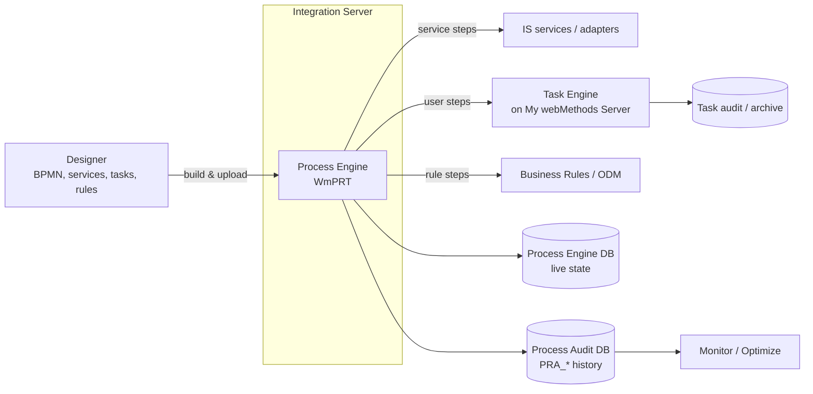

# IBM webMethods BPMS Academy

**English** | [中文](README.zh-CN.md)

**Author: Daniel Yuanpeng Xu** — product manager in business-process and decision automation. Concept, curriculum, frameworks and all *Author's view* content are by Daniel Yuanpeng Xu.

**A cited knowledge base and interactive, mobile-friendly course on IBM webMethods BPMS — the Process Engine, Task Engine, Business Rules, execution history, BPMN, and how process platforms work alongside AI agents.**

Static HTML, CSS and JavaScript. No build step, no backend, no tracking. Open `index.html` or publish with GitHub Pages.

**Current release: [v1.0.0](https://github.com/Xudaniel/webmethods-bpms-academy/releases/tag/v1.0.0)** · [Live site](https://xudaniel.github.io/webmethods-bpms-academy/) · [Product requirements (PRD)](docs/PRD.md) · [Changelog](CHANGELOG.md)

**Two ways to learn:**
- **Interactive version** (`index.html`) — tabs, sliders, a simulator, a scan lab and games.
- **Reading version** (`read.html`) — the whole course on one page with five diagrams and a quiz with answer key. No clicking required; prints cleanly to PDF.

> **Independent learning resource.** Sections marked *Author's view* are the personal opinions of the author, Daniel Yuanpeng Xu, drawn from experience as a product manager on process and decision-automation products; they are not the position of any employer or vendor and contain no employer-internal data.
>
> **Also:** This is not an official IBM site and is not affiliated with or endorsed by IBM or Software AG. Product names are trademarks of their respective owners. All content comes from public product documentation and public reports, cited below. No customer, employer-internal or confidential data is used; the Agent Scan Lab ships with synthetic data only.

---

## Contents

1. [Who this is for](#who-this-is-for)
2. [What you will learn](#what-you-will-learn)
3. [Curriculum](#curriculum)
4. [IBM webMethods knowledge base](#ibm-webmethods-knowledge-base)
5. [How to use IBM webMethods BPMS](#how-to-use-ibm-webmethods-bpms)
6. [Core concepts at a glance](#core-concepts-at-a-glance)
7. [Interactive tools](#interactive-tools)
8. [Agent-era patterns](#agent-era-patterns)
9. [Market context](#market-context)
10. [Getting started](#getting-started)
11. [Project structure](#project-structure)
12. [Editing content](#editing-content)
13. [Testing](#testing)
14. [Design principles](#design-principles)
15. [Roadmap](#roadmap)
16. [Contributing](#contributing)
17. [Sources](#sources)

---

## Who this is for

| Audience | What they get |
| --- | --- |
| Product managers and architects | A clear model of how the Process Engine, Task Engine, rules and audit history fit together, and where agents belong |
| Developers new to webMethods BPM | BPMN essentials, runtime components and where to find execution data |
| Pre-sales and consultants | Worked cases, patterns and a repeatable method to find automation and agent opportunities in an existing estate |
| Students of process automation | A hands-on simulator and quiz that connect BPMN diagrams to running instances |
| **Beginners** | A 15-minute path through the site, plain-language explanations and a glossary |
| **Customers and prospects** | A 10-minute guided demo that shows the value and depth of IBM webMethods BPMS |
| **Business users, developers, analysts and operations** | Step-by-step *How to use* guides for their role, with official documentation links |

No prior webMethods experience is assumed. Familiarity with basic workflow ideas helps.

## What you will learn

After working through the site you should be able to:

1. Name the main IBM webMethods components in a BPMS solution and explain what each one does.
2. Distinguish the **Process Engine database** (live state) from the **Process Audit database** (history), and know where human-task history lives.
3. Read and design a BPMN model using tasks, gateways, events and lanes.
4. Choose Process Engine quality-of-service settings (Optimize Locally, Volatile Transition Documents, Volatile Tracking) and explain what each trades away.
5. Model decisions in webMethods Business Rules: rule projects, rule sets, decision tables, decision trees and event rules.
6. Decide when logic belongs in the process, in a rule task or decision service, or with a person.
7. Apply three agent-era patterns: *agent proposes, rules decide, process executes*; the *human-approval inbox*; and the *decision log*.
8. Score execution history to find ODM rule candidates and agent candidates, and explain the limits of that analysis.
9. Explain why upgrade deadlines and regulation (EU AI Act) shape buying decisions in this market.

## Curriculum

| # | Section | Format | Outcome |
| --- | --- | --- | --- |
| 0 | **Start here** | Six hands-on steps | Plain-language explainer for a general audience: before/after a BPMS, who owns which job, an agent decision guard with live policy sliders, the market clock, where the market really is, five ideas for the agent era |
| 1 | **Overview** | Reading + family table | The core idea (process orchestrates, rules judge, people handle exceptions, agents propose) and IBM webMethods at a glance |
| 1a | **Knowledge base** | Cited reference | Releases, Process Engine and QoS, execution history, Task Engine, Business Rules, Rule Engine configuration, design checklist — 42 cited facts |
| 1b | **How to use** | Step-by-step guides | Business user, process developer, business analyst, operations, plus a 10-minute customer demo script |
| 1c | **Hands-on lab** | 30-minute exercise | Build, enable, run and monitor a purchase-approval process, with a progress tracker and pitfalls |
| 2 | **Lifecycle** | Clickable stages + release table | Model → implement → build & upload → execute → monitor → optimize → govern; 10.15 support dates |
| 3 | **Architecture** | Clickable component map | Designer, Process Engine (WmPRT), Task Engine, Process Engine DB, Process Audit DB, rules/ODM, Monitor/Optimize; `PRA_*` tables |
| 4 | **BPMN** | Reference tables | Activities, gateways, events, pools and lanes |
| 5 | **Patterns** | Filterable cards | Four classic and three agent-era patterns: problem, solution, when to use |
| 6 | **Cases** | Flow diagrams | Purchase approval, loan decisioning, logistics exception — each with a design lesson |
| 7 | **Simulator** | Interactive | Run a loan instance through a rule task and an underwriter task; watch audit-style log rows |
| 8 | **Agent Scan Lab** | Interactive | Classify process steps from history; synthetic sample or your own CSV |
| 9 | **Market** | Reading + sources | Analyst sizing range, Gartner BOAT, competitor signals, regulatory dates |
| 10 | **Glossary** | Searchable | 36 terms, including QoS, Business Rules and day-to-day operation terms |
| 11 | **Quiz** | 22 questions | Immediate feedback with explanations and a running score |

Every section has its own URL fragment (for example `#simulator`), so you can link directly to it.

## Reading version

`read.html` is for readers who want to read straight through — on a phone, offline or on paper.

| Feature | Detail |
| --- | --- |
| One page | 18 numbered sections, including the IBM webMethods knowledge base, how-to guides and a printable lab sheet, with a table of contents, from "Why this matters" to sources |
| Five static diagrams | Architecture · where execution history lives · 2022–2028 timeline · agent decision guard · loan process in BPMN. Inline SVG, so they render without JavaScript |
| Quiz | All 22 questions printed with options, then an answer key with explanations |
| Worked examples | The decision-guard policy applied to five cases; the simulator's audit log; the scan lab's synthetic result table |
| Print-ready | Print stylesheet: no navigation, diagrams and tables kept on one page, source URLs printed. About 17 Letter pages |
| Same content | Text is rendered from `js/content.js`, `js/knowledge.js` and `js/explainer.js`, so the reading and interactive versions never drift apart |

## IBM webMethods knowledge base

The **Knowledge base** section (`#knowledge`, and section 3 of the reading version) is a cited reference on how IBM webMethods BPMS actually behaves. It has **7 topics and 42 facts, each linked to public IBM or Software AG documentation**, plus a practitioner note per topic.

| Topic | What you learn |
| --- | --- |
| Releases and lifecycle | 10.15 (GA Oct 2022; end of maintenance Oct 2027, end of support Oct 2028; last release on AIX and z/Linux), 11.1 (Sep 2024), 12.1 (Java 21, Jakarta EE 10, FIPS 140-3, containers) |
| Process Engine runtime and quality of service | Transition documents; the speed-versus-guarantee trade-off; **Optimize Locally** (on by default), **Volatile Transition Documents** (on), **Volatile Tracking** (off); Universal Messaging as JMS provider; Broker deprecated |
| Execution history and audit | Process Engine DB versus Process Audit DB (`PRA_*` tables), logging levels, where task history lives in 10.15 |
| Task Engine and human work | Inboxes on My webMethods Server, `getTaskAudit`, task archiving |
| webMethods Business Rules | Rule projects, rule sets, decision tables, decision trees, event rules; Data/Service/Process actions; deploying to Integration Server and My webMethods Server |
| Rule Engine configuration and Rule Tasks | Where the Rules Engine runs (WmBusinessRules), configuring a Rule Task, Process Aware tables, event rules and JMS triggers, Hot Deploy |
| Practitioner design checklist | Ten checks for design reviews and upgrades |

**IBM webMethods at a glance.** The Overview (and section 2 of the reading version) maps the family components you meet in a BPMS project: Integration Server, Designer, My webMethods Server, Process Engine, Task Engine, Business Rules, Universal Messaging, Monitor/Optimize and IBM webMethods Hybrid Integration. The Start page shows a **knowledge-at-a-glance** counter (topics, cited facts, components, sources, glossary terms, quiz questions).

## How to use IBM webMethods BPMS

The site is built first for **beginners and customers**, and for the **people who will use the product every day**.

**New here? Take the 15-minute path:** Start here → Overview (IBM webMethods at a glance) → How to use → Simulator → Quiz. It's also listed at the top of the Start page.

The **How to use** section (`#howto`, section 4 of the reading version) has step-by-step guides by role. Each step shows where to click in the product, what happens, and a link to the official documentation. Each guide ends with *how you'll know it worked* and a tip.

| Role | Guide | Key steps |
| --- | --- | --- |
| Business user | Work your tasks in My webMethods | My Inbox → find the task → Accept → Submit / Complete → Delegate if needed |
| Process developer | Model, build and switch on a process | Process Developer mode → draw the BPMN and implement steps (service, user task, rule task) → logging and QoS → Build and upload → **Enable for execution** → test in Monitor |
| Business analyst | Change a business rule safely | Rule project in the My webMethods Server repository → open and lock → edit the decision table → verify → **Hot Deploy** (no process rebuild) |
| Operations | Watch, fix and resubmit | Process Instances → Stop / Suspend / Resume → **Resubmit** (optionally after editing pipeline data) → Task List Management → permissions |

**Customer demo script (10 minutes, author's view).** Six beats: what to click, what to say, and which customer question each beat answers. It runs from "why a process platform" through a safe AI agent and a live process run to "how fast can the business change a policy". Open it from the *Show a customer* tab, or from the link on the Start page.

### Hands-on lab: your first process in 30 minutes

The **Hands-on lab** section (`#lab`, section 5 of the reading version) connects the role guides into one exercise. You build a small purchase-approval process: a message start event, an "Approve request" user task, an exclusive gateway, and Approved / Rejected end events.

| Stage | Minutes | You'll know it worked when |
| --- | --- | --- |
| 1. Create the project and the process | 3 | The process opens on an empty canvas |
| 2. Start the process with a document | 4 | The start event shows the receive document |
| 3. Add the approval task | 6 | The step shows a user-task icon |
| 4. Route on the decision | 4 | Every path reaches an end event |
| 5. Build, upload and enable | 5 | No build errors; Execution Enabled |
| 6. Start an instance | 3 | The task appears in the approver's inbox |
| 7. Work the task as the approver | 3 | The task shows Completed |
| 8. Follow the instance in Monitor | 2 | The instance is Completed via Approved |

Every step shows where to click and cites public documentation. A **progress tracker** is saved only in your browser. A **pitfalls table** covers problems such as "the process never starts" and "no task in the inbox". There is a **practice path** for learners without an environment, and a **level-up** exercise that replaces judgement with a decision table and Hot Deploy. The reading version prints the lab as a sheet with tick boxes.

## Core concepts at a glance



**Where execution history lives**

| Store | Purpose | Typical use |
| --- | --- | --- |
| Process Engine database | Private, real-time instance state | Used by the engine only; not for reporting |
| Process Audit database | Public history: process and step status, transitions, logged fields, errors | Monitor, reporting, process analysis |
| Task Engine audit / archive | Per-task operations, assignments, outcomes | Human-task analysis |

Key Process Audit tables (9.6 and later use the `PRA_` prefix):

| Table | Holds |
| --- | --- |
| `PRA_PROCESS` | A row per process status (if process status logging is on) |
| `PRA_PROCESS_STEP` | A row per step status (if step logging is on) |
| `PRA_PROCESS_STEP_LOOP` | Step status with process, step and loop iteration |
| `PRA_STEP_TRANSITION` | Begin and end step of each transition (if transition logging is on) |
| `PRA_STEP_LOGGED_FIELD(S)` | Run-time values of fields marked for logging |
| `PRA_ERROR` | A row for each failed step |

> In 10.15, writing task status into the Process Audit tables is **disabled by default**. Human-task detail usually has to come from the Task Engine audit (`getTaskAudit`) or the task archive.

## Interactive tools

### Loan process simulator

A five-step loan process: *Application received → Fetch credit data → Rule: eligibility → Underwriter review → Send decision*.

| Rule (illustrative) | Outcome |
| --- | --- |
| Credit score < 580 | Decline |
| Score ≥ 720 and loan/income ≤ 35% | Approve |
| Anything else | Refer to underwriter (user task) |

The log panel prints rows shaped like `PRA_PROCESS`, `PRA_PROCESS_STEP` and `PRA_STEP_LOGGED_FIELD` entries, so learners can connect a running instance to the history it leaves behind.

### Agent Scan Lab

Long-running BPMS estates hold years of evidence about where people approve almost everything, wait for days, or make the same decision for the same inputs. The lab turns that history into a ranked list of opportunities. Everything runs in the browser; files are never uploaded.

**Metrics per step**

| Metric | Meaning |
| --- | --- |
| Volume per month | Completed instances of the step |
| Work minutes / wait hours | Human effort and queue time |
| Top-outcome share | Share of the most common outcome (e.g. "approve") |
| Determinism | Share of instances whose input group produces one outcome ≥ 95% of the time |
| Rework, error rate | Loops and failures |

**Classification rules**

| Class | Rule | Interpretation |
| --- | --- | --- |
| Rule candidate (ODM) | user task, determinism ≥ 80% | A decision already made by rule — just not written down |
| Agent candidate (rubber-stamp) | ≥ 90% one outcome and ≤ 15 min work | Agent prepares, rule or person confirms |
| Agent candidate (triage + human approve) | wait ≥ 24 h and ≥ 70% one outcome | Agent triages documents; person approves |
| Integration fix | service step, error rate ≥ 5% | Fix the integration before adding AI |
| Keep human | everything else | High variance or high stakes |

Estimated hours saved = human hours per month × an assumed automatable share (rules 80%, rubber-stamp 60%, triage 40%). **These thresholds and shares are placeholders** to be calibrated on real data.

**CSV input** — one row per completed step instance:

| Column | Type | Example | Typical source |
| --- | --- | --- | --- |
| `process` | text | `Customs hold` | `PRA_PROCESS` / model metadata |
| `step` | text | `Release approval` | `PRA_PROCESS_STEP` |
| `step_type` | `user_task` \| `service` \| `gateway` | `user_task` | model metadata |
| `instance_id` | text | `42` | `PRA_PROCESS_STEP` |
| `start_ts`, `end_ts` | ISO timestamp | `2026-05-01T09:00:00` | `PRA_PROCESS_STEP` |
| `wait_min`, `work_min` | number | `30`, `6` | Task Engine audit |
| `outcome` | text | `approve` | logged field or task data |
| `input_key` | text (hash) | `k17` | hash of decision-driving fields |
| `loop_count` | integer | `0` | `PRA_PROCESS_STEP_LOOP` |
| `error` | 0/1 | `0` | `PRA_ERROR` |

Use anonymised exports only. Do not include personal data or raw business payloads.

**Limits.** Results depend on what was logged and retained: purged or archived history, low logging levels, or missing outcome fields reduce what the scan can see. The synthetic sample was generated to contain these patterns, so it demonstrates the method, not real-world results.

A Python version with the same logic is in [`tools/`](tools/):

```bash
cd tools
python3 make_synthetic.py            # writes synthetic_audit.csv
python3 agent_scan.py synthetic_audit.csv
```

## Start here: the public explainer

Built for readers with no BPMS background. Each step is interactive:

| Step | Interaction | Point it makes |
| --- | --- | --- |
| 1. One request, two worlds | Toggle without / with a BPMS | Routing, rules, timers and audit replace "someone remembering" |
| 2. Who should own each job? | Sorting game, 8 jobs | Process orchestrates, rules judge, people handle exceptions, agents propose |
| 3. Agents need a rulebook | Sliders for auto-approve limit and minimum delay; key-account toggle | An agent proposes credits; rules return allow / refer / deny; each decision is logged with a rule version |
| 4. The clock that drives this market | Clickable timeline, 2022–2028 | Upgrade deadlines and regulation decide when platforms are re-evaluated |
| 5. Where the market really is | Tap-to-reveal layers | Analyst category vs where a mature on-premises BPMS actually competes |
| 6. Five ideas for the agent era | Expandable cards | Mine process history, human-approval inbox, decision flight recorder, build where the base is, maintenance-to-AI credits |

Steps 3, 5 and 6 are labelled *Author's view*.

## Agent-era patterns

| Pattern | Problem | Solution |
| --- | --- | --- |
| **Agent proposes, rules decide, process executes** | Agents read documents well, but regulated decisions must be explainable and repeatable | Agent extracts facts and proposes; a decision service returns allow / deny / refer; the process executes or escalates to a person; every step is logged |
| **Human-approval inbox for agents** | Agents on several platforms need a person to approve some actions, with SLAs and audit | Route "needs a human" steps into BPMS user tasks to reuse assignment, delegation, escalation and audit |
| **Decision log (flight recorder)** | After an incident you must show the rule version, inputs and approver behind an outcome | Log inputs, rule version, outcome and approver for every agent-relevant decision alongside the process audit trail |

## Market context

Summarised from public sources (2026). See the Market page for details.

- **Sizing is inconsistent.** 2025 estimates for the "BPM market" range from about **$16.7B to $26.5B** depending on the firm and scope. Useful for direction, not for sizing a product line.
- **The category is shifting to orchestration.** Gartner's 2026 Magic Quadrant for *Business Orchestration and Automation Technologies* (BOAT) evaluated 20 vendors and requires native AI-agent orchestration and governance. Gartner expects 70% of enterprises to move to a consolidated orchestration platform by 2030, up from 10%.
- **Growth is in regulated, human-supervised work.** Camunda reported ARR nearing $200M in August 2026, led by insurance, public sector and banking; Appian reports about 80% of ARR from financial services, life sciences and public sector.
- **Deadlines drive decisions.**

| Date | Event |
| --- | --- |
| 18 Oct 2022 | webMethods 10.15 general availability |
| Oct 2027 | webMethods 10.15 end of maintenance (last release supporting AIX and z/Linux) |
| 2 Dec 2027 | EU AI Act obligations for Annex III high-risk systems (e.g. credit scoring) |
| Oct 2028 | webMethods 10.15 end of support |

## Getting started

**View locally**

```bash
git clone https://github.com/Xudaniel/webmethods-bpms-academy.git
cd webmethods-bpms-academy
python3 -m http.server 8000
# open http://localhost:8000
```

Opening `index.html` directly also works in most browsers; a local server avoids file-URL restrictions when loading CSVs.

**Publish with GitHub Pages**

1. Repository **Settings → Pages**.
2. **Source:** Deploy from a branch → `main` / `(root)`.
3. The site appears at `https://xudaniel.github.io/webmethods-bpms-academy/`.

**Browser support:** current Chrome, Edge, Firefox and Safari, desktop and mobile. No external libraries or fonts are loaded.

## Project structure

```
webmethods-bpms-academy/
├── index.html          # interactive version
├── read.html           # reading version: one page, diagrams, quiz with answer key
├── README.md           # English README
├── README.zh-CN.md     # Chinese README (中文说明)
├── CHANGELOG.md        # release history
├── docs/
│   └── PRD.md          # product requirements document
├── css/
│   ├── styles.css      # layout, components, mobile breakpoints
│   └── read.css        # reading version: diagrams and print styles
├── js/
│   ├── content.js      # course content and sources
│   ├── knowledge.js    # IBM webMethods knowledge base: family, cited topics, extra glossary and quiz
│   ├── howto.js        # How to use: role guides, beginner path, customer demo script
│   ├── lab.js          # Hands-on lab: first process in 30 minutes
│   ├── explainer.js    # "Start here" content (author's view items labelled)
│   ├── explainer-app.js# "Start here" interactions: toggle, sorting game, decision guard, timeline
│   └── read.js         # renders the reading version from the same content files
│   └── app.js          # navigation, simulator, scan lab, glossary search, quiz
├── tools/
│   ├── agent_scan.py   # Python version of the scan
│   └── make_synthetic.py
└── tests/
    └── smoke_test.py   # headless browser check of every section
```

## Editing content

All text lives in `js/content.js` in one `window.ACADEMY` object, so content changes rarely touch layout or logic.

| Key | Shape | Rendered in |
| --- | --- | --- |
| `architecture` | `{ id, name, role, text, tip }[]` | Architecture tiles |
| `auditTables` | `[table, description][]` | Architecture → Process Audit tables |
| `lifecycle` | `[stage, description][]` | Lifecycle tiles |
| `lifecycleDates` | `[event, date][]` | Lifecycle → release table |
| `bpmn` | `{ group, items: [name, description][] }[]` | BPMN |
| `patterns` | `{ name, tag: "classic" \| "agent era", problem, solution, when }[]` | Patterns |
| `cases` | `{ name, flow: string[], lesson }[]` | Cases |
| `glossary` | `[term, definition][]` | Glossary |
| `market` | `{ sizing, signals, takeaways }` | Market |
| `quiz` | `{ q, a: string[], c: correctIndex, e: explanation }[]` | Quiz |
| `sources` | `[title, url][]` | Market → Sources |

The knowledge base lives in `js/knowledge.js` as `window.KNOWLEDGE`: `family` (`[component, role][]`), `topics` (`{ id, title, summary, facts[], practice, sources: number[] }[]`), `glossary`, `quiz` and numbered `sources`. Its glossary terms, quiz questions and sources are merged into the main course automatically.

Rules for content: cite a public source for every factual claim, keep dates absolute (e.g. "Oct 2027", not "next year"), and never add customer names, revenue figures or non-public material.

## Testing

```bash
pip install playwright
playwright install chromium
python3 tests/smoke_test.py
```

The test serves the site locally, opens every section at phone width (390 × 844), checks the IBM webMethods title, knowledge counter, family table and cited knowledge topics, the beginner path, every how-to guide, the demo script and the hands-on lab with its progress tracker, exercises the Start-here interactions, runs the simulator to completion and the Agent Scan Lab on the synthetic sample, checks that `read.html` has five diagrams, a complete quiz and answer key and all sections filled, and fails on any JavaScript error.

## Design principles

- **Mobile first.** Single column, sticky section bar, tables scroll horizontally, most important columns first.
- **No dependencies.** Plain HTML/CSS/JS; nothing to install, nothing that breaks on a library update.
- **Privacy by design.** No analytics, no network calls; uploaded CSVs are read in the browser only.
- **Content separated from code.** One content file, cited sources, absolute dates.
- **Honest numbers.** Placeholders and synthetic data are labelled as such wherever they appear.

## Roadmap

- [ ] Visual BPMN diagrams for each case (SVG)
- [ ] Simulator: timer escalation and parallel-gateway scenarios
- [ ] Agent Scan Lab: adjustable thresholds and CSV export of results
- [ ] Module on migrating Business Rules to ODM decision services
- [ ] Knowledge base: Monitor/Optimize, deployment and upgrade topics

## Contributing

Issues and pull requests are welcome. Please keep changes small, cite public sources for any new facts, run `tests/smoke_test.py` before opening a PR, and do not include confidential or customer data.

## Sources

**Product documentation**
- [Process Audit Log database component tables — Designer 10.15](https://documentation.softwareag.com/webmethods/designer/sdf10-15/webhelp/sdf-webhelp/sdf-webhelp/proc.process.audit.log.database.component.tables.html)
- [Process Engine vs Process Audit databases — IBM community](https://community.ibm.com/community/user/discussion/differences-between-process-engine-db-and-process-audit-log-db)
- [Task Engine `getTaskAudit`](https://documentation.softwareag.com/webmethods/task_engine/wtn10-7/10-7_Task_Engine_webhelp/task-engine-webhelp/te_web_taskaudit.html)
- [Task audit logging into Process Audit disabled by default — IBM 10.15 docs](https://www.ibm.com/docs/en/SSHZPA_10.15.0/te_users_guide/co-disable_enable_task_logging_in_processes.html)
- [Task archiving](https://documentation.softwareag.com/webmethods/compendiums/v10-7/C_Digital_Event_Comm/intsagdes-compendium/co-about-task-archiving.html)

**How to use (day-to-day operation)**
Every step in the site links to its source; the main ones:
- [About My Inbox (Task Engine)](https://documentation.softwareag.com/webmethods/compendiums/v10-5/C_Run_BPs_and_CAs/runbpca-compendium/co-about_my_inbox.html)
- [Accepting a task](https://documentation.softwareag.com/webmethods/compendiums/v10-3/C_Run_BPs_and_CAs/runbpca-compendium/co-accepting_a_task.html)
- [Enabling and disabling process model versions (Monitor)](https://documentation.softwareag.com/webmethods/monitor/wmn10-3/10-3_Monitor_webhelp/monitor-webhelp/to-process_models_24.html)
- [Build and upload preferences (Designer 10.5)](https://documentation.softwareag.com/webmethods/designer/sdf10-5/10-5_sdf-webhelp/sdf-webhelp/proc.configuring.build.and.upload.preferences.html)
- [Hot deploying a rule project](https://documentation.softwareag.com/webmethods/compendiums/v10-4/C_Digital_Event_Comm/intsagdes-compendium/ta-hot_deploy_decent.html)
- [About resubmitting process instances and steps (Monitor 10.7)](https://documentation.softwareag.com/webmethods/monitor/wmn10-7/10-7_Monitor_webhelp/wmn-webhelp/to-processes_25.html)
- [Stopping, suspending or resuming a process instance (Monitor 10.7)](https://documentation.softwareag.com/webmethods/monitor/wmn10-7/10-7_Monitor_webhelp/wmn-webhelp/to-processes_23.html)

**Process Engine, Business Rules and releases**
- [Tuning Process Engine performance and quality of service](https://documentation.softwareag.com/webmethods/compendiums/v10-3/C_Run_BPs_and_CAs/runbpca-compendium/to-concepts_2.html)
- [Quality of service settings](https://documentation.softwareag.com/webmethods/wmsuites/wmsuite10-1/C_Run_BPs_and_CAs/runbpca-compendium/to-tuning_3.html)
- [Configuring Process Engine settings — IBM 11.1 docs](https://www.ibm.com/docs/en/SSLMF12_11.1/ta-configuring_monitoring_configuring_settings.html)
- [About webMethods Business Rules — Designer 10.15](https://documentation.softwareag.com/webmethods/designer/sdf10-15/webhelp/sdf-webhelp/sdf-webhelp/proc.about.webmethods.business.rules.html)
- [Rules Development terminology — Designer 10.7](https://documentation.softwareag.com/webmethods/designer/sdf10-7/10-7_sdf-webhelp/sdf-webhelp/co-rules_terminology.html)
- [Rules Development overview — Designer 10.7](https://documentation.softwareag.com/webmethods/designer/sdf10-7/10-7_sdf-webhelp/sdf-webhelp/co-intro_business_rules.html)
- [IBM webMethods Integration 12.1 lifecycle — IBM](https://www.ibm.com/support/pages/ibm-webmethods-integration121)
- [From legacy integration to AI-ready architecture with IBM webMethods 12.1 — IBM community](https://community.ibm.com/community/user/blogs/noboru-tanaka/2026/07/23/ibm-webmethods12-ai-led-integration-arc)
- [IBM webMethods 11.1 release notes (copy)](https://www.scribd.com/document/818628366/webmethods-release-notes)
- [Introducing IBM webMethods Hybrid Integration — IBM](https://www.ibm.com/new/announcements/introducing-webmethods-hybrid-integration)

**Lifecycle and regulation**
- [webMethods support lifecycle — IBM](https://www.ibm.com/support/pages/node/7180543)
- [Longer support for webMethods 10.15 — Software AG forum](https://tech.forums.softwareag.com/t/longer-support-for-webmethods-10-15/276574)
- [EU AI Act Digital Omnibus — Orrick](https://www.orrick.com/fr-FR/Insights/2026/07/EU-AI-Act-Update-Digital-Omnibus-Finalizes-8-Compliance-Changes)

**Market**
- [Gartner BOAT Magic Quadrant 2026 — abstract](https://www.gartner.com/en/documents/8381781) · [Appian on BOAT 2026](https://itwire.com/guest-articles/company-news/2026-gartner-critical-capabilities-for-business-orchestration-and-automation-technologies-report-ranks-appian-1-for-the-deterministic-workflow-automation-use-case-and-platform-cons)
- [Camunda ARR nearing $200M — Business Wire](https://www.businesswire.com/news/home/20260804044254/en/) · [Camunda regulated-industry growth](https://techintelpro.com/news/ai/agentic-ai/camunda-accelerates-agentic-orchestration-adoption)
- [Appian Q3 2026 results — SEC 8-K](https://www.sec.gov/Archives/edgar/data/0001441683/000144168326000056/appnex991earningsrelease-9.htm) · [Appian industry mix](https://www.webull.com/news/15872292364510209)
- BPM market sizing: [Mordor](https://www.scotts-international.com/business-process-management-market-share-analysis-industry-trends-statistics-growth-forecasts-2026-2031,t2166895/58022) · [IMARC](https://www.imarcgroup.com/global-business-process-management-market) · [Fortune Business Insights](https://www.fortunebusinessinsights.com/business-process-management-bpm-market-102639) · [360iResearch](https://cn.gii.tw/report/ires2011888-business-process-management-market-by-organization.html)

---

© 2026 Daniel Yuanpeng Xu. No open-source license has been chosen yet, so default copyright applies. Open an issue if you would like to reuse the material.

**Author:** Daniel Yuanpeng Xu · [github.com/Xudaniel](https://github.com/Xudaniel)
