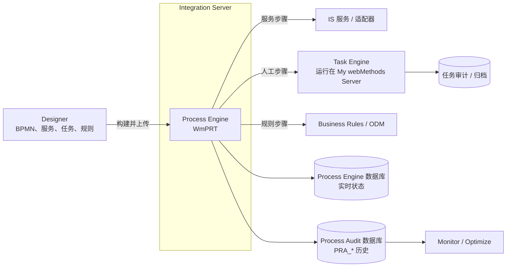

# IBM webMethods BPMS 学院

[English](README.md) | **中文**

**作者：Daniel Yuanpeng Xu** —— 业务流程与决策自动化领域的产品经理。本项目的构思、课程设计、分析框架以及所有标注为「作者观点」的内容，均由 Daniel Yuanpeng Xu 完成。

**一份附出处的知识库加一门可互动、适配手机的课程：讲解 IBM webMethods BPMS 的 Process Engine、Task Engine、Business Rules、执行历史、BPMN，以及流程平台如何与 AI agent 协同工作。**

纯静态 HTML、CSS 和 JavaScript。无需构建，无后端，无任何追踪。直接打开 `index.html`，或通过 GitHub Pages 发布即可。

**当前版本：[v1.0.0](https://github.com/Xudaniel/webmethods-bpms-academy/releases/tag/v1.0.0)** · [在线网站](https://xudaniel.github.io/webmethods-bpms-academy/) · [产品需求文档（PRD，英文）](docs/PRD.md) · [更新日志](CHANGELOG.md)

**两种学习方式：**
- **互动版**（`index.html`）：栏目切换、滑块、模拟器、扫描实验室和小游戏。
- **阅读版**（`read.html`）：整门课放在一页里，附五张图和带答案的测验。不用点来点去，也可以直接打印成 PDF。

> **独立学习资源。** 标注为「作者观点」（*Author's view*）的部分，是作者 Daniel Yuanpeng Xu 基于其在流程与决策自动化产品上的产品经理经验所写的个人观点，不代表任何雇主或厂商的立场，也不包含任何雇主内部数据。
>
> **另外：** 本站不是 IBM 官方网站，与 IBM 或 Software AG 无隶属关系，也未获其背书。文中产品名称为各自所有者的商标。所有内容均来自公开的产品文档和公开报告，出处见下文。未使用任何客户数据、雇主内部数据或机密信息；Agent 扫描实验室只附带模拟数据。

---

## 目录

0. [在手机上使用](#-在手机上使用)
1. [适合谁](#适合谁)
2. [学完能做到什么](#学完能做到什么)
3. [课程安排](#课程安排)
4. [IBM webMethods 知识库](#ibm-webmethods-知识库)
5. [如何使用 IBM webMethods BPMS](#如何使用-ibm-webmethods-bpms)
6. [从这里开始：面向大众的互动讲解](#从这里开始面向大众的互动讲解)
7. [核心概念一览](#核心概念一览)
8. [互动工具](#互动工具)
9. [Agent 时代的设计模式](#agent-时代的设计模式)
10. [市场背景](#市场背景)
11. [快速开始](#快速开始)
12. [项目结构](#项目结构)
13. [如何修改内容](#如何修改内容)
14. [测试](#测试)
15. [设计原则](#设计原则)
16. [后续计划](#后续计划)
17. [参与贡献](#参与贡献)
18. [资料来源](#资料来源)

---

## 📱 在手机上使用

这个网站优先为手机设计。建议把它存成手机上的 App，用起来最方便：


**iPhone（Safari）**
1. 用 Safari 打开 <https://xudaniel.github.io/webmethods-bpms-academy/>。如果是在电脑上看到这个页面，用手机相机扫右边的二维码即可。
2. 点**分享**按钮，或者点地址栏旁边的 **⋯** 再选「分享」。
3. 往下滑，点**添加到主屏幕**。如果找不到，滑到列表最底下点**编辑操作**，把它加进来。
4. 保持**作为 Web App 打开**开启，再点**添加**。

**Android（Chrome）**
1. 用 Chrome 打开网站。
2. 点右上角 **⋮** → **添加到主屏幕**。
3. 选择**安装**（或**安装应用**），然后确认。

**在手机上怎么找内容**
- 左上角的 **☰ Sections** 列出全部栏目，按「开始 / 动手 / 学习 / 讲课」分组；也可以左右滑动顶部的标签栏。
- 每个栏目最后都有**上一页 / 下一页**；右下角圆形的 **↑** 按钮回到顶部。阅读版还有 **Contents** 按钮，可以跳回目录。
- **离线：** 第一次打开之后，存到主屏幕的 App 没有网络也能用。实验进度只保存在你自己的手机上。
- **调大字体：** 用浏览器的字号设置或双指放大，页面会自动重新排版，360 像素宽的屏幕上也不需要左右滑动。
- **只想阅读或存成 PDF：** 打开**阅读版**，用浏览器的「分享」或「打印」功能保存。

## 适合谁

| 读者 | 能获得什么 |
| --- | --- |
| 产品经理与架构师 | 看清 Process Engine、Task Engine、规则和审计历史如何配合，以及 agent 应该放在哪里 |
| 刚接触 webMethods BPM 的开发者 | BPMN 基础、运行时组件，以及执行数据存在哪里 |
| 售前与顾问 | 实例、设计模式，以及一套可重复使用的方法，用来在现有系统里找出自动化和 agent 的机会 |
| 学习流程自动化的学生 | 动手的模拟器和测验，把 BPMN 图和真实运行的流程实例对应起来 |
| **初学者** | 15 分钟入门路线、通俗讲解和术语表 |
| **客户与潜在客户** | 10 分钟的引导式演示，看清 IBM webMethods BPMS 的价值和深度 |
| **业务用户、开发、分析师和运维** | 按角色划分的「如何使用」操作教程，附官方文档链接 |

不需要任何 webMethods 基础，懂一点工作流概念会更容易上手。

## 学完能做到什么

1. 说出 BPMS 方案中 IBM webMethods 的主要组件，并解释各自的作用。
2. 区分 **Process Engine 数据库**（实时状态）和 **Process Audit 数据库**（历史记录），并知道人工任务的历史存在哪里。
3. 读懂并设计包含任务、网关、事件和泳道的 BPMN 模型。
4. 为 Process Engine 选择服务质量设置（Optimize Locally、Volatile Transition Documents、Volatile Tracking），并说明各自牺牲了什么。
5. 用 webMethods Business Rules 建模决策：规则项目、规则集、决策表、决策树和事件规则。
6. 判断一段逻辑应该放在流程里、规则任务或决策服务里，还是交给人。
7. 运用三个 agent 时代的模式：*agent 提建议、规则做判断、流程来执行*；*人工审批入口*；*决策日志*。
8. 用执行历史打分，找出适合写成 ODM 规则或交给 agent 的步骤，并说明这种分析的局限。
9. 解释为什么升级期限和监管（欧盟 AI 法案）会影响这个市场的采购决定。

## 课程安排

| # | 栏目 | 形式 | 收获 |
| --- | --- | --- | --- |
| 0 | **从这里开始**（Start here） | 六个动手步骤 | 面向大众的浅显讲解：有无 BPMS 的对比、每项工作该由谁负责、带实时策略滑块的 agent 决策关卡、驱动市场的时间线、市场真正在哪里、agent 时代的五个想法 |
| 1 | **概览**（Overview） | 阅读 + 产品家族表 | 核心理念（流程负责编排，规则负责判断，人负责例外，agent 负责提建议）和 IBM webMethods 一览 |
| 1a | **知识库**（Knowledge base） | 附出处的参考资料 | 版本、Process Engine 与 QoS、执行历史、Task Engine、Business Rules、规则引擎配置、设计清单——42 条引用事实 |
| 1b | **如何使用**（How to use） | 分步教程 | 业务用户、流程开发、业务分析师、运维四类角色，外加 10 分钟客户演示脚本 |
| 1c | **动手实验**（Hands-on lab） | 30 分钟练习 | 构建、启用、运行并监控一个采购审批流程，带进度记录和常见问题表 |
| 1d | **故障排查**（Troubleshooting） | 可搜索 | 16 个问题：症状 → 先检查什么 → 怎么解决 → 在哪里做，附出处 |
| 1e | **讲课**（Teach a class） | 工作坊方案 | 3 小时议程、打印清单、讲师提示（作者观点） |
| 2 | **生命周期**（Lifecycle） | 可点击的阶段 + 版本日期表 | 建模 → 实现 → 构建上传 → 执行 → 监控 → 优化 → 治理；10.15 的支持日期 |
| 3 | **架构**（Architecture） | 可点击的组件图 | Designer、Process Engine（WmPRT）、Task Engine、两个数据库、规则/ODM、Monitor/Optimize；`PRA_*` 表 |
| 4 | **BPMN** | 参考表 | 活动、网关、事件、池与泳道 |
| 5 | **设计模式**（Patterns） | 可筛选的卡片 | 四个传统模式和三个 agent 时代模式：问题、解法、适用场景 |
| 6 | **实例**（Cases） | 流程图 | 采购审批、贷款决策、物流异常处理，每个都附设计要点 |
| 7 | **模拟器**（Simulator） | 互动 | 让一笔贷款走完规则任务和核保人工任务，同步看到审计风格的日志 |
| 8 | **Agent 扫描实验室**（Agent Scan Lab） | 互动 | 根据历史数据给流程步骤分类；可用模拟数据，也可上传自己的 CSV |
| 9 | **市场**（Market） | 阅读 + 出处 | 各家市场规模估算、Gartner BOAT、竞争对手动态、监管日期 |
| 10 | **术语表**（Glossary） | 可搜索 | 36 个术语，含 QoS、Business Rules 和日常操作术语 |
| 11 | **测验**（Quiz） | 22 道题 | 即时反馈、附解析和得分 |

每个栏目都有自己的网址片段（例如 `#simulator`），可以直接分享链接。网站界面目前为英文。

## IBM webMethods 知识库

**知识库**栏目（互动版 `#knowledge`，阅读版第 3 章）是一份讲清 IBM webMethods BPMS 实际怎么运作的参考资料，共 **7 个主题、42 条事实，每条都链接到 IBM 或 Software AG 的公开文档**，每个主题后附一段实践建议。

| 主题 | 学到什么 |
| --- | --- |
| 版本与生命周期 | 10.15（2022 年 10 月正式发布；2027 年 10 月结束维护，2028 年 10 月结束支持；最后一个支持 AIX 和 z/Linux 的版本）、11.1（2024 年 9 月）、12.1（Java 21、Jakarta EE 10、FIPS 140-3、容器化） |
| Process Engine 运行与服务质量（QoS） | 转移文档；速度与可靠性的取舍；**Optimize Locally**（默认开）、**Volatile Transition Documents**（默认开）、**Volatile Tracking**（默认关）；Universal Messaging 作为 JMS 提供方；Broker 已弃用 |
| 执行历史与审计 | Process Engine 数据库与 Process Audit 数据库（`PRA_*` 表）、日志级别、10.15 中人工任务历史存在哪里 |
| Task Engine 与人工工作 | My webMethods Server 上的任务收件箱、`getTaskAudit`、任务归档 |
| webMethods Business Rules | 规则项目、规则集、决策表、决策树、事件规则；Data/Service/Process 动作；部署到 Integration Server 和 My webMethods Server |
| 规则引擎配置与 Rule Task | 规则引擎在哪里运行（WmBusinessRules）、如何配置 Rule Task、Process Aware 决策表、事件规则与 JMS 触发器、热部署 |
| 实践设计清单 | 设计评审和升级时用的十项检查 |

**IBM webMethods 一览。** 概览页（阅读版第 2 章）列出 BPMS 项目里会接触到的产品家族组件：Integration Server、Designer、My webMethods Server、Process Engine、Task Engine、Business Rules、Universal Messaging、Monitor/Optimize 和 IBM webMethods Hybrid Integration。「从这里开始」页顶部有**知识一览**计数器（主题、引用事实、组件、来源、术语、测验题数）。

## 如何使用 IBM webMethods BPMS

这个网站首先是给**初学者和客户**看的，也要教**每天使用这个产品的人**怎么操作。

**第一次来？走一遍 15 分钟路线：**从这里开始 → 概览（IBM webMethods 一览）→ 如何使用 → 模拟器 → 测验。「从这里开始」页顶部也列出了这条路线。

**如何使用**栏目（互动版 `#howto`，阅读版第 4 章）按角色给出一步一步的操作教程。每一步都写明在产品里点哪里、会发生什么，并链接官方文档；每个教程最后有「怎么确认做成了」和一条小建议。

| 角色 | 教程 | 关键步骤 |
| --- | --- | --- |
| 业务用户 | 在 My webMethods 里处理任务 | 打开 My Inbox → 找到任务 → Accept（接受）→ Submit / Complete（提交/完成）→ 需要时 Delegate（转交） |
| 流程开发人员 | 建模、构建并启用流程 | 切到 Process Developer 模式 → 画 BPMN、为每步选实现方式（服务、人工任务、规则任务）→ 设置日志与 QoS → Build and upload → **启用执行（Execution Enabled）** → 在 Monitor 里测试 |
| 业务分析师 | 安全地修改业务规则 | My webMethods Server 仓库中的规则项目 → 打开并锁定 → 修改决策表 → 校验 → **Hot Deploy（热部署）**，无需重建流程 |
| 运维人员 | 监控、修复与重新提交 | Process Instances → 停止/暂停/恢复 → **Resubmit（重新提交）**，必要时先修改 pipeline 数据 → Task List Management → 权限 |

**客户演示脚本（10 分钟，作者观点）。**共六个环节，每个环节写明点哪里、说什么、回答客户的哪个问题：从「为什么需要流程平台」，到安全地使用 AI agent、现场跑一个流程，再到「业务部门多快能改一条规则」。从「Show a customer」标签或首页的链接打开。

### 动手实验：30 分钟做出第一个流程

**动手实验**栏目（互动版 `#lab`，阅读版第 5 章）把几个角色教程串成一个完整练习：做一个小型采购审批流程，依次是消息开始事件、「Approve request」人工任务、排他网关，最后是 Approved / Rejected 两个结束事件。

| 阶段 | 分钟 | 怎么确认做成了 |
| --- | --- | --- |
| 1. 建项目和流程 | 3 | 流程在空白画布中打开 |
| 2. 用文档启动流程 | 4 | 开始事件显示接收文档 |
| 3. 加审批任务 | 6 | 步骤显示人工任务图标 |
| 4. 按决定分流 | 4 | 每条路径都到达结束事件 |
| 5. 构建、上传并启用 | 5 | 构建无错误；已勾选 Execution Enabled |
| 6. 启动一个实例 | 3 | 审批人的收件箱出现任务 |
| 7. 以审批人身份处理任务 | 3 | 任务状态为 Completed |
| 8. 在 Monitor 中跟踪实例 | 2 | 实例经 Approved 路径完成 |

每一步都写明在哪里点，并附公开文档出处。**进度会自动保存**，只存在你自己的浏览器里。**常见问题表**列出了「流程不启动」「收件箱没有任务」等情况的原因和解决办法。没有环境的学员可以走**练习路线**；**进阶练习**是用决策表加 Hot Deploy 代替人工判断。阅读版会把整个实验打印成一张带勾选框的练习单。

### 故障排查、速查卡和讲课

- **故障排查**（互动版 `#trouble`，阅读版第 6 章）：按 4 个类别（启动与部署、任务、规则、监控与运维）收录 16 个常见问题，可以搜索。每个问题都给出先检查什么、怎么解决、在哪里操作，并附官方出处，例如「流程不启动」「任务接受不了」「Hot Deploy 是灰的」「重新提交从别的步骤开始了」。
- **角色速查卡和自测**：每个角色教程下面都有一页速查卡（关键操作和操作位置，外加 3 条要点），可以单独打印；还有 3 道即时反馈的自测题，四个角色共 12 题。阅读版第 7 章收录全部四张速查卡。
- **讲课**（互动版 `#teach`，阅读版第 8 章，作者观点）：3 小时工作坊议程，每个模块都链接到网站对应栏目，并列出课前要打印的材料和讲师提示（分别给客户课和用户课用）。

### 示意图、阅读时间和学习进度

- **阅读时间：** 每个栏目顶部都标注阅读时间（按每分钟约 200 词计算，每张图再加一点；动手类栏目另外标出动手时间）。「☰ Sections」菜单和阅读版每一章也都有，并显示整门课的总时长。
- **示意图**（原创 SVG，不使用 IBM 素材），互动版和阅读版都有：
  - **服务质量互动图**：切换 Process Engine 的三个设置，看各自换来什么、牺牲什么。
  - **流程与规则的分工**，以及**用 Hot Deploy 修改规则**的路径。
  - 每个角色教程下各配一张图：**任务生命周期**、**构建流程**、**实例状态**。
  - 实验流程的 **BPMN 图（带流动的令牌动画）**、**「流程不启动」排查流程图**，以及**工作坊时间轴**。
  - `tools/build_diagrams.js` 负责生成知识库用到的独立 SVG 文件。
- **学习进度和徽章：** 显示已浏览的栏目数（共 17 个），另有 8 枚徽章，解锁时有小小的庆祝动画：探索者、驯服 Agent、模拟器、扫描员、排障能手、角色达标、实验完成、测验满分。还有一个「你知道吗？」卡片，随机展示知识库里一条有出处的事实。这些都只保存在你自己的浏览器里。

## 从这里开始：面向大众的互动讲解

为没有 BPMS 背景的读者设计，每一步都可以动手：

| 步骤 | 互动方式 | 想说明的道理 |
| --- | --- | --- |
| 1. 同一个请求，两种结局 | 切换「没有 BPMS / 有 BPMS」 | 路由、规则、计时和审计，取代了「靠人记得」 |
| 2. 每项工作该归谁？ | 8 项工作的分类小游戏 | 流程负责编排，规则负责判断，人负责例外，agent 负责提建议 |
| 3. Agent 需要一本规则手册 | 调整自动批准上限、最短延误时长，切换大客户选项 | agent 提出赔付建议；规则给出批准 / 转人工 / 拒绝；每个决定都带规则版本记入日志 |
| 4. 驱动这个市场的时钟 | 可点击的时间线（2022–2028） | 升级期限和监管决定了企业何时重新评估平台 |
| 5. 市场真正在哪里 | 点击逐层展开 | 分析机构的品类口径，与成熟本地部署 BPMS 实际竞争的地方之间的差别 |
| 6. Agent 时代的五个想法 | 可展开的卡片 | 挖掘流程历史、人工审批入口、决策「黑匣子」、在现有客户群里做方案、把维护费变成 AI 额度 |

第 3、5、6 步标注为「作者观点」。

## 阅读版

`read.html` 面向只想从头读到尾的读者，手机、离线或打印都适用。

| 特点 | 说明 |
| --- | --- |
| 一页读完 | 21 个编号章节（含 IBM webMethods 知识库、操作教程、可打印的实验练习单、故障排查、角色速查卡和讲课方案），附目录，从「为什么重要」到资料来源 |
| 五张静态图 | 架构图 · 执行历史存在哪里 · 2022–2028 时间线 · agent 决策关卡 · 贷款流程 BPMN 图。用内嵌 SVG 绘制，不依赖 JavaScript |
| 测验 | 22 道题连同选项完整列出，最后附答案和解析 |
| 实例 | 决策关卡策略套用到五个案例的结果、模拟器的审计日志、扫描实验室的模拟结果表 |
| 可直接打印 | 专门的打印样式：去掉导航，图表不跨页，打印出资料链接。约 17 页 Letter 纸 |
| 内容同源 | 文字来自 `js/content.js`、`js/knowledge.js` 和 `js/explainer.js`，阅读版和互动版永远保持一致 |

## 核心概念一览



**执行历史存在哪里**

| 存储 | 用途 | 典型用法 |
| --- | --- | --- |
| Process Engine 数据库 | 引擎私有的实时实例状态 | 只供引擎使用，不用于报表 |
| Process Audit 数据库 | 公开的历史：流程和步骤状态、流转、记录的字段、错误 | Monitor、报表、流程分析 |
| Task Engine 审计 / 归档 | 每个任务的操作、分派和结果 | 人工任务分析 |

Process Audit 的关键表（9.6 及以后使用 `PRA_` 前缀）：

| 表 | 存什么 |
| --- | --- |
| `PRA_PROCESS` | 每个流程状态一行（需开启流程状态记录） |
| `PRA_PROCESS_STEP` | 每个步骤状态一行（需开启步骤记录） |
| `PRA_PROCESS_STEP_LOOP` | 带流程、步骤和循环迭代次数的步骤状态 |
| `PRA_STEP_TRANSITION` | 每次流转的起止步骤（需开启流转记录） |
| `PRA_STEP_LOGGED_FIELD(S)` | 标记为需记录的字段的运行时取值 |
| `PRA_ERROR` | 每个失败步骤一行 |

> 在 10.15 中，把任务状态写入 Process Audit 表的功能**默认关闭**。人工任务的明细通常要从 Task Engine 审计（`getTaskAudit`）或任务归档中获取。

## 互动工具

### 贷款流程模拟器

五步贷款流程：*收到申请 → 获取征信数据 → 规则：资格判断 → 核保人员复核 → 发送结果*。

| 规则（仅作示意） | 结果 |
| --- | --- |
| 信用分 < 580 | 拒绝 |
| 信用分 ≥ 720 且 贷款/收入 ≤ 35% | 批准 |
| 其他情况 | 转核保人员（人工任务） |

日志面板会打印与 `PRA_PROCESS`、`PRA_PROCESS_STEP`、`PRA_STEP_LOGGED_FIELD` 形式相同的记录，帮助学习者把运行中的实例和它留下的历史对应起来。

### Agent 扫描实验室

长期运行的 BPMS 系统积累了多年证据：哪些审批几乎全部通过、哪些步骤一等就是几天、哪些决定对同样的输入总是一样。实验室把这些历史变成一份排好序的机会清单。全部计算都在浏览器里完成，文件不会被上传。

**每个步骤的指标**

| 指标 | 含义 |
| --- | --- |
| 每月处理量 | 该步骤完成的实例数 |
| 工作分钟 / 等待小时 | 人工投入和排队时间 |
| 最常见结果占比 | 最常见结果（如「批准」）所占比例 |
| 确定性 | 同组输入下某一结果占比 ≥ 95% 的实例比例 |
| 返工率、出错率 | 循环和失败的比例 |

**分类规则**

| 类别 | 规则 | 解读 |
| --- | --- | --- |
| 规则候选（ODM） | 人工任务，确定性 ≥ 80% | 这个决定其实已经有规则，只是没人写下来 |
| Agent 候选（盖章式） | 某一结果 ≥ 90% 且工作 ≤ 15 分钟 | agent 准备，规则或人确认 |
| Agent 候选（分拣 + 人工批准） | 等待 ≥ 24 小时且某一结果 ≥ 70% | agent 分拣材料，人来批准 |
| 修复集成 | 服务步骤，出错率 ≥ 5% | 先修好集成，再谈 AI |
| 保留给人 | 其他情况 | 结果差异大或风险高 |

预计节省工时 = 每月人工工时 × 假设的可自动化比例（规则 80%、盖章式 60%、分拣 40%）。**这些门槛和比例都是占位假设**，需要用真实数据校准。

**CSV 输入**：每个已完成的步骤实例一行。

| 字段 | 类型 | 示例 | 常见来源 |
| --- | --- | --- | --- |
| `process` | 文本 | `Customs hold` | `PRA_PROCESS` / 模型元数据 |
| `step` | 文本 | `Release approval` | `PRA_PROCESS_STEP` |
| `step_type` | `user_task` \| `service` \| `gateway` | `user_task` | 模型元数据 |
| `instance_id` | 文本 | `42` | `PRA_PROCESS_STEP` |
| `start_ts`、`end_ts` | ISO 时间戳 | `2026-05-01T09:00:00` | `PRA_PROCESS_STEP` |
| `wait_min`、`work_min` | 数字 | `30`、`6` | Task Engine 审计 |
| `outcome` | 文本 | `approve` | 记录的字段或任务数据 |
| `input_key` | 文本（哈希） | `k17` | 决定性业务字段的哈希值 |
| `loop_count` | 整数 | `0` | `PRA_PROCESS_STEP_LOOP` |
| `error` | 0/1 | `0` | `PRA_ERROR` |

只使用匿名化导出的数据，不要包含个人信息或原始业务内容。

**局限。** 结果取决于当初记录并保留了哪些数据：历史被清理或归档、日志级别过低、缺少结果字段，都会让扫描看到的东西变少。模拟数据是按这些模式专门生成的，所以只能演示方法，不代表真实情况。

[`tools/`](tools/) 里有逻辑相同的 Python 版本：

```bash
cd tools
python3 make_synthetic.py            # 生成 synthetic_audit.csv
python3 agent_scan.py synthetic_audit.csv
```

## Agent 时代的设计模式

| 模式 | 问题 | 解法 |
| --- | --- | --- |
| **agent 提建议、规则做判断、流程来执行** | agent 擅长读材料，但受监管的决定必须可解释、可重复 | agent 提取事实并提出建议；决策服务返回批准 / 拒绝 / 转人工；流程执行或升级给人；每一步都有记录 |
| **给 agent 的人工审批入口** | 来自多个平台的 agent 有些操作需要人批准，并且要有时限和审计 | 把「需要人工」的步骤送进 BPMS 人工任务，直接复用分派、委派、升级和审计功能 |
| **决策日志（「黑匣子」）** | 出了问题后，必须说明是哪个规则版本、什么输入、谁批准导致了这个结果 | 对每个与 agent 有关的决定，记录输入、规则版本、结果和批准人，与流程审计记录放在一起 |

## 市场背景

整理自 2026 年的公开资料，详见网站的 Market 页。

- **规模口径不一致。** 各家对 2025 年「BPM 市场」的估算在约 **167 亿到 265 亿美元**之间，取决于机构和统计范围。可以看方向，不适合拿来估算某条产品线的规模。
- **品类正在转向编排。** Gartner 2026 年的「业务编排与自动化技术」（BOAT）魔力象限评估了 20 家厂商，要求平台原生支持 AI agent 的编排与治理。Gartner 预计到 2030 年，70% 的企业会转向统一的编排平台，而现在只有 10%。
- **增长来自受监管、需要人工监督的工作。** Camunda 2026 年 8 月称年度经常性收入接近 2 亿美元，增长由保险、公共部门和银行带动；Appian 约 80% 的年度经常性收入来自金融服务、生命科学和公共部门。
- **期限推动决策。**

| 日期 | 事件 |
| --- | --- |
| 2022 年 10 月 18 日 | webMethods 10.15 正式发布 |
| 2027 年 10 月 | webMethods 10.15 结束主流维护（也是最后一个支持 AIX 和 z/Linux 的版本） |
| 2027 年 12 月 2 日 | 欧盟 AI 法案对附件 III 高风险系统（如信用评分）的义务开始适用 |
| 2028 年 10 月 | webMethods 10.15 结束支持 |

## 快速开始

**本地查看**

```bash
git clone https://github.com/Xudaniel/webmethods-bpms-academy.git
cd webmethods-bpms-academy
python3 -m http.server 8000
# 打开 http://localhost:8000
```

大多数浏览器也可以直接打开 `index.html`；用本地服务器可以避免加载 CSV 时的文件路径限制。

**通过 GitHub Pages 发布**

1. 进入仓库 **Settings → Pages**。
2. **Source** 选 Deploy from a branch → `main` / `(root)`。
3. 网站地址为 `https://xudaniel.github.io/webmethods-bpms-academy/`。

**浏览器支持：** 最新版 Chrome、Edge、Firefox、Safari，桌面和手机均可。不加载任何外部库或字体。

## 项目结构

```
webmethods-bpms-academy/
├── index.html            # 互动版
├── read.html             # 阅读版：一页读完，附图和带答案的测验
├── README.md             # 英文说明
├── README.zh-CN.md       # 中文说明（本文件）
├── CHANGELOG.md          # 版本更新日志
├── manifest.webmanifest  # 存成 App（名称、图标、主题色）
├── sw.js                 # 离线支持（优先联网，断网时用缓存）
├── assets/               # App 图标、二维码、示意图（SVG）
├── docs/
│   └── PRD.md            # 产品需求文档（英文）
├── css/
│   ├── styles.css        # 布局、组件、手机适配
│   └── read.css          # 阅读版：图示和打印样式
├── js/
│   ├── content.js        # 课程内容和资料来源
│   ├── knowledge.js      # IBM webMethods 知识库：产品家族、附出处的主题、补充术语和测验
│   ├── howto.js          # 如何使用：角色教程、入门路线、客户演示脚本
│   ├── lab.js            # 动手实验：30 分钟做出第一个流程
│   ├── support.js        # 故障排查、角色速查卡与自测、讲课方案
│   ├── diagrams.js       # 原创 SVG 示意图（服务质量互动图、角色图、实验 BPMN、排查流程图、时间轴）
│   ├── fun.js            # 阅读时间、学习进度、徽章、「你知道吗」
│   ├── mobile.js         # 手机指南、栏目菜单、上一页/下一页、回到顶部、离线支持
│   ├── explainer.js      # 「从这里开始」的内容（作者观点已标注）
│   ├── explainer-app.js  # 「从这里开始」的互动逻辑
│   ├── app.js            # 导航、模拟器、扫描实验室、术语搜索、测验
│   └── read.js           # 用同一份内容生成阅读版
├── tools/
│   ├── build_diagrams.js # 由 js/diagrams.js 生成 assets/diagrams/*.svg
│   ├── agent_scan.py     # 扫描方法的 Python 版本
│   └── make_synthetic.py
└── tests/
    └── smoke_test.py     # 用无头浏览器检查每个栏目
```

## 如何修改内容

课程文字集中在 `js/content.js` 的 `window.ACADEMY` 对象里，「从这里开始」的文字在 `js/explainer.js` 的 `window.EXPLAINER` 里。改内容通常不需要动布局或逻辑。

| 键 | 结构 | 显示位置 |
| --- | --- | --- |
| `architecture` | `{ id, name, role, text, tip }[]` | 架构组件 |
| `auditTables` | `[表名, 说明][]` | 架构 → Process Audit 表 |
| `lifecycle` | `[阶段, 说明][]` | 生命周期 |
| `lifecycleDates` | `[事件, 日期][]` | 生命周期 → 版本日期表 |
| `bpmn` | `{ group, items: [名称, 说明][] }[]` | BPMN |
| `patterns` | `{ name, tag, problem, solution, when }[]` | 设计模式 |
| `cases` | `{ name, flow: string[], lesson }[]` | 实例 |
| `glossary` | `[术语, 定义][]` | 术语表 |
| `market` | `{ sizing, signals, takeaways }` | 市场 |
| `quiz` | `{ q, a: string[], c: 正确选项序号, e: 解析 }[]` | 测验 |
| `sources` | `[标题, 链接][]` | 市场 → 资料来源 |

知识库在 `js/knowledge.js` 的 `window.KNOWLEDGE` 里：`family`（`[组件, 作用][]`）、`topics`（`{ id, title, summary, facts[], practice, sources: 编号[] }[]`）、`glossary`、`quiz` 和带编号的 `sources`。其中的术语、测验题和来源会自动并入主课程。

内容规则：每个事实都要附公开出处；日期一律写绝对日期（如「2027 年 10 月」，不写「明年」）；不得加入客户名称、收入数字或任何非公开资料。

## 测试

```bash
pip install playwright
playwright install chromium
python3 tests/smoke_test.py
```

测试会在本地启动网站，以手机宽度（390 × 844）打开每个栏目，检查标题以 IBM webMethods 开头、知识计数器、产品家族表和附出处的知识主题、入门路线、每个角色教程、演示脚本，以及动手实验和进度记录、故障排查搜索与筛选、角色自测和讲课议程，操作「从这里开始」的各项互动，把模拟器跑完，并用模拟数据运行扫描实验室；同时检查 `read.html` 有五张图、测验与答案数量一致、各章节都有内容。还会检查手机指南、栏目菜单、每个栏目的上一页/下一页、回到顶部按钮、360 像素宽度下各栏目都没有横向溢出，以及 App 图标和离线脚本是否存在。出现任何 JavaScript 错误即判为失败。

## 设计原则

- **手机优先。** 单栏布局、吸顶导航、表格可横向滚动、最重要的列放在前面。
- **零依赖。** 纯 HTML/CSS/JS，无需安装，不会因第三方库升级而失效。
- **隐私优先。** 无分析统计、无网络请求；上传的 CSV 只在浏览器中读取。
- **内容与代码分离。** 内容集中管理，出处可查，日期明确。
- **数字诚实。** 占位假设和模拟数据在出现的地方都有标注。

## 后续计划

- [ ] 为每个实例绘制可视化 BPMN 图（SVG）
- [ ] 模拟器增加计时升级和并行网关场景
- [ ] 扫描实验室支持调整门槛并导出结果 CSV
- [ ] 新增从 Business Rules 迁移到 ODM 决策服务的模块
- [ ] 网站界面中文版
- [ ] 知识库：Monitor/Optimize、部署与升级主题

## 参与贡献

欢迎提交 issue 和 pull request。请保持改动小而聚焦，新增事实需附公开出处，提交前运行 `tests/smoke_test.py`，并且不要包含机密或客户数据。

## 资料来源

**产品文档**
- [Process Audit Log 数据库组件表 — Designer 10.15](https://documentation.softwareag.com/webmethods/designer/sdf10-15/webhelp/sdf-webhelp/sdf-webhelp/proc.process.audit.log.database.component.tables.html)
- [Process Engine 与 Process Audit 数据库的区别 — IBM 社区](https://community.ibm.com/community/user/discussion/differences-between-process-engine-db-and-process-audit-log-db)
- [Task Engine `getTaskAudit`](https://documentation.softwareag.com/webmethods/task_engine/wtn10-7/10-7_Task_Engine_webhelp/task-engine-webhelp/te_web_taskaudit.html)
- [10.15 默认关闭任务写入 Process Audit — IBM 文档](https://www.ibm.com/docs/en/SSHZPA_10.15.0/te_users_guide/co-disable_enable_task_logging_in_processes.html)
- [任务归档](https://documentation.softwareag.com/webmethods/compendiums/v10-7/C_Digital_Event_Comm/intsagdes-compendium/co-about-task-archiving.html)

**如何使用（日常操作）**
网站里每一步都链接到对应出处，主要有：
- [About My Inbox (Task Engine)](https://documentation.softwareag.com/webmethods/compendiums/v10-5/C_Run_BPs_and_CAs/runbpca-compendium/co-about_my_inbox.html)
- [Accepting a task](https://documentation.softwareag.com/webmethods/compendiums/v10-3/C_Run_BPs_and_CAs/runbpca-compendium/co-accepting_a_task.html)
- [Enabling and disabling process model versions (Monitor)](https://documentation.softwareag.com/webmethods/monitor/wmn10-3/10-3_Monitor_webhelp/monitor-webhelp/to-process_models_24.html)
- [Build and upload preferences (Designer 10.5)](https://documentation.softwareag.com/webmethods/designer/sdf10-5/10-5_sdf-webhelp/sdf-webhelp/proc.configuring.build.and.upload.preferences.html)
- [Hot deploying a rule project](https://documentation.softwareag.com/webmethods/compendiums/v10-4/C_Digital_Event_Comm/intsagdes-compendium/ta-hot_deploy_decent.html)
- [About resubmitting process instances and steps (Monitor 10.7)](https://documentation.softwareag.com/webmethods/monitor/wmn10-7/10-7_Monitor_webhelp/wmn-webhelp/to-processes_25.html)
- [Stopping, suspending or resuming a process instance (Monitor 10.7)](https://documentation.softwareag.com/webmethods/monitor/wmn10-7/10-7_Monitor_webhelp/wmn-webhelp/to-processes_23.html)

**Process Engine、Business Rules 与版本**
- [Process Engine 性能与服务质量调优](https://documentation.softwareag.com/webmethods/compendiums/v10-3/C_Run_BPs_and_CAs/runbpca-compendium/to-concepts_2.html)
- [服务质量设置](https://documentation.softwareag.com/webmethods/wmsuites/wmsuite10-1/C_Run_BPs_and_CAs/runbpca-compendium/to-tuning_3.html)
- [配置 Process Engine 设置 — IBM 11.1 文档](https://www.ibm.com/docs/en/SSLMF12_11.1/ta-configuring_monitoring_configuring_settings.html)
- [关于 webMethods Business Rules — Designer 10.15](https://documentation.softwareag.com/webmethods/designer/sdf10-15/webhelp/sdf-webhelp/sdf-webhelp/proc.about.webmethods.business.rules.html)
- [规则开发术语 — Designer 10.7](https://documentation.softwareag.com/webmethods/designer/sdf10-7/10-7_sdf-webhelp/sdf-webhelp/co-rules_terminology.html)
- [规则开发概览 — Designer 10.7](https://documentation.softwareag.com/webmethods/designer/sdf10-7/10-7_sdf-webhelp/sdf-webhelp/co-intro_business_rules.html)
- [IBM webMethods Integration 12.1 生命周期 — IBM](https://www.ibm.com/support/pages/ibm-webmethods-integration121)
- [IBM webMethods 12.1：从传统集成走向 AI 就绪架构 — IBM 社区](https://community.ibm.com/community/user/blogs/noboru-tanaka/2026/07/23/ibm-webmethods12-ai-led-integration-arc)
- [IBM webMethods 11.1 发布说明（副本）](https://www.scribd.com/document/818628366/webmethods-release-notes)
- [IBM webMethods Hybrid Integration 发布 — IBM](https://www.ibm.com/new/announcements/introducing-webmethods-hybrid-integration)

**生命周期与监管**
- [webMethods 支持生命周期 — IBM](https://www.ibm.com/support/pages/node/7180543)
- [webMethods 10.15 延长支持 — Software AG 论坛](https://tech.forums.softwareag.com/t/longer-support-for-webmethods-10-15/276574)
- [欧盟 AI 法案 Digital Omnibus — Orrick](https://www.orrick.com/fr-FR/Insights/2026/07/EU-AI-Act-Update-Digital-Omnibus-Finalizes-8-Compliance-Changes)

**市场**
- [Gartner BOAT 魔力象限 2026 — 摘要](https://www.gartner.com/en/documents/8381781) · [Appian 关于 BOAT 2026](https://itwire.com/guest-articles/company-news/2026-gartner-critical-capabilities-for-business-orchestration-and-automation-technologies-report-ranks-appian-1-for-the-deterministic-workflow-automation-use-case-and-platform-cons)
- [Camunda 年度经常性收入接近 2 亿美元 — Business Wire](https://www.businesswire.com/news/home/20260804044254/en/) · [Camunda 受监管行业增长](https://techintelpro.com/news/ai/agentic-ai/camunda-accelerates-agentic-orchestration-adoption)
- [Appian 2026 年第三季度业绩 — SEC 8-K](https://www.sec.gov/Archives/edgar/data/0001441683/000144168326000056/appnex991earningsrelease-9.htm) · [Appian 行业构成](https://www.webull.com/news/15872292364510209)
- BPM 市场规模：[Mordor](https://www.scotts-international.com/business-process-management-market-share-analysis-industry-trends-statistics-growth-forecasts-2026-2031,t2166895/58022) · [IMARC](https://www.imarcgroup.com/global-business-process-management-market) · [Fortune Business Insights](https://www.fortunebusinessinsights.com/business-process-management-bpm-market-102639) · [360iResearch](https://cn.gii.tw/report/ires2011888-business-process-management-market-by-organization.html)

---

© 2026 Daniel Yuanpeng Xu。尚未选择开源许可证，默认著作权保护适用。如需复用本项目内容，请提交 issue 联系。

**作者：** Daniel Yuanpeng Xu · [github.com/Xudaniel](https://github.com/Xudaniel)
