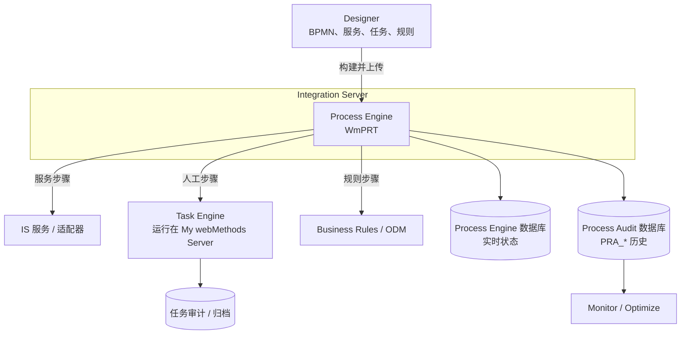

# IBM webMethods BPMS 学院

[English](README.md) | **中文**

<p>
  <a href="https://xudaniel.github.io/webmethods-bpms-academy/"></a>
  <a href="https://github.com/Xudaniel/webmethods-bpms-academy/releases/tag/v2.3.0"></a>
  
  <a href="https://github.com/Xudaniel"></a>
</p>

**按你真正会用到的方式学 IBM webMethods BPMS。** 免费、手机优先：选好角色就有一条 3–5 步的路线，先用一张图看懂整个产品，再动手学。每条事实都有公开文档出处。

### [▶ 打开课程（中文版）](https://xudaniel.github.io/webmethods-bpms-academy/?lang=zh)

[阅读版](https://xudaniel.github.io/webmethods-bpms-academy/read.html) · [English site](https://xudaniel.github.io/webmethods-bpms-academy/) · [v2.3.0 更新日志](CHANGELOG.md) · [PRD（英文）](docs/PRD.md)

<p>
  
  
  
</p>

> **Daniel Yuanpeng Xu 的独立学习资源。** 不是 IBM 官方网站，未获 IBM 或 Software AG 背书。只用公开资料（出处见下文）；「作者观点」是个人看法，Agent 扫描实验室只用模拟数据。

**跳到：** [开始](#五分钟上手) · [适合谁](#适合谁) · [手机](#-在手机上) · [课程详情](#课程详情) · [参与开发](#参与开发) · [作者](#关于作者) · [出处](#资料来源)

## 五分钟上手

- 👋 **选你的角色**，拿到 3–5 步路线 → [从这里开始](https://xudaniel.github.io/webmethods-bpms-academy/?lang=zh#start)
- ⚡ **什么都不会？** 先上 10 分钟速成 → [10 分钟速成](https://xudaniel.github.io/webmethods-bpms-academy/?lang=zh#crash)
- 🧱 **学基础**：7 节 2 分钟小课 → [基础 101](https://xudaniel.github.io/webmethods-bpms-academy/?lang=zh#basics)
- 🧪 **动手学**：贷款流程模拟器和 30 分钟实验 → [动手实验](https://xudaniel.github.io/webmethods-bpms-academy/?lang=zh#lab)
- 🛠️ **排查问题**：16 个可搜索的症状 → [故障排查](https://xudaniel.github.io/webmethods-bpms-academy/?lang=zh#trouble)

<details>
<summary><b>全部功能（19 项）</b></summary>

- 👋 **选你的角色**（新手、客户、业务用户、流程开发、业务分析师、运维、讲师），拿到一条会自动打勾的 3–5 步路线 → [从这里开始](https://xudaniel.github.io/webmethods-bpms-academy/#start)
- 📦 **跟着一个故事学**：Mia 申请一台 1,200 美元的笔记本电脑，这张单子走遍整门课，经理 Sam、业务分析师 Priya、开发 Leo、运维 Omar 依次登场；每个栏目讲下一段故事，并显示单子现在走到哪一步 → [从这里开始](https://xudaniel.github.io/webmethods-bpms-academy/#start)
- ⚡ **什么都不会？先上 10 分钟速成**：5 步、每步 2 分钟（BPMS 是什么、每一步谁来做、IBM webMethods 的几个组件、从画图到运行、为什么对 AI agent 重要），每步一张图，最后 3 道小题 → [10 分钟速成](https://xudaniel.github.io/webmethods-bpms-academy/#crash)
- 🧱 **先学基础**：7 节 2 分钟小课（流程与实例、每一步谁来做、五个 BPMN 图形、规则与流程分开、人工任务、引擎与审计记录、从画图到运行），每节配一张图和一道题 → [基础 101](https://xudaniel.github.io/webmethods-bpms-academy/#basics)
- 🌐 **用中文学**：点页头的 **中文** 按钮（或打开 `?lang=zh`），浏览器语言是中文时会直接打开中文版，你的选择也会被记住。整个网站都已译好：课程全部栏目、示意图、小游戏和测验、阅读版和两份高管简报 → [中文版](https://xudaniel.github.io/webmethods-bpms-academy/?lang=zh)
- 🌱 **每个术语都看得懂**：点任意带下划线的术语（BPMN、IS、MWS、Hot Deploy……），弹出一句大白话解释；打开**新手模式**，只显示最先需要的 10 个栏目 → 全站
- 🗺️ **用一张图看懂整个产品**：从建模到审计记录，点任意一个框就跳到对应教程 → [从这里开始](https://xudaniel.github.io/webmethods-bpms-academy/#start)
- 🎛️ **动手调设置**：切换服务质量设置，看各自换来什么、牺牲什么；或者调 AI agent 的审批额度，看决策日志怎么变 → [知识库](https://xudaniel.github.io/webmethods-bpms-academy/#knowledge) · [从这里开始](https://xudaniel.github.io/webmethods-bpms-academy/#start)
- 🧪 **边做边学**：先在模拟器里跑一遍贷款流程，再用 30 分钟的动手实验做出你的第一个真实流程 → [模拟器](https://xudaniel.github.io/webmethods-bpms-academy/#simulator) · [动手实验](https://xudaniel.github.io/webmethods-bpms-academy/#lab)
- 🔍 **什么都能搜到**：点 ☰ 旁边的 🔍（或按 `/`），搜索知识库、故障排查、术语表、使用指南和速查卡、动手实验、基础 101、合规控制、设计模式、案例和 BPMN，中英文都行。点一下结果就直接跳到那个位置 → 全站
- 📒 **记住答错的题**：全站任何地方答错的题（测验、基础 101、10 分钟速成、身份自测、刷卡分类、值班演练）都会收进复习本，1 天后、3 天后再考；答对两次就移出。「从这里开始」会显示今天要复习几题 → [复习本](https://xudaniel.github.io/webmethods-bpms-academy/#review)
- 🚨 **练习值班**：三个小故障（流程不启动、人工决定被忽略、Monitor 里什么都看不到），时钟一直在走。查对了往下走，查错了要多花时间；每个都以带出处的复盘收尾 → [值班演练](https://xudaniel.github.io/webmethods-bpms-academy/#drills)
- 👆 **刷卡分类：规则、agent 还是人？** 60 秒判断 20 个合成步骤；滑动（或点按钮、用方向键），每个答案都用 Agent 扫描实验室的同一套门槛来解释。有连对、最高分和分享语 → [刷卡分类](https://xudaniel.github.io/webmethods-bpms-academy/#swipe)
- 🧩 **修好坏掉的流程**：五关点选拼图（缺结束事件、网关选错、额度写死在网关里、人工任务没有超时、经理什么都要亲自审）；点 ▶ 运行，看令牌能不能走通，走不通就告诉你原因 → [修图闯关](https://xudaniel.github.io/webmethods-bpms-academy/#puzzles)
- 💼 **给客户做演示**：打开专业模式（或分享带 `?mode=pro` 的链接），隐藏徽章和故事；再打印一页银行或保险的高管简报 → [简报](https://xudaniel.github.io/webmethods-bpms-academy/brief.html)
- 🏦 **给银行和保险客户看合规控制**：七项常见控制（四眼审批、职责分离、决策可追溯、人工监督、变更控制、留存、韧性），对应要求它们的监管框架，以及 IBM webMethods BPMS 能提供的证据；每条法规都链接到监管机构原文 → [合规控制](https://xudaniel.github.io/webmethods-bpms-academy/#controls)
- 🛠️ **解决问题**：搜索 16 个常见症状（「流程不启动」「Hot Deploy 是灰的」），找到原因和解决办法 → [故障排查](https://xudaniel.github.io/webmethods-bpms-academy/#trouble)
- 📱 **随身带着**：存到手机主屏幕，离线也能看，还能打印成 PDF → [在手机上使用](#-在手机上)
- 🎓 **讲课或演示**：10 分钟客户演示脚本和 3 小时工作坊方案 → [讲课](https://xudaniel.github.io/webmethods-bpms-academy/#teach)

</details>

## 适合谁

不需要任何 webMethods 基础。

- **初学者**：从角色「新手」开始。15 分钟入门路线、通俗讲解、术语表和测验。
- **客户与潜在客户**：从角色「客户」或演示脚本开始。大约 20 分钟看清产品的业务价值和深度。
- **业务用户**：从角色「业务用户」开始。接受、完成、转交任务，外加速查卡和自测。
- **流程开发人员**：从角色「流程开发」开始。建模、构建、**启用**、测试，然后做动手实验。
- **业务分析师**：从角色「业务分析师」开始。安全地修改决策表，用 Hot Deploy 上线，不用重建流程。
- **运维人员**：从角色「运维」开始。实例状态，暂停、恢复、重新提交，以及需要的权限。
- **讲师、售前、顾问**：从角色「讲师」开始。工作坊方案、演示脚本、实例和 Agent 扫描实验室。
- **产品经理与架构师**：从架构、知识库开始。看清引擎、规则和审计历史如何配合，以及 agent 该放在哪里。

## 📱 在手机上

这个网站优先为手机设计。建议把它存成手机上的 App，用起来最方便：


**iPhone（Safari）**
1. 用 Safari 打开 <https://xudaniel.github.io/webmethods-bpms-academy/>。如果是在电脑上看到这个页面，用手机相机扫右边的二维码即可。
2. 点**分享**按钮，或者点地址栏旁边的 **⋯** 再选「分享」。
3. 往下滑，点**添加到主屏幕**。如果找不到，滑到列表最底下点**编辑操作**，把它加进来。
4. 保持**作为 Web App 打开**开启，再点**添加**。

**Android（Chrome）**
1. 用 Chrome 打开网站。
2. 点右上角 **⋮** → **添加到主屏幕**。
3. 选择**安装**（或**安装应用**），然后确认。

**在手机上怎么找内容**
- 左上角的 **☰ Sections** 列出全部栏目，按「开始 / 动手 / 学习 / 讲课」分组；也可以左右滑动顶部的标签栏。
- ☰ 旁边的 **🔍 搜索**（或按 `/`）：在你的设备上搜索所有栏目；也可以用 ↑ ↓ 和回车。
- 每个栏目最后都有**上一页 / 下一页**；右下角圆形的 **↑** 按钮回到顶部。阅读版还有 **Contents** 按钮，可以跳回目录。
- **离线：** 第一次打开之后，存到主屏幕的 App 没有网络也能用。实验进度只保存在你自己的手机上。
- **调大字体：** 用浏览器的字号设置或双指放大，页面会自动重新排版，360 像素宽的屏幕上也不需要左右滑动。
- **只想阅读或存成 PDF：** 打开**阅读版**，用浏览器的「分享」或「打印」功能保存。

## 课程详情

<details>
<summary><b>网站里有什么</b></summary>

### 开始：你的路线和全局图
- **Mia 的申请单**：一个贯穿整门课的虚构故事。Mia 需要一台 1,200 美元的笔记本电脑。「认识角色」卡片介绍她、经理 Sam、分析师 Priya、开发 Leo 和运维 Omar。17 个栏目开头各有一张故事卡，讲下一段情节，显示五步进度（提交 → 规则检查 → 经理审批 → 生成订单 → 留档），并附「下一段故事」链接，按 12 段路线走完。阅读版也有同样的故事框。
- **10 分钟速成**，给什么都还不会的人：5 步一次只看一步，有「上一步 / 下一步」和进度条；每步一张图和一句「记住」，最后 3 道自测题，完成卡片会指向基础 101、修图游戏或动手实验。「新手」路线的第一步就是它。
- **基础 101**，给完全零基础的人：7 节小课讲清每个流程平台背后的概念。每节有一个通俗小故事、三个要点、一张图、一道自测题和「深入了解」链接；最后一节把每个概念对应到 IBM webMethods 的产品名。进度保存在你的浏览器里。
- **你是谁？** 7 个角色，每个角色一条 3–5 步路线。每步写明目的和阅读时间，点一下直达对应的教程、知识主题或故障排查分类，看过自动打勾。路线经过的每个栏目，最后都有「你的路线：下一步 →」。
- **一张图看懂 IBM webMethods BPMS：** 带编号、可点击的总图，从「建模 → 构建上传 → **启用**」（新手最容易漏的一步）「→ Process Engine → 人处理任务 / 规则做判断 → 监控与修复 → 审计历史」，并标出 AI agent 在哪里参与。
- **六个动手小步骤**，面向大众：有无 BPMS 的对比、每项工作该由谁负责、用规则手册管住 AI agent（见下方「从这里开始：面向大众的互动讲解」）。

### 学：附出处的知识库和示意图
共 **12 个主题、81 条事实**，每条都链接到 IBM 或 Software AG 的公开文档，每个主题后附一段实践建议：

- **版本与生命周期**：10.15（2022 年 10 月正式发布；2027 年 10 月 31 日结束支持，可付费延长支持到 2028 年 10 月和 2030 年 10 月；最后一个支持 AIX 和 z/Linux 的版本）、11.1（2024 年 9 月）、12.1（Java 21、Jakarta EE 10、FIPS 140-3、容器化）
- **Process Engine 运行与服务质量（QoS）**：转移文档；速度与可靠性的取舍；**Optimize Locally**（默认开）、**Volatile Transition Documents**（默认开）、**Volatile Tracking**（默认关）；Universal Messaging 作为 JMS 提供方；Broker 已弃用
- **执行历史与审计**：Process Engine 数据库与 Process Audit 数据库（`PRA_*` 表）、日志级别、10.15 中人工任务历史存在哪里
- **Task Engine 与人工工作**：My webMethods Server 上的任务收件箱、`getTaskAudit`、任务归档
- **webMethods Business Rules**：规则项目、规则集、决策表、决策树、事件规则；Data/Service/Process 动作；部署到 Integration Server 和 My webMethods Server
- **规则引擎配置与 Rule Task**：规则引擎在哪里运行（WmBusinessRules），以及如何指向远程 Integration Server（`businessrulesruntime` 别名）；如何配置 Rule Task、Process Aware 决策表、规则动作与日志级别、事件规则与 JMS 触发器、热部署及其服务器连接
- **把 webMethods Business Rules 迁到 IBM ODM**：规则项目、决策表和处理模式怎么对应到 ODM 的 BOM、ruleset、规则任务和退出条件；怎样把表以 JSON 取出、用 Excel 导入 ODM；流程怎样通过 OpenAPI 调用 ODM；切换前怎样两边并行对比
- **Monitor、重新提交与 Optimize**：Monitor 在哪里、如何重新提交失败或已完成的实例（Resubmit Closest / Earliest、修改 pipeline）、需要哪些权限、Optimize 的 KPI 与流程分析
- **从 10.15 升级**：新旧版本并行安装：Database Component Configurator、迁移工具或 Command Central、保留进行中的实例、模型升版本号、升级后检查；12.1 升级前分析工具覆盖和不覆盖什么；升级后的许可证密钥与计量
- **IBM Integration（原 webMethods Hybrid Integration，IWHI）**：它是什么（2025 年 5 月发布，2026 年改名 IBM Integration）、混合控制平面管理哪些运行时、怎么卖、六组能力（其中没有 BPM）、REST API 变成 MCP 工具，以及为什么 BPMS 继续留在 webMethods 环境里而不是迁走
- **IBM 各流程产品里的 agent 与人工任务**：watsonx Orchestrate 流程里的人工任务、Business Automation Workflow 26.0 通过 MCP 开放流程/案例/任务、Cloud Pak for Business Automation 的 MCP 服务器、webMethods Integration 的 MCP 工具，以及 BPM 12.1 的 Task Engine API 目前能做什么
- **实践设计清单**：设计评审和升级时用的十项检查

**面向受监管行业的控制**：七项控制，每项写明监管期望、BPMS 与规则如何实现（附产品文档出处），以及审计时能看到的证据。法规说明涵盖 SR 11-7、OSFI E-23（2027 年 5 月 1 日生效）、欧盟 AI 法案附件三及第 12、14 条、GDPR 第 22 条、NAIC 的 AI 示范公告和 DORA（2025 年 1 月 17 日起适用），全部引用监管机构原文。仅为教育性对照，不构成法律或合规建议。

**专业模式与高管简报**：页头的 💼 开关（或 `?mode=pro` 链接）切换到适合客户会议的简洁呈现：隐藏徽章、进度、彩纸动画、「你知道吗」和 Mia 的故事，保留图、出处和事实。[`brief.html`](https://xudaniel.github.io/webmethods-bpms-academy/brief.html) 为银行和保险各生成一页 A4 简报：问题、流程加规则能帮什么、关键控制、时间节点和编号出处。每个知识主题都标注了最近一次对照出处复核的日期。

**示意图**都是原创 SVG，不使用 IBM 素材，课程和阅读版各 26 张，包括：各组件在哪里运行（架构图）、流程生命周期循环、BPMN 网关与泳道、「agent 提议、规则决定、流程执行」、每个实例的流程图、模拟器的贷款流程、决策表的结构、Agent 扫描实验室的分类方法、基础 101 的四张图（模型与实例、每一步谁来做、五个 BPMN 图形、引擎与审计记录）；**服务质量互动图**、流程与规则的分工、Hot Deploy 路径、任务生命周期、构建流程、实例状态、带**令牌动画**的实验流程图、「流程不启动」排查流程图，以及工作坊时间轴。此外还有架构、BPMN、设计模式、实例、市场，以及 33 个术语和 22 道测验题。

### 做：分步教程、动手实验和故障排查
**修图闯关**：五关，每关有一处毛病。点一下把零件放进虚线框，按 ▶ 运行，令牌会沿着流程走；放错了会说明原因，并链接到讲这个知识点的小课。进度保存在你的浏览器里，五关全过得「流程修理工」🧩 徽章。

**刷卡分类**：为手机设计的卡片游戏。每张卡片是一个合成的步骤，带四个数字（同一结果占多少、相同输入得到相同结果的比例、处理分钟数、等待小时数）。往左滑交给规则，往右滑交给 agent，往上滑留给人。答案直接来自 Agent 扫描实验室的分类规则，所以游戏和实验室的结论永远一致。

**值班演练**：三个通过 Mia 的故事讲述的分支故障。每个决定给两到三个检查选项；选对了往下走，选错了要多花模拟时间并告诉你原因，你思考的时候时钟也在走。复盘会把你用的时间和理想路径比较，并给每一步附上文档出处。三个都走理想路径，可以得到「值班英雄」🚨 徽章。

**决策实验室**：调整决策表的阈值，测试一笔申请（通过、转人工或拒绝）；对比「改规则」和「改流程」各要多久；并列出常见的规则配置陷阱。

**如何使用**按角色划分。每一步写明菜单路径并附官方出处，最后告诉你「怎么确认做成了」。每个角色还配有可打印的**速查卡**和 3 道**自测题**：

- **业务用户**\
  教程：在 My webMethods 里处理任务\
  关键步骤：打开 My Inbox → 找到任务 → Accept（接受）→ Submit / Complete（提交/完成）→ 需要时 Delegate（转交）
- **流程开发人员**\
  教程：建模、构建并启用流程\
  关键步骤：切到 Process Developer 模式 → 画 BPMN、为每步选实现方式（服务、人工任务、规则任务）→ 设置日志与 QoS → Build and upload → **启用执行（Execution Enabled）** → 在 Monitor 里测试
- **业务分析师**\
  教程：安全地修改业务规则\
  关键步骤：My webMethods Server 仓库中的规则项目 → 打开并锁定 → 修改决策表 → 校验 → **Hot Deploy（热部署）**，无需重建流程
- **运维人员**\
  教程：监控、修复与重新提交\
  关键步骤：Process Instances → 停止/暂停/恢复 → **Resubmit（重新提交）**，必要时先修改 pipeline 数据 → Task List Management → 权限

**动手实验：30 分钟做出第一个流程。** 做一个采购审批流程，带进度记录、常见问题表、给没有环境的学员的练习路线，还可以打印成练习单：

- **1. 建项目和流程**（3 分钟）：流程在空白画布中打开
- **2. 用文档启动流程**（4 分钟）：开始事件显示接收文档
- **3. 加审批任务**（6 分钟）：步骤显示人工任务图标
- **4. 按决定分流**（4 分钟）：每条路径都到达结束事件
- **5. 构建、上传并启用**（5 分钟）：构建无错误；已勾选 Execution Enabled
- **6. 启动一个实例**（3 分钟）：审批人的收件箱出现任务
- **7. 以审批人身份处理任务**（3 分钟）：任务状态为 Completed
- **8. 在 Monitor 中跟踪实例**（2 分钟）：实例经 Approved 路径完成

**故障排查：** 16 个可搜索的问题，分为四类：启动与部署、任务、规则、监控与运维。每个问题都写明先检查什么、怎么解决、在哪里操作，并附出处。

### 讲课与演示
- **客户演示脚本**（10 分钟，作者观点）：共六个环节，每个环节写明点哪里、说什么、回答客户的哪个问题。
- **讲课方案**（作者观点）：3 小时工作坊议程，每个环节链接到网站对应栏目，并附打印清单和讲师提示。

### 给新手的大白话
- **🌐 中文 / English**（页头开关，会记在你的设备上；也可以用 `?lang=zh` / `?lang=en`）：和英文版一样详细的简体中文版。产品和界面名称保留英文，方便你对照真实产品和 IBM 文档。分批翻译（[#68](https://github.com/Xudaniel/webmethods-bpms-academy/issues/68)）：互动课程全部栏目已完成，包括术语表（33 个）、测验（24 题）、受监管行业的合规控制、决策实验室、修图闯关和所有示意图，还有阅读版（全部 23 章）和两份高管简报。浏览器首选语言是中文时，在你选择语言之前都会打开中文版。
- **点任意带下划线的术语**（课程和阅读版都有），弹出一句大白话解释、技术定义和术语表链接；手机上从屏幕底部弹出。测验题不加下划线，照样考得到你。
- **🌱 新手模式**（页头开关，记在你的设备上）：标签栏和 ☰ 菜单只显示 12 个新手栏目；每个栏目开头有一段「In plain words」通俗说明；进阶栏目会提示可以先跳过，「上一节 / 下一节」也会自动跳过它们。

### 学得下去
- **⏱ 阅读时间：** 每个栏目、「☰ Sections」菜单和阅读版的每一章都标注阅读时间。整门课大约 40 分钟读完。
- **学习进度和徽章：** 显示已浏览的栏目数（共 25 个）；11 枚徽章解锁时有小小的庆祝动画；还有「你知道吗？」小知识。这些都只保存在你的浏览器里。

</details>

<details>
<summary><b>课程安排：25 个栏目，按网站顺序</b></summary>

- **1. **从这里开始**（Start here）** · 角色选择、总图、六个动手步骤\
  找到你的路线，看懂全局，理解流程平台为什么对 AI agent 很重要
- **2. **10 分钟速成**（10-minute course）** · 5 步、5 张图、3 道题\
  完全零基础，10 分钟看懂 IBM webMethods BPMS
- **3. **基础 101**（Basics 101）** · 7 节小课，每节配图和一道题\
  零基础讲清每个流程平台背后的概念，再对应到 IBM webMethods 的名字
- **4. **概览**（Overview）** · 阅读 + 产品家族表\
  核心理念，以及 IBM webMethods 一览（9 个组件）
- **5. **知识库**（Knowledge base）** · 附出处的参考 + 互动图\
  12 个主题、81 条事实，讲清产品实际怎么运作
- **6. **合规控制**（Controls）** · 控制对照表 + 法规说明\
  面向银行和保险：七项控制、对应的监管框架（SR 11-7、OSFI E-23、欧盟 AI 法案、GDPR 第 22 条、NAIC、DORA）以及 BPMS 能提供的证据
- **7. **如何使用**（How to use）** · 角色教程、速查卡、自测、演示脚本\
  四类角色的日常操作，以及如何给客户演示
- **8. **动手实验**（Hands-on lab）** · 30 分钟练习，带进度记录\
  构建、启用、运行并监控你的第一个流程
- **9. **决策实验室**（Decision lab）** · 互动决策表 + 对比\
  改规则阈值、测试一笔申请，看规则为什么比流程改得快
- **10. **修图闯关**（Fix the diagram）** · 五关拼图 + 令牌动画\
  修好坏掉的流程：结束事件、网关选择、规则任务、超时提醒、只把例外交给人
- **11. **刷卡分类**（Swipe sort）** · 20 张卡片，60 秒\
  规则、agent 还是留给人？一张张卡片判断 agent 时代的分工
- **12. **故障排查**（Troubleshooting）** · 搜索 + 流程图\
  症状 → 先检查什么 → 怎么解决 → 在哪里操作
- **13. **值班演练**（On-call drills）** · 三个带时钟的分支故障\
  在一点压力下练习先查什么，再看带出处的复盘
- **14. **讲课**（Teach a class）** · 工作坊方案 + 时间轴\
  给用户或客户上的 3 小时课
- **15. **生命周期**（Lifecycle）** · 可点击的阶段 + 版本表\
  建模 → 实现 → 构建上传 → 执行 → 监控 → 优化 → 治理；各版本的支持日期
- **16. **架构**（Architecture）** · 可点击的组件图\
  引擎、数据库和 `PRA_*` 审计表
- **17. BPMN** · 参考表\
  活动、网关、事件、池和泳道
- **18. **设计模式**（Patterns）** · 可筛选卡片\
  四个经典模式和三个 agent 时代的模式
- **19. **实例**（Cases）** · 流程图\
  采购审批、贷款决策、物流异常
- **20. **模拟器**（Simulator）** · 互动\
  让一个贷款实例经过规则任务和核保人任务，并查看审计日志
- **21. Agent 扫描实验室** · 互动\
  从流程历史里找出适合写成规则或交给 agent 的步骤（模拟数据或你的 CSV）
- **22. **市场**（Market）** · 阅读 + 出处\
  市场规模、分析机构观点、竞争信号、监管日期
- **23. **术语表**（Glossary）** · 可搜索\
  33 个术语；全站带下划线的术语都能点开看大白话解释
- **24. **测验**（Quiz）** · 24 道题\
  即时反馈并计分
- **25. **复习本**（Review book）** · 间隔复习\
  答错的题 1 天后、3 天后再考（又错了就 7 天后再考一次），直到记住

每个栏目都有自己的链接（例如 [`#lab`](https://xudaniel.github.io/webmethods-bpms-academy/#lab)），底部还有「上一页 / 下一页」。

</details>

<details>
<summary><b>阅读版</b></summary>

[`read.html`](https://xudaniel.github.io/webmethods-bpms-academy/read.html) 适合想从头读到尾的读者，手机、离线、纸面都能读。共 **23 章**，附目录和每章阅读时间、按角色的「我该读哪几章？」对照表、**26 张示意图**，以及全部教程、速查卡和故障排查，还有带勾选框的实验练习单和附答案的测验。可以直接打印。阅读版和互动版的文字来自同一组文件，两边不会出现不一致。

</details>

<details>
<summary><b>学完能做到什么</b></summary>

1. 说出 BPMS 方案中 IBM webMethods 的主要组件，并解释各自的作用。
2. 区分 **Process Engine 数据库**（实时状态）和 **Process Audit 数据库**（历史记录），并知道人工任务的历史存在哪里。
3. 读懂并设计包含任务、网关、事件和泳道的 BPMN 模型。
4. 为 Process Engine 选择服务质量设置（Optimize Locally、Volatile Transition Documents、Volatile Tracking），并说明各自牺牲了什么。
5. 用 webMethods Business Rules 建模决策：规则项目、规则集、决策表、决策树和事件规则。
6. 判断一段逻辑应该放在流程里、规则任务或决策服务里，还是交给人。
7. 运用三个 agent 时代的模式：*agent 提建议、规则做判断、流程来执行*；*人工审批入口*；*决策日志*。
8. 用执行历史打分，找出适合写成 ODM 规则或交给 agent 的步骤，并说明这种分析的局限。
9. 解释为什么升级期限和监管（欧盟 AI 法案）会影响这个市场的采购决定。

</details>

<details>
<summary><b>核心概念一览</b></summary>



**执行历史存在哪里**

- **Process Engine 数据库**\
  用途：引擎私有的实时实例状态\
  典型用法：只供引擎使用，不用于报表
- **Process Audit 数据库**\
  用途：公开的历史：流程和步骤状态、流转、记录的字段、错误\
  典型用法：Monitor、报表、流程分析
- **Task Engine 审计 / 归档**\
  用途：每个任务的操作、分派和结果\
  典型用法：人工任务分析

Process Audit 的关键表（9.6 及以后使用 `PRA_` 前缀）：

- `PRA_PROCESS`：每个流程状态一行（需开启流程状态记录）
- `PRA_PROCESS_STEP`：每个步骤状态一行（需开启步骤记录）
- `PRA_PROCESS_STEP_LOOP`：带流程、步骤和循环迭代次数的步骤状态
- `PRA_STEP_TRANSITION`：每次流转的起止步骤（需开启流转记录）
- `PRA_STEP_LOGGED_FIELD(S)`：标记为需记录的字段的运行时取值
- `PRA_ERROR`：每个失败步骤一行

> 在 10.15 中，把任务状态写入 Process Audit 表的功能**默认关闭**。人工任务的明细通常要从 Task Engine 审计（`getTaskAudit`）或任务归档中获取。

</details>

<details>
<summary><b>互动工具：模拟器和 Agent 扫描实验室</b></summary>

### 贷款流程模拟器

五步贷款流程：*收到申请 → 获取征信数据 → 规则：资格判断 → 核保人员复核 → 发送结果*。

- **信用分 < 580**：拒绝
- **信用分 ≥ 720 且 贷款/收入 ≤ 35%**：批准
- **其他情况**：转核保人员（人工任务）

日志面板会打印与 `PRA_PROCESS`、`PRA_PROCESS_STEP`、`PRA_STEP_LOGGED_FIELD` 形式相同的记录，帮助学习者把运行中的实例和它留下的历史对应起来。

**⏪ 实例时光机**：实例跑完后，日志下面会出现一个播放器。拖动滑块（或用 ⏮ ◀ ▶ ▶▶ 和方向键），令牌就在贷款流程图上移动，对应的审计记录行会亮起来。勾选「如果打开了 Volatile Tracking 会怎样？」，就能看到这些记录一行都不会留下，并链接到有出处的服务质量主题。

### Agent 扫描实验室

长期运行的 BPMS 系统积累了多年证据：哪些审批几乎全部通过、哪些步骤一等就是几天、哪些决定对同样的输入总是一样。实验室把这些历史变成一份排好序的机会清单。全部计算都在浏览器里完成，文件不会被上传。

**每个步骤的指标**

- **每月处理量**：该步骤完成的实例数
- **工作分钟 / 等待小时**：人工投入和排队时间
- **最常见结果占比**：最常见结果（如「批准」）所占比例
- **确定性**：同组输入下某一结果占比 ≥ 95% 的实例比例
- **返工率、出错率**：循环和失败的比例

**分类规则**

- **规则候选（ODM）**\
  规则：人工任务，确定性 ≥ 80%\
  解读：这个决定其实已经有规则，只是没人写下来
- **Agent 候选（盖章式）**\
  规则：某一结果 ≥ 90% 且工作 ≤ 15 分钟\
  解读：agent 准备，规则或人确认
- **Agent 候选（分拣 + 人工批准）**\
  规则：等待 ≥ 24 小时且某一结果 ≥ 70%\
  解读：agent 分拣材料，人来批准
- **修复集成**\
  规则：服务步骤，出错率 ≥ 5%\
  解读：先修好集成，再谈 AI
- **保留给人**\
  规则：其他情况\
  解读：结果差异大或风险高

预计节省工时 = 每月人工工时 × 假设的可自动化比例（规则 80%、盖章式 60%、分拣 40%）。**这些门槛和比例都是占位假设**，需要用真实数据校准。

**CSV 输入**：每个已完成的步骤实例一行。

- `process`\
  类型：文本\
  示例：`Customs hold`\
  常见来源：`PRA_PROCESS` / 模型元数据
- `step`\
  类型：文本\
  示例：`Release approval`\
  常见来源：`PRA_PROCESS_STEP`
- `step_type`\
  类型：`user_task` \| `service` \| `gateway`\
  示例：`user_task`\
  常见来源：模型元数据
- `instance_id`\
  类型：文本\
  示例：`42`\
  常见来源：`PRA_PROCESS_STEP`
- `start_ts`、`end_ts`\
  类型：ISO 时间戳\
  示例：`2026-05-01T09:00:00`\
  常见来源：`PRA_PROCESS_STEP`
- `wait_min`、`work_min`\
  类型：数字\
  示例：`30`、`6`\
  常见来源：Task Engine 审计
- `outcome`\
  类型：文本\
  示例：`approve`\
  常见来源：记录的字段或任务数据
- `input_key`\
  类型：文本（哈希）\
  示例：`k17`\
  常见来源：决定性业务字段的哈希值
- `loop_count`\
  类型：整数\
  示例：`0`\
  常见来源：`PRA_PROCESS_STEP_LOOP`
- `error`\
  类型：0/1\
  示例：`0`\
  常见来源：`PRA_ERROR`

只使用匿名化导出的数据，不要包含个人信息或原始业务内容。

**局限。** 结果取决于当初记录并保留了哪些数据：历史被清理或归档、日志级别过低、缺少结果字段，都会让扫描看到的东西变少。模拟数据是按这些模式专门生成的，所以只能演示方法，不代表真实情况。

[`tools/`](tools/) 里有逻辑相同的 Python 版本：

```bash
cd tools
# 生成 synthetic_audit.csv
python3 make_synthetic.py
python3 agent_scan.py synthetic_audit.csv
```

</details>

<details>
<summary><b>从这里开始：面向大众的互动讲解</b></summary>

在角色选择和总图下面，有六个可以动手的小步骤，为没有 BPMS 背景的读者讲清楚「为什么」：

- **1. 同一个请求，两种结局**\
  互动方式：切换「没有 BPMS / 有 BPMS」\
  想说明的道理：路由、规则、计时和审计，取代了「靠人记得」
- **2. 每项工作该归谁？**\
  互动方式：8 项工作的分类小游戏\
  想说明的道理：流程负责编排，规则负责判断，人负责例外，agent 负责提建议
- **3. Agent 需要一本规则手册**\
  互动方式：调整自动批准上限、最短延误时长，切换大客户选项\
  想说明的道理：agent 提出赔付建议；规则给出批准 / 转人工 / 拒绝；每个决定都带规则版本记入日志
- **4. 驱动这个市场的时钟**\
  互动方式：可点击的时间线（2022–2028）\
  想说明的道理：升级期限和监管决定了企业何时重新评估平台
- **5. 市场真正在哪里**\
  互动方式：点击逐层展开\
  想说明的道理：分析机构的品类口径，与成熟本地部署 BPMS 实际竞争的地方之间的差别
- **6. Agent 时代的五个想法**\
  互动方式：可展开的卡片\
  想说明的道理：挖掘流程历史、人工审批入口、决策「黑匣子」、在现有客户群里做方案、把维护费变成 AI 额度

第 3、5、6 步标注为「作者观点」。

</details>

<details>
<summary><b>Agent 时代的设计模式</b></summary>

- **agent 提建议、规则做判断、流程来执行**\
  问题：agent 擅长读材料，但受监管的决定必须可解释、可重复\
  解法：agent 提取事实并提出建议；决策服务返回批准 / 拒绝 / 转人工；流程执行或升级给人；每一步都有记录
- **给 agent 的人工审批入口**\
  问题：来自多个平台的 agent 有些操作需要人批准，并且要有时限和审计\
  解法：把「需要人工」的步骤送进 BPMS 人工任务，直接复用分派、委派、升级和审计功能
- **决策日志（「黑匣子」）**\
  问题：出了问题后，必须说明是哪个规则版本、什么输入、谁批准导致了这个结果\
  解法：对每个与 agent 有关的决定，记录输入、规则版本、结果和批准人，与流程审计记录放在一起

</details>

<details>
<summary><b>市场背景</b></summary>

整理自 2026 年的公开资料，详见网站的 Market 页。

- **规模口径不一致。** 各家对 2025 年「BPM 市场」的估算在约 **167 亿到 265 亿美元**之间，取决于机构和统计范围。可以看方向，不适合拿来估算某条产品线的规模。
- **品类正在转向编排。** Gartner 2026 年的「业务编排与自动化技术」（BOAT）魔力象限评估了 20 家厂商，要求平台原生支持 AI agent 的编排与治理。Gartner 预计到 2030 年，70% 的企业会转向统一的编排平台，而现在只有 10%。
- **增长来自受监管、需要人工监督的工作。** Camunda 2026 年 8 月称年度经常性收入接近 2 亿美元，增长由保险、公共部门和银行带动；Appian 约 80% 的年度经常性收入来自金融服务、生命科学和公共部门。
- **期限推动决策。**

- **2022 年 10 月 18 日**：webMethods 10.15 正式发布
- **2027 年 10 月 31 日**：webMethods 10.15 结束支持（也是最后一个支持 AIX 和 z/Linux 的版本）
- **2027 年 12 月 2 日**：欧盟 AI 法案对附件 III 高风险系统（如信用评分）的义务开始适用
- **2028 年 10 月 31 日**：webMethods 10.15 第一阶段延长支持结束（后续延长支持只含使用咨询和已知缺陷，到 2030 年 10 月 31 日）

</details>

## 参与开发

<details>
<summary><b>快速开始</b></summary>

**本地查看**

```bash
git clone https://github.com/Xudaniel/webmethods-bpms-academy.git
cd webmethods-bpms-academy
python3 -m http.server 8000
# 打开 http://localhost:8000
```

大多数浏览器也可以直接打开 `index.html`；用本地服务器可以避免加载 CSV 时的文件路径限制。

**通过 GitHub Pages 发布**

1. 进入仓库 **Settings → Pages**。
2. **Source** 选 Deploy from a branch → `main` / `(root)`。
3. 网站地址为 <https://xudaniel.github.io/webmethods-bpms-academy/>。

**浏览器支持：** 最新版 Chrome、Edge、Firefox、Safari，桌面和手机均可。不加载任何外部库或字体。

</details>

<details>
<summary><b>项目结构</b></summary>

根目录：`webmethods-bpms-academy/`

- `index.html` — 互动版
- `read.html` — 阅读版：一页读完，附图和带答案的测验
- `brief.html` — 银行与保险的一页式高管简报（可打印成 PDF）
- `README.md` — 英文说明
- `README.zh-CN.md` — 中文说明（本文件）
- `CHANGELOG.md` — 版本更新日志
- `manifest.webmanifest` — 存成 App（名称、图标、主题色）
- `sw.js` — 离线支持（优先联网，断网时用缓存）
- `assets/` — App 图标、二维码、示意图（SVG）、README 截图
- `docs/`
  - `PRD.md` — 产品需求文档（英文）
  - `USER-TESTING.md` — 15 分钟用户测试脚本
- `css/`
  - `styles.css` — 布局、组件、手机适配
  - `read.css` — 阅读版：图示和打印样式
- `js/`
  - `content.js` — 课程内容和资料来源
  - `knowledge.js` — IBM webMethods 知识库：产品家族、附出处的主题、补充术语和测验
  - `howto.js` — 如何使用：角色教程、入门路线、客户演示脚本
  - `lab.js` — 动手实验：30 分钟做出第一个流程
  - `support.js` — 故障排查、角色速查卡与自测、讲课方案
  - `diagrams.js` — 原创 SVG 示意图（服务质量互动图、角色图、实验 BPMN、排查流程图、时间轴）
  - `path.js` — 角色选择与个人路线、可点击的全流程总图
  - `i18n.js` — 中文 / English 切换（?lang=zh），最先加载
  - `zh/` — 中文文本，按区域分文件： core.js、beginner.js、guides.js、 explore.js、labs.js、read.js
  - `swipe.js` — 刷卡分类：规则、agent 还是人？（#53）
  - `timemachine.js` — 模拟器下的实例时光机（#51）
  - `drills.js` — 带时钟和出处复盘的值班演练（#50）
  - `review.js` — 复习本：答错的题按时回来（#76）
  - `search.js` — 全站搜索，在浏览器里完成，中英文（#77）
  - `words.js` — 点术语看大白话解释、新手模式
  - `basics.js` — 基础 101：七节基础课和自测
  - `crash.js` — 10 分钟速成：五步和三道自测
  - `decision-lab.js` — 决策实验室：决策表、改规则与改流程对比、规则配置陷阱
  - `controls.js` — 面向受监管行业的控制：控制项、监管框架、证据
  - `pro.js` — 专业模式（页头开关或 ?mode=pro）
  - `brief.js` — 根据控制对照表生成高管简报
  - `fun.js` — 阅读时间、学习进度、徽章、「你知道吗」
  - `mobile.js` — 手机指南、栏目菜单、上一页/下一页、回到顶部、离线支持
  - `explainer.js` — 「从这里开始」的内容（作者观点已标注）
  - `explainer-app.js` — 「从这里开始」的互动逻辑
  - `app.js` — 导航、模拟器、扫描实验室、术语搜索、测验
  - `read.js` — 用同一份内容生成阅读版
- `tools/`
  - `build_diagrams.js` — 由 js/diagrams.js 生成 assets/diagrams/*.svg
  - `agent_scan.py` — 扫描方法的 Python 版本
  - `make_synthetic.py`
- `tests/`
  - `smoke_test.py` — 用无头浏览器检查每个栏目

</details>

<details>
<summary><b>如何修改内容</b></summary>

课程文字集中在 `js/content.js` 的 `window.ACADEMY` 对象里，「从这里开始」的文字在 `js/explainer.js` 的 `window.EXPLAINER` 里。改内容通常不需要动布局或逻辑。

- `architecture`\
  结构：`{ id, name, role, text, tip }[]`\
  显示位置：架构组件
- `auditTables`\
  结构：`[表名, 说明][]`\
  显示位置：架构 → Process Audit 表
- `lifecycle`\
  结构：`[阶段, 说明][]`\
  显示位置：生命周期
- `lifecycleDates`\
  结构：`[事件, 日期][]`\
  显示位置：生命周期 → 版本日期表
- `bpmn`\
  结构：`{ group, items: [名称, 说明][] }[]`\
  显示位置：BPMN
- `patterns`\
  结构：`{ name, tag, problem, solution, when }[]`\
  显示位置：设计模式
- `cases`\
  结构：`{ name, flow: string[], lesson }[]`\
  显示位置：实例
- `glossary`\
  结构：`[术语, 定义][]`\
  显示位置：术语表
- `market`\
  结构：`{ sizing, signals, takeaways }`\
  显示位置：市场
- `quiz`\
  结构：`{ q, a: string[], c: 正确选项序号, e: 解析 }[]`\
  显示位置：测验
- `sources`\
  结构：`[标题, 链接][]`\
  显示位置：市场 → 资料来源

知识库在 `js/knowledge.js` 的 `window.KNOWLEDGE` 里：`family`（`[组件, 作用][]`）、`topics`（`{ id, title, summary, facts[], practice, sources: 编号[] }[]`）、`glossary`、`quiz` 和带编号的 `sources`。其中的术语、测验题和来源会自动并入主课程。

内容规则：每个事实都要附公开出处；日期一律写绝对日期（如「2027 年 10 月」，不写「明年」）；不得加入客户名称、收入数字或任何非公开资料。

</details>

<details>
<summary><b>测试</b></summary>

```bash
pip install playwright
playwright install chromium
python3 tests/smoke_test.py
```

GitHub Actions 会在每个 pull request 上自动运行同一个测试（`.github/workflows/smoke-test.yml`），每次推送到 `main` 也会运行。为 `main` 开启分支保护（要求 `smoke` 检查通过）后，测试失败的改动就无法合并。测试会在本地启动网站，以手机宽度（390 × 844）打开每个栏目，检查标题以 IBM webMethods 开头、知识计数器、产品家族表和附出处的知识主题、入门路线、每个角色教程、演示脚本，以及动手实验和进度记录、故障排查搜索与筛选、角色自测和讲课议程，操作「从这里开始」的各项互动，把模拟器跑完，并用模拟数据运行扫描实验室；同时检查 `read.html` 有五张图、测验与答案数量一致、各章节都有内容。还会检查手机指南、栏目菜单、每个栏目的上一页/下一页、回到顶部按钮、360 像素宽度下各栏目都没有横向溢出，以及 App 图标和离线脚本是否存在。出现任何 JavaScript 错误即判为失败。

</details>

<details>
<summary><b>设计原则</b></summary>

- **新手优先。** 先选角色、看一张图、动手做一件事，细节放在后面。
- **手机优先。** 单栏布局，有「☰ Sections」菜单和「上一页 / 下一页」；360 像素宽也不用左右滑动，还能存成 App。
- **零依赖。** 纯 HTML、CSS 和 JavaScript，无需安装，也不会因为第三方库升级而失效。
- **隐私优先。** 没有统计分析、账号和 cookie。学习进度、徽章和上传的 CSV 都只留在你的浏览器里。离线脚本只缓存本站自己的文件。
- **事实有出处。** 内容来自公开资料，日期写绝对日期，个人观点标注「作者观点」。
- **数字诚实。** 占位假设和模拟数据在出现的地方都有标注。

</details>

<details>
<summary><b>后续计划</b></summary>

**下一步**
- [ ] **练习沙盒：** 做几个简化的练习界面，并清楚标注「示意，非官方界面」，不需要安装环境就能练习接受任务、勾选 Execution Enabled 和热部署规则
- [ ] **知识库：** 逐个版本说明从 10.15 到 12.1 有哪些变化
- [ ] **模拟器：** 增加计时升级和并行网关场景

**以后**
- [x] 网站界面中文版（#68）
- [x] 从 webMethods Business Rules 迁移到 IBM ODM 决策服务的模块（知识库主题）
- [ ] 扫描实验室：可调整门槛，可导出 CSV

**v2.3.0 已完成：** 全站中文版（#68）；全站搜索；复习本（间隔复习）；值班演练、实例时光机和刷卡分类；知识库扩展到 11 个有出处的主题、72 条事实；优化入门页（三个演示）。

**v2.2.0 已完成：** 给完全零基础的人的「10 分钟速成」：5 步、5 张图、3 道自测题；「新手」路线的第一步。

**v2.1.0 已完成：** 面向受监管行业的合规控制；专业模式；银行与保险的一页高管简报；知识主题标注复核日期。

**v2.0.0 已完成：** 修图闯关（五关拼图）；Mia 的申请单，一个贯穿整门课的故事；新增 11 张示意图；知识库新增 Monitor/Optimize 与「从 10.15 升级」两个主题；规则配置陷阱附上出处；每个 PR 自动跑冒烟测试。

**v1.3.0 已完成：** 基础 101、决策实验室。

**v1.2.0 已完成：** 点术语看大白话解释、新手模式。

**v1.1.0 已完成：** 角色路线、全流程总图、动手实验、故障排查、速查卡与自测、讲课方案、手机 App 与离线使用、阅读时间、14 张示意图、徽章，以及作者署名。详见[更新日志](CHANGELOG.md)。

</details>

<details>
<summary><b>参与贡献</b></summary>

欢迎提交 issue 和 pull request。请保持改动小而聚焦，新增事实需附公开出处，提交前运行 `tests/smoke_test.py`，并且不要包含机密或客户数据。

**找真实用户试一试：**按[15 分钟用户测试](docs/USER-TESTING.md#中文15-分钟用户测试)做一次，用[反馈表](https://github.com/Xudaniel/webmethods-bpms-academy/issues/new?template=feedback.yml)提交结果。

</details>

## 关于作者

**Daniel Yuanpeng Xu** 是 IBM webMethods BPMS 学院的作者和产品负责人，也是业务流程与决策自动化领域的产品经理，常驻多伦多。

产品方向、目标读者和范围都由他确定。公开资料由他挑选并核实，「作者观点」中的分析框架由他撰写，每一次改动和每一个版本也都由他主导和审定。本学院是他的个人独立作品，与 IBM 无隶属关系，也未获 IBM 背书。

- GitHub：[@Xudaniel](https://github.com/Xudaniel)
- LinkedIn：[Daniel Xu](https://www.linkedin.com/in/danielxuvision/)
- 产品需求文档：[docs/PRD.md](docs/PRD.md)

### 如何引用

> Xu, Daniel Yuanpeng (2026). *IBM webMethods BPMS Academy* (Version 2.3.0) [Interactive course]. https://github.com/xudaniel/webmethods-bpms-academy

点 GitHub 页面上的 **Cite this repository** 按钮（来自 [`CITATION.cff`](CITATION.cff)），就能拿到 APA 和 BibTeX 格式的引用。复用或改编本项目内容时，请注明作者 **Daniel Yuanpeng Xu**，并附上本仓库链接。

## 资料来源

<details>
<summary><b>全部出处（产品文档、生命周期、监管、市场）</b></summary>

**产品文档**
- [Process Audit Log 数据库组件表 — Designer 10.15](https://documentation.softwareag.com/webmethods/designer/sdf10-15/webhelp/sdf-webhelp/sdf-webhelp/proc.process.audit.log.database.component.tables.html)
- [Process Engine 与 Process Audit 数据库的区别 — IBM 社区](https://community.ibm.com/community/user/discussion/differences-between-process-engine-db-and-process-audit-log-db)
- [Task Engine `getTaskAudit`](https://documentation.softwareag.com/webmethods/task_engine/wtn10-7/10-7_Task_Engine_webhelp/task-engine-webhelp/te_web_taskaudit.html)
- [10.15 默认关闭任务写入 Process Audit — IBM 文档](https://www.ibm.com/docs/en/SSHZPA_10.15.0/te_users_guide/co-disable_enable_task_logging_in_processes.html)
- [任务归档](https://documentation.softwareag.com/webmethods/compendiums/v10-7/C_Digital_Event_Comm/intsagdes-compendium/co-about-task-archiving.html)

**如何使用（日常操作）**
网站里每一步都链接到对应出处，主要有：
- [About My Inbox (Task Engine)](https://documentation.softwareag.com/webmethods/compendiums/v10-5/C_Run_BPs_and_CAs/runbpca-compendium/co-about_my_inbox.html)
- [Accepting a task](https://documentation.softwareag.com/webmethods/compendiums/v10-3/C_Run_BPs_and_CAs/runbpca-compendium/co-accepting_a_task.html)
- [Enabling and disabling process model versions (Monitor)](https://documentation.softwareag.com/webmethods/monitor/wmn10-3/10-3_Monitor_webhelp/monitor-webhelp/to-process_models_24.html)
- [Build and upload preferences (Designer 10.5)](https://documentation.softwareag.com/webmethods/designer/sdf10-5/10-5_sdf-webhelp/sdf-webhelp/proc.configuring.build.and.upload.preferences.html)
- [Hot deploying a rule project](https://documentation.softwareag.com/webmethods/compendiums/v10-4/C_Digital_Event_Comm/intsagdes-compendium/ta-hot_deploy_decent.html)
- [About resubmitting process instances and steps (Monitor 10.7)](https://documentation.softwareag.com/webmethods/monitor/wmn10-7/10-7_Monitor_webhelp/wmn-webhelp/to-processes_25.html)
- [Stopping, suspending or resuming a process instance (Monitor 10.7)](https://documentation.softwareag.com/webmethods/monitor/wmn10-7/10-7_Monitor_webhelp/wmn-webhelp/to-processes_23.html)

**Process Engine、Business Rules 与版本**
- [Process Engine 性能与服务质量调优](https://documentation.softwareag.com/webmethods/compendiums/v10-3/C_Run_BPs_and_CAs/runbpca-compendium/to-concepts_2.html)
- [服务质量设置](https://documentation.softwareag.com/webmethods/wmsuites/wmsuite10-1/C_Run_BPs_and_CAs/runbpca-compendium/to-tuning_3.html)
- [配置 Process Engine 设置 — IBM 11.1 文档](https://www.ibm.com/docs/en/SSLMF12_11.1/ta-configuring_monitoring_configuring_settings.html)
- [关于 webMethods Business Rules — Designer 10.15](https://documentation.softwareag.com/webmethods/designer/sdf10-15/webhelp/sdf-webhelp/sdf-webhelp/proc.about.webmethods.business.rules.html)
- [规则开发术语 — Designer 10.7](https://documentation.softwareag.com/webmethods/designer/sdf10-7/10-7_sdf-webhelp/sdf-webhelp/co-rules_terminology.html)
- [规则开发概览 — Designer 10.7](https://documentation.softwareag.com/webmethods/designer/sdf10-7/10-7_sdf-webhelp/sdf-webhelp/co-intro_business_rules.html)
- [IBM webMethods Integration 12.1 生命周期 — IBM](https://www.ibm.com/support/pages/ibm-webmethods-integration121)
- [IBM webMethods 12.1：从传统集成走向 AI 就绪架构 — IBM 社区](https://community.ibm.com/community/user/blogs/noboru-tanaka/2026/07/23/ibm-webmethods12-ai-led-integration-arc)
- [IBM webMethods 11.1 发布说明（副本）](https://www.scribd.com/document/818628366/webmethods-release-notes)
- [IBM webMethods Hybrid Integration 发布 — IBM](https://www.ibm.com/new/announcements/introducing-webmethods-hybrid-integration)

**生命周期与监管**
- [webMethods 支持生命周期 — IBM](https://www.ibm.com/support/pages/node/7180543)
- [webMethods 10.15 延长支持 — Software AG 论坛](https://tech.forums.softwareag.com/t/longer-support-for-webmethods-10-15/276574)
- [欧盟 AI 法案 Digital Omnibus — Orrick](https://www.orrick.com/fr-FR/Insights/2026/07/EU-AI-Act-Update-Digital-Omnibus-Finalizes-8-Compliance-Changes)

**市场**
- [Gartner BOAT 魔力象限 2026 — 摘要](https://www.gartner.com/en/documents/8381781) · [Appian 关于 BOAT 2026](https://itwire.com/guest-articles/company-news/2026-gartner-critical-capabilities-for-business-orchestration-and-automation-technologies-report-ranks-appian-1-for-the-deterministic-workflow-automation-use-case-and-platform-cons)
- [Camunda 年度经常性收入接近 2 亿美元 — Business Wire](https://www.businesswire.com/news/home/20260804044254/en/) · [Camunda 受监管行业增长](https://techintelpro.com/news/ai/agentic-ai/camunda-accelerates-agentic-orchestration-adoption)
- [Appian 2026 年第三季度业绩 — SEC 8-K](https://www.sec.gov/Archives/edgar/data/0001441683/000144168326000056/appnex991earningsrelease-9.htm) · [Appian 行业构成](https://www.webull.com/news/15872292364510209)
- BPM 市场规模：[Mordor](https://www.scotts-international.com/business-process-management-market-share-analysis-industry-trends-statistics-growth-forecasts-2026-2031,t2166895/58022) · [IMARC](https://www.imarcgroup.com/global-business-process-management-market) · [Fortune Business Insights](https://www.fortunebusinessinsights.com/business-process-management-bpm-market-102639) · [360iResearch](https://cn.gii.tw/report/ires2011888-business-process-management-market-by-organization.html)

---

**作者与维护者：[Daniel Yuanpeng Xu](https://github.com/Xudaniel)** · [LinkedIn](https://www.linkedin.com/in/danielxuvision/)

© 2026 Daniel Yuanpeng Xu。保留所有权利。本项目尚未选择开源许可证，默认受著作权保护。如需复用，请先提交 issue 联系，并注明作者 Daniel Yuanpeng Xu。

</details>

---

**作者与维护者：[Daniel Yuanpeng Xu](https://github.com/Xudaniel)** · [LinkedIn](https://www.linkedin.com/in/danielxuvision/)

© 2026 Daniel Yuanpeng Xu。保留所有权利。本项目尚未选择开源许可证，默认受著作权保护。如需复用，请先提交 issue 联系，并注明作者 Daniel Yuanpeng Xu。
